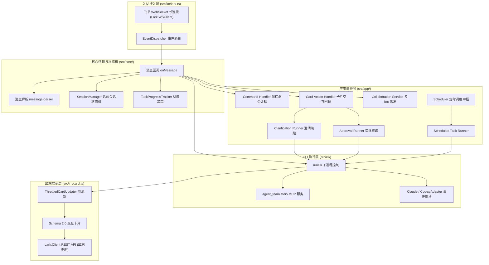
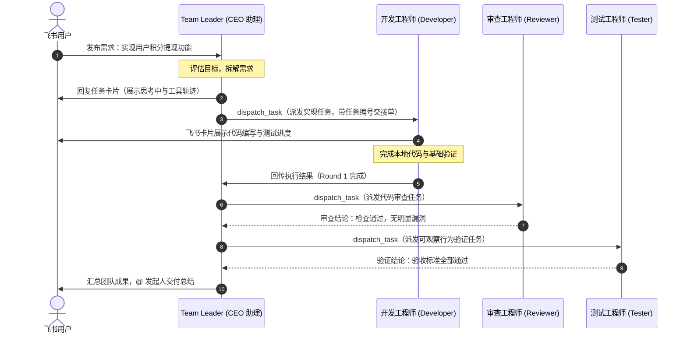

# 🤖 Agent Team — 你的个人生产系统

> 把**飞书**变成 AI 编程 CLI（Claude Code / Codex）的多 Agent 协作指挥台。  
> 一个话题 = 一个任务；Bot 之间可互相 @ 协作；卡片实时可视化进度；人类在环审批与需求澄清；定时巡检全自动化。

---

[](https://nodejs.org/)
[](https://www.typescriptlang.org/)
[](https://open.feishu.cn/)
[](https://modelcontextprotocol.io/)
[](https://pnpm.io/)
[](LICENSE)

---

## 💡 为什么需要 Agent Team？

像 **Claude Code** 与 **OpenAI Codex** 这样的终端 AI 编程工具拥有强大的项目级编码与工具执行能力，但在日常工作中往往面临几个痛点：

1. **终端受限，无法移动协作**：只能守在电脑终端前，离开电脑就无法下发任务或查看进度。
2. **单兵作战，缺乏分工**：复杂的研发流程包含「需求澄清 ➔ 方案拆解 ➔ 编码实现 ➔ 代码审查 ➔ 功能验证」，单个 CLI 容易因上下文过载或职责混乱而产生幻觉。
3. **黑盒执行与失控风险**：长时间运行的代码重构黑盒不可见；缺乏高危操作拦截，可能误执行删库、删文件或生产重启。
4. **模糊需求直接盲目开工**：一句话需求往往隐藏大量歧义，CLI 盲目推测实现导致大量无效返工。

**Agent Team** 深度结合飞书生态与终端 AI 编程工具的能力：

- 以**飞书话题（Thread）**作为任务的上下文单元，随时随地在手机或 PC 飞书下发任务；
- 在一个群中注册多个具备专精角色的 Bot（CEO助理、产品经理、研发工程师、审查工程师、测试工程师），通过 **stdio MCP** 工具自动分工交接；
- 实时推送工具级进度卡片、支持发起人一键停止；
- 遇到歧义主动发起交互式澄清问答，遇到高危操作主动暂停并请求人类审批！

---

## ✨ 核心特性

### 1. 🧵 话题即任务（Thread as Task）

- **上下文天然隔离**：在飞书群或私聊中，每个 Thread 自动映射为一个独立的 CLI 会话。
- **状态流转与持久化**：会话状态机（`creating` ➔ `active` ➔ `idle` ➔ `closed`）自动落盘保存，服务重启后无缝恢复，支持随时追问或恢复历史话题。
- **多端可视**：无论是在工位 PC 还是通勤时的手机飞书，随时跟进编码任务。

### 2. 👥 多 Bot 团队协作编排（Multi-Bot Orchestration）

- **角色专精团队**：可在 `config/bots.json` 注册多个 Bot（如 Team Leader、产品经理、开发工程师、审查工程师、测试工程师）。
- **`dispatch_task` 工具与交接单**：通过交接单模型（`taskId` / `dispatchId` / `round`），Team Leader 可将任务确定性派发给团队成员，成员完成并验证后交回结论，形成「需求 ➔ 拆解 ➔ 研发 ➔ 审查 ➔ 验收」的完整自动化闭环。
- **收件箱防重与幂等**：进程内 `CollaborationInbox` 取件码机制结合飞书重推去重，确保交接可靠不漏跑、不重跑。
- **分组容灾与限额自动接力（Group Failover & Limit Continuation）**：支持同组配置（`"group": "developer"`）。当主力 Bot（如官方 Claude 架构的 `developer`）因触发 5 小时用量或 Token 达到上限被挂起拦截（`hit session limit`）时，系统自动识别并安全将控制权归还 CEO 助理；CEO 助理自动重定向唤醒同组备份成员（如接入智谱/DeepSeek 备用模型的 `developer2`），以全新的独立 Session 继承当前工作区代码产物继续执行，无需人工介入重跑，既规避上下文污染又节约 Token 开销。

### 3. 📊 飞书 2.0 交互卡片与工具级实时进度

- **实时执行轨迹**：实时呈现当前执行步骤、工具名称（带中文动作标签与图标）、耗时、Token 累计、上下文窗口占用比例。
- **节流刷新机制**：内置 `ThrottledCardUpdater`（1 秒时间窗口合并 + 串行链），杜绝卡片闪烁与飞书 API 限流。
- **前台测试同步执行保障**：冒烟验证与验收测试全链路强制要求前台同步阻塞执行，严格禁止派发静默后台进程。确保 CLI 工具输出、退出码与卡片步骤实时对应，杜绝后台静默执行导致的任务提前误判完成或漏报测试失败。
- **一键中止**：执行中卡片自带红色「停止任务」按钮，仅允许任务发起人快速阻断。
- **超长回答优雅呈现**：900 字符内直接展示，超长自动收起并附带「查看完整回答」折叠面板；超出飞书限制时自动分条续发。

### 4. ❓ 交互式需求澄清（Grill-me & Clarification）

- **告别盲目开发**：配置了 `grill-me` 技能的 Bot 在发现需求歧义时，调用应用层工具 `request_clarification` 提交结构化问题清单。
- **飞书卡片逐题问答**：飞书话题中弹出专属交互卡片，支持「单选按钮」、「自定义答案输入」或「交给 Agent 决定（按推荐方案）」。
- **自动带答案续跑**：答案收齐后自动将结构化问答拼入 Prompt，在同一会话中续跑整理结论。若用户在话题中直接发新文本，旧卡片自动作废并作为补充说明合入。

### 5. 📄 产品方案交付闭环与云文档评论区修订

- **双模方案交付**：产品 Bot 通过 `request_spec_approval` 提交权威产物：
  - **`local` 模式**：生成工作区本地规范文件与切片 Tickets。`specPath` 是 Spec 文件相对路径；`ticketsPath` 是包含独立 `.md` ticket 的目录相对路径，不能填写单个文件。路径必须位于工作区内（拒绝绝对路径、盘符、UNC 与 `..`）。MCP 工具会检查产物并把失败原因返回给 CLI；应用层缺少提交、提交被拒或产物校验失败时，会带着具体原因在原会话重试一次，且重试不得改变交付方式；重试仍失败则不会展示确认卡，并报告真实的失败原因。
  - **`lark-doc` 模式**：直接调用飞书云文档 API 生成 Docx 方案，并在飞书弹出方案确认卡。
- **云文档划词评论修订**：支持订阅飞书云文档评论事件（`drive.notice.comment_add_v1`）。在待确认的方案文档中划词评论并 `@Bot`，Bot 自动排队读取评论并在原文档上完成修订与回复！

### 6. 🛡️ 高危操作人类审批（Human-in-the-Loop Approval）

- **安全停止机制（`stopToolNames`）**：当开发类 Bot 准备执行可能影响系统稳定性的敏感操作（重启服务、删除文件、修改生产配置、执行数据库写操作）时，调用 `request_approval` 工具。
- **毫秒级断停子进程**：Runner 捕获到工具调用即刻终止 CLI 子进程，绝不抢跑。
- **审批卡放行**：在飞书话题中发送审批卡（展示操作名、详情、影响范围与回滚方案），群内成员点击「通过」或「拒绝」（或 5 分钟超时兜底），系统携带审批决策续跑原会话。

### 7. ⏰ 定时巡检与计划任务（Cron / Scheduled Tasks）

- **三类调度规则**：支持一次性（`once`）、固定间隔（`interval`）与 `cron` 表达式（基于 `croner` 自动计算下次触发点）。
- **全渠道管理**：
  - 飞书斜杠命令：`/schedule <自然语言需求>`、`/schedules` 列出全部计划。
  - 应用层 MCP 工具：`schedule_manage`（支持增删改查、暂停、恢复、即刻执行与查看运行日志）。
  - 本地 HTTP RESTful API（默认端口 `3101`，支持可选 Token 鉴权）。
  - 本地文件热更新对账：直接修改 `data/schedules.json`，调度器轮询秒级对账生效。
- **防重叠与中断自愈**：同一时刻只执行一次，前一轮未跑完自动跳过防并发打架，服务重启自动补账修复中断记录。

### 8. ⚡ 双 CLI 引擎、飞书动态模型配置与端点隔离

- **无缝支持主流 CLI**：统一抽象 `CliAdapter` 事件协议，完整适配 Claude Code（`--output-format stream-json`）与 OpenAI Codex（`exec --json`）。
- **飞书卡片动态配置角色模型（热更新免重启）**：
  - 管理员发送 `/model`（或 `/config`）或点击 `/team` 卡片中的「⚙️ 角色模型与端点配置」，即可弹出可视化配置卡片，支持直接修改每个角色的 `Base URL`、`API Key` 与 `Model`。
  - **Claude 与 Codex 端点配置严格隔离**：卡片内置 CLI 切换 Tab，同一角色的 Claude（Anthropic 兼容协议与密钥）与 Codex（OpenAI 协议与密钥）按 `(botId, cliId)` 独立持久化，互不污染。切换引擎时精准读取各自端点，彻底避免 Anthropic 端点错传给 Codex 的协议异常。
  - **严格权限与零重启热重载**：基于 `OWNER_OPEN_ID` 严格鉴权，非管理员禁止修改；修改保存后立即落盘并刷新内存缓存，下一轮任务即刻生效，无需重启服务进程。
- **双模式飞书接入**：
  - **极简模式（单应用全员共享）**：仅需配置一组全局 `FEISHU_APP_ID` 与 `FEISHU_APP_SECRET`，所有团队成员无缝共用。系统基于消息内 `dispatchId` 精准唤醒目标角色 Bot，无需在飞书开放平台繁琐创建多个应用。
  - **多应用独立模式**：亦可为各成员单独配置专属自建应用凭证，实现独立机器人名字与专属头像；两种模式完全兼容、支持平滑混用与自动兜底。

---

## 🏛️ 系统架构

### 分层架构概览



### 多 Bot 协作时序图



---

## 🚀 快速开始

### 1. 前置环境要求

- **Node.js**: >= 22.0.0
- **包管理器**: `pnpm`（建议 ^12.3.4）
- **AI 编程工具**: 确保本机已安装并登录以下至少一个 CLI：
  - [Claude Code](https://docs.anthropic.com/en/docs/agents-and-tools/claude-code/overview) (`claude --version`)
  - [OpenAI Codex](https://github.com/openai/codex) (`codex --version`)
- **PM2**（生产常驻可选）: `npm install -g pm2`
- **agent-browser**（浏览器端到端验收可选）: 如需启用 UI 真实页面交互验收，需安装 `npm install -g agent-browser && agent-browser install`（受限网络可配置 `AGENT_BROWSER_EXECUTABLE_PATH` 指向本机 Chrome）

### 2. 获取代码与依赖安装

```bash
git clone https://github.com/CerrorJ/Agent-Team.git
cd Agent-Team

# 安装项目依赖
pnpm install
```

### 3. 配置环境变量与团队成员

#### ① 复制并配置 `.env`

```bash
cp .env.example .env
```

根据实际情况编辑 `.env`：

- **飞书凭证配置（支持两种模式）**：
  - **极简模式（推荐，单套凭证跑全员）**：直接配置全局 `FEISHU_APP_ID` 与 `FEISHU_APP_SECRET`，所有团队成员无缝共用一套凭证，事件分发通过 `dispatchId` 自动精准路由给目标 Bot，无需在飞书开放平台建多个应用。
  - **多应用独立模式**：若需要各 Bot 拥有独立头像与名称，可在 `.env` 中为每个 Bot 配置专属环境变量（如 `FEISHU_CEO_ASSISTANT_APP_ID` / `FEISHU_DEVELOPER_APP_ID` 等）。两种模式完全兼容并支持混用（未配置独立凭证的 Bot 自动回退至全局凭证）。
- `BOTS_CONFIG`: Bot 配置文件路径，默认 `config/bots.json`
- `OWNER_OPEN_ID`: 你的飞书 `open_id`（可通过启动后发送消息从终端日志 `sender=` 处获取）
- `CLI_WORKDIR`: 默认代码执行目录（留空则默认为当前项目根目录）
- `SCHEDULE_API_PORT`: 定时任务本地管理接口端口（默认 `3101`）

#### ② 复制并配置 `config/bots.json`

```bash
cp config/bots.example.json config/bots.json
```

在 `config/bots.json` 中定义你的团队成员配置，例如：

```json
{
  "teamLeader": "ceo-assistant",
  "defaultProductDeliveryMode": "lark-doc",
  "bots": [
    {
      "id": "ceo-assistant",
      "appIdEnv": "FEISHU_CEO_ASSISTANT_APP_ID",
      "appSecretEnv": "FEISHU_CEO_ASSISTANT_APP_SECRET",
      "defaultCli": "claude",
      "workspace": "../my-project",
      "role": "CEO 助理，负责理解目标、组织成员并汇总团队结论",
      "systemPrompt": "先明确目标和分工，再把任务交给合适的团队成员。"
    },
    {
      "id": "product",
      "appIdEnv": "FEISHU_PRODUCT_APP_ID",
      "appSecretEnv": "FEISHU_PRODUCT_APP_SECRET",
      "defaultCli": "claude",
      "workspace": "../my-project",
      "role": "产品经理，负责澄清需求并形成可验收的产品说明",
      "skills": ["grill-me", "to-spec", "to-tickets", "lark-doc", "lark-drive"]
    },
    {
      "id": "developer",
      "group": "developer",
      "appIdEnv": "FEISHU_DEVELOPER_APP_ID",
      "appSecretEnv": "FEISHU_DEVELOPER_APP_SECRET",
      "defaultCli": "claude",
      "workspace": "../my-project",
      "role": "开发工程师，负责根据需求完成实现和基础验证",
      "collaborationMaxRounds": 16,
      "systemPrompt": "保持实现直接、清楚，并在交付前运行与改动相关的验证。"
    },
    {
      "id": "developer2",
      "group": "developer",
      "appIdEnv": "FEISHU_DEVELOPER2_APP_ID",
      "appSecretEnv": "FEISHU_DEVELOPER2_APP_SECRET",
      "defaultCli": "claude",
      "workspace": "../my-project",
      "role": "开发工程师（备用），负责在同组开发限流时代班完成实现和基础验证",
      "collaborationMaxRounds": 16,
      "systemPrompt": "保持实现直接、清楚，并在交付前运行与改动相关的验证。"
    }
  ]
}
```

#### ③ 安装与准备工作流 Skills（含来源地址与安装命令）

在 `config/bots.json` 中，各 Bot 绑定了专门的工作流技能（如产品经理的 `grill-me`、`to-spec`、`lark-doc`，审查员的 `code-review-expert`，测试员的 `verify` 等）。

启动时，系统会按以下优先级检索 Skill 对应的 `SKILL.md`（若全部缺失会在终端输出 `[Skill]` 告警）：

1. `<工作区>/.agents/skills/<skill>/SKILL.md`（最高优先，项目独享）
2. `<工作区>/.claude/skills/<skill>/SKILL.md`
3. `~/.agents/skills/<skill>/SKILL.md`（**系统级 / 全局推荐**，所有项目与 Bot 共享）
4. `~/.claude/skills/<skill>/SKILL.md`
5. `~/.codex/skills/<skill>/SKILL.md`

##### 📦 依赖技能与官方仓库地址对照表

| 技能类别             | 技能名称（`skills`）                                        | 来源仓库 / 官方地址                                                                  | 推荐一键安装命令                                                        | 作用与前置依赖                                                                                                                                        |
| -------------------- | ----------------------------------------------------------- | ------------------------------------------------------------------------------------ | ----------------------------------------------------------------------- | ----------------------------------------------------------------------------------------------------------------------------------------------------- |
| **飞书云端生态**     | `lark-doc`<br>`lark-drive`<br>`lark-*`                      | [github.com/larksuite/cli](https://github.com/larksuite/cli#agent-skills)            | `npx skills add larksuite/cli -g -y`<br>`npm install -g @larksuite/cli` | 驱动飞书云文档（Docx）生成与划词评论修订。<br>⚠️ 需安装 `lark-cli` 并执行 `lark-cli login` 授权                                                       |
| **研发工作流**       | `to-spec`<br>`to-tickets`<br>`implement-ticket`<br>`verify` | [github.com/mattpocock/skills](https://github.com/mattpocock/skills)                 | `npx skills add mattpocock/skills -g -y`                                | 负责 PRD 规约提炼、功能切片 Tickets 拆解与验收验证。<br>💡 _本项目 `workspace-template/` 亦已内置优化版_                                              |
| **交互式需求澄清**   | `grill-me`                                                  | 本项目深度定制版                                                                     | 复制本项目模板至全局（见下文）                                          | 专为飞书交互卡片（`request_clarification` 工具闭环）定制的高质量批量澄清技能                                                                          |
| **代码审查专家**     | `code-review-expert`                                        | 社区审查规范 / [mattpocock/skills](https://github.com/mattpocock/skills)             | `npx skills add mattpocock/skills -g -y`                                | 供 Reviewer 机器人针对 git diff 与验收标准进行独立代码审查与风险识别                                                                                  |
| **端到端浏览器验收** | `verify`（结合 `agent-browser`）                            | [github.com/vercel-labs/agent-browser](https://github.com/vercel-labs/agent-browser) | `npm install -g agent-browser`<br>`agent-browser install`               | 供页面验收工程师使用真实浏览器操作 UI、表单交互与截图留证。<br>⚠️ 如受限网络无法下载 Chromium，可配置 `AGENT_BROWSER_EXECUTABLE_PATH` 指向本机 Chrome |

##### 🛠️ 快速安装方式

- **方案 A：使用 Skills CLI 一键安装到全局（推荐）**

  ```bash
  # 1. 安装飞书官方套件技能及底层 CLI 工具
  npm install -g @larksuite/cli
  lark-cli login
  npx skills add larksuite/cli -g -y

  # 2. 安装研发流程与代码审查技能
  npx skills add mattpocock/skills -g -y

  # 3. （可选）安装页面端到端浏览器验收工具
  npm install -g agent-browser && agent-browser install

  # 4. 将本项目定制的飞书卡片澄清技能（grill-me 等）同步到系统级目录
  # Windows (PowerShell):
  Copy-Item -Recurse -Force "workspace-template\.agents\skills\*" "$HOME\.agents\skills\"
  # Linux / macOS:
  mkdir -p ~/.agents/skills && cp -r workspace-template/.agents/skills/* ~/.agents/skills/
  ```

- **方案 B：单项目工作区内安装**
  如果你只想在特定项目中使用，可直接将本项目自带的 [workspace-template](file:///d:/Chi/CCCC/Agent-Team/workspace-template) 中的 `.agents/` 与 `.claude/` 目录复制到你要开发的代码仓库根目录。

### 4. 飞书开放平台配置指引

根据所选凭证模式创建飞书自建应用（极简模式只需创建 1 个共用应用；独立模式为每个 Bot 创建独立应用）：

1. 前往 [飞书开放平台](https://open.feishu.cn/)，创建自建应用并开启「机器人」能力。
2. **连接模式**：选择 **WebSocket 长连接模式**（无需配置公网回调地址或公网 IP，本地即可运行！）。
3. **权限配置**（开通并在版本中发布生效）：
   - 消息与群组：`im:message`（读取消息）、`im:message:send_as_bot`（以应用身份发消息）、`im:resource`（获取消息中的资源文件）。
   - 云文档与评论（如配置了产品经理的 `lark-drive`）：开通云文档只读/读写及评论订阅权限。
4. **事件订阅**：
   - 订阅事件：`im.message.receive_v1`（接收消息v1.0）。
   - 订阅卡片回调：`card.action.trigger`（卡片行为触发）。
   - （可选）订阅评论事件：`drive.notice.comment_add_v1`。

### 5. 运行与验证

```bash
# 开发模式（监听源码、.env、config/bots.json 热重载）
pnpm dev

# 单次运行
pnpm start:once

# 类型检查与编译构建
pnpm build
```

控制台输出以下日志即表示成功运行：

```text
Agent Team 启动，正在建立飞书长连接…
[配置] 已注册 3 个 bot，Team Leader=ceo-assistant，已恢复 0 个会话
[CLI] id=claude command=claude
[CLI] id=codex command=codex
[Bot CEO-ASSISTANT] default_cli=claude workspace=/path/to/workdir
[Bot CEO-ASSISTANT] 已连接
```

此时打开飞书，将机器人拉入测试群或发起私聊，发送 `@机器人 帮我写一个快速排序算法` 即可体验！

---

## 🎮 常用斜杠命令

在飞书话题中向 Bot 发送消息时，可搭配丰富的斜杠指令：

| 命令               | 说明                                                                     | 示例                                           |
| ------------------ | ------------------------------------------------------------------------ | ---------------------------------------------- |
| `/<prompt>`        | 普通任务，使用当前 Bot 的默认引擎执行                                    | `@Bot 实现用户注册接口`                        |
| `/claude <任务>`   | 显式指定使用 **Claude Code** 引擎执行                                    | `@Bot /claude 重构数据库连接池`                |
| `/codex <任务>`    | 显式指定使用 **Codex** 引擎执行                                          | `@Bot /codex 检查内存泄漏`                     |
| `/team`            | 查看当前团队成员名单、职责与绑定技能，附带模型配置入口                   | `@Bot /team`                                   |
| `/model [角色ID]`  | 飞书卡片动态配置角色模型与端点（支持 `/config`，管理员专属，免重启生效） | `@Bot /model` 或 `@Bot /model developer`       |
| `/status`          | 查看当前话题会话状态、绑定工作目录与会话 ID                              | `@Bot /status`                                 |
| `/close`           | 强制关闭当前话题会话（终止运行中的任务并标记为 closed）                  | `@Bot /close`                                  |
| `/new`             | 在当前话题下关闭旧会话并重开全新会话上下文                               | `@Bot /new`                                    |
| `/newall`          | 重置当前话题下所有空闲成员的 CLI 会话（下次交互均开启全新 CLI 会话）     | `@Bot /newall`                                 |
| `/resume`          | 交互式查看并恢复本地已有历史 CLI 会话                                    | `@Bot /resume`                                 |
| `/compact [要求]`  | 原生压缩当前 CLI 会话的历史上下文，释放 Token 空间                       | `@Bot /compact 聚焦在认证模块`                 |
| `/cd [路径]`       | 动态查看或切换当前话题绑定的工作区目录                                   | `@Bot /cd ./services/order`                    |
| `/schedule <需求>` | 用自然语言创建定时计划任务                                               | `@Bot /schedule 每天早上9点巡检服务器错误日志` |
| `/schedules`       | 查看当前已注册的全部定时任务与状态卡片                                   | `@Bot /schedules`                              |
| `/help`            | 查看帮助说明                                                             | `@Bot /help`                                   |

#### 🎯 角色模型与思考等级配置机制 (`/model`)

团队支持为每个 Bot 成员针对 **Claude Code** 与 **OpenAI Codex** 两套引擎独立配置端点、密钥、模型与思考/推理等级：

1. **三级继承与优先级**：
   - **最高优先级**：飞书卡片角色独立覆盖配置（持久化于 `data/bot-model-overrides.json`，免重启热生效）；
   - **次优先级**：宿主系统环境变量（`.env` 中的 `ANTHROPIC_*`、`OPENAI_*`、`MAX_THINKING_TOKENS` 等）；
   - **默认回退**：各 CLI 本地用户级配置（或 CC Switch 切换的服务/官方端点）。
2. **思考 / 推理等级白名单校验**：
   - **Codex**：严格限制为 `low`、`medium`、`high`，对应启动参数 `-c model_reasoning_effort="..."`；
   - **Claude**：严格限制为 `low`、`medium`、`high`、`max` 或正整数 Token 预算，映射至 `MAX_THINKING_TOKENS`；
   - **稳态保护**：热重载在遭遇损坏或非法 JSON 时自动保留最后一次有效内存配置，彻底防止意外回退。
3. **端点检测与可用模型探测**：
   - 配置卡片支持一键探测自定义端点可用模型，并动态渲染下拉列表以供快速选择；
   - 探测过程完整保留 Base URL 草稿；因安全规范未保存密钥不予回显，探测后（无论成功或失败）均明确引导重新输入密钥，确保模型与端点上下文一致落盘。

---

## 🔌 内置 MCP 应用层工具

Agent Team 通过 stdio MCP 协议向 Claude Code 和 Codex 原生注册了一套应用层工具（`agent_team`）：

| 工具名称                | 核心作用               | 触发机制与效果                                                                  |
| ----------------------- | ---------------------- | ------------------------------------------------------------------------------- |
| `request_clarification` | 提交需求澄清问题       | 截获后渲染逐题交互卡片，答案收集完毕后自动拼进 prompt 续跑。                    |
| `request_spec_approval` | 提交唯一产品方案       | 支持 `local` 规范文件检查或 `lark-doc` 飞书云文档确认卡，确认后可触发团队交接。 |
| `dispatch_task`         | 派发任务给团队成员     | 仅限 Team Leader 调用。在飞书推送交接卡片并自动 @ 目标 Bot 执行。               |
| `request_approval`      | 高危操作审批拦截       | **停止型工具**。直接暂停 CLI 子进程，在飞书弹审批卡等待人类点击放行或拒绝。     |
| `schedule_manage`       | 定时任务全生命周期管理 | 支持列表查询、添加、批量增删、编辑、启停、立即执行与日志审计。                  |

---

## 🚢 生产部署

项目内置了针对生产环境的部署 CLI，基于 PM2 实现持久常驻守护：

```bash
# 1. 环境自检（检查 node/pnpm/pm2/claude/codex 及配置文件）
pnpm agent-team doctor

# 2. 启动生产守护进程（自动触发 build 并清理脏环境变量）
pnpm agent-team start

# 3. 查看进程运行状态与实时日志
pnpm agent-team status
pnpm agent-team logs

# 4. 重启 / 停止
pnpm agent-team restart
pnpm agent-team stop

# 5. 配置操作系统开机自启
pm2 startup
pm2 save
```

> **国内 ECS 部署建议**：可使用 Linux VPS（Ubuntu/Debian），通过 `nvm` 安装 Node.js 22+、使用 npmmirror 镜像源加速。具体详细步骤参见 [SETUP.md](file:///d:/Chi/CCCC/Agent-Team/SETUP.md)。

---

## 📁 目录结构

```text
Agent-Team/
├── config/                  # 团队 Bot 配置文件 (bots.json)
├── data/                    # 本地数据持久化目录 (.gitignore 忽略)
│   ├── bot-model-overrides.json # 角色模型与端点动态覆盖持久化 (按 botId + cliId 隔离)
│   ├── sessions.json        # 话题会话状态机持久化
│   ├── schedules.json       # 定时任务配置与热更新对账
│   ├── schedule-runs.json   # 定时任务执行记录 (最近100条/任务)
│   ├── approval-flows.json  # 高危操作审批流持久化
│   └── product-spec-flows.json # 产品方案确认流持久化
├── demo-server/             # 故障注入与巡检演示示例服务
├── docs/                    # 架构与交接单设计详述
├── openwiki/                # OpenWiki 自动维护的完整项目知识库
├── src/
│   ├── app/                 # 应用编排层 (命令处理、卡片动作、调度中枢、协作派发)
│   ├── cli/                 # CLI 执行层 (Claude/Codex 适配器、进程管理、统一事件)
│   ├── core/                # 核心领域模型 (会话状态机、交接单、审批、定时规则、模型动态配置)
│   ├── im/                  # 飞书接入层 (WebSocket 长连接、消息解析、Schema 2.0 卡片构建)
│   ├── mcp/                 # stdio MCP 服务实现 (五个 agent_team 工具注册)
│   ├── deploy-cli.ts        # pm2 生产部署封装 CLI
│   ├── probe-app-tool.ts    # MCP 应用层工具验证探针
│   ├── probe-cli.ts         # CLI 原始输出解析探针
│   └── index.ts             # 系统核心启动入口
├── workspace-template/      # 推荐的工作区模板（含 grill-me, to-spec 等 Skills）
├── CLAUDE.md                # 规范约定与排坑错题本
├── SETUP.md                 # 本地及 ECS 服务器部署手册
├── package.json             # 依赖与脚本配置
└── tsconfig.json            # TypeScript 编译配置
```

---

## 📚 详细文档导航 (OpenWiki)

本项目配置了基于 OpenWiki 的自动化文档体系，详细设计与运维指南请参阅：

- [🚀 快速开始与导航](file:///d:/Chi/CCCC/Agent-Team/openwiki/quickstart.md)
- [🏛️ 架构总览](file:///d:/Chi/CCCC/Agent-Team/openwiki/architecture/overview.md)
- [🔄 消息处理完整流程](file:///d:/Chi/CCCC/Agent-Team/openwiki/workflows/message-flow.md)
- [👥 多 Bot 注册与配置](file:///d:/Chi/CCCC/Agent-Team/openwiki/domain/bot-registry.md)
- [🤝 多 Bot 协作机制与交接单](file:///d:/Chi/CCCC/Agent-Team/openwiki/domain/collaboration.md)
- [❓ 需求澄清流程与交互卡片](file:///d:/Chi/CCCC/Agent-Team/openwiki/domain/clarification.md)
- [📄 产品方案交付与云文档协同](file:///d:/Chi/CCCC/Agent-Team/openwiki/domain/product-spec.md)
- [🛡️ 高危操作审批机制](file:///d:/Chi/CCCC/Agent-Team/openwiki/domain/approval.md)
- [⏰ 定时任务调度机制](file:///d:/Chi/CCCC/Agent-Team/openwiki/domain/scheduling.md)
- [🎨 任务卡片系统与节流机制](file:///d:/Chi/CCCC/Agent-Team/openwiki/domain/task-card.md)
- [🛠️ 运维与排错手册](file:///d:/Chi/CCCC/Agent-Team/openwiki/operations/runbook.md)

---

## 🤝 贡献与代码规范

- **运行时规范**：Strict TypeScript，ESM only（导入显式带 `.js` 后缀），Node >= 22。
- **凭证安全**：密钥与敏感 Token 绝不硬编码，只在 `.env` 中维护。
- **前台测试执行保障**：冒烟验证与端到端测试必须前台同步阻塞执行并等待退出码，严禁派发静默后台进程，确保卡片实时流转透明。
- **代码风格**：使用 ESLint + Prettier，强制使用箭头函数与声明空行。
  ```bash
  pnpm lint:fix
  pnpm format
  ```
- **错题本文化**：开发与踩坑后，请在 [CLAUDE.md](file:///d:/Chi/CCCC/Agent-Team/CLAUDE.md) 追加一条「现象 ➔ 原因 ➔ 正确做法」。

---

## 📄 开源许可证

本项目采用 [ISC License](LICENSE) 授权。
