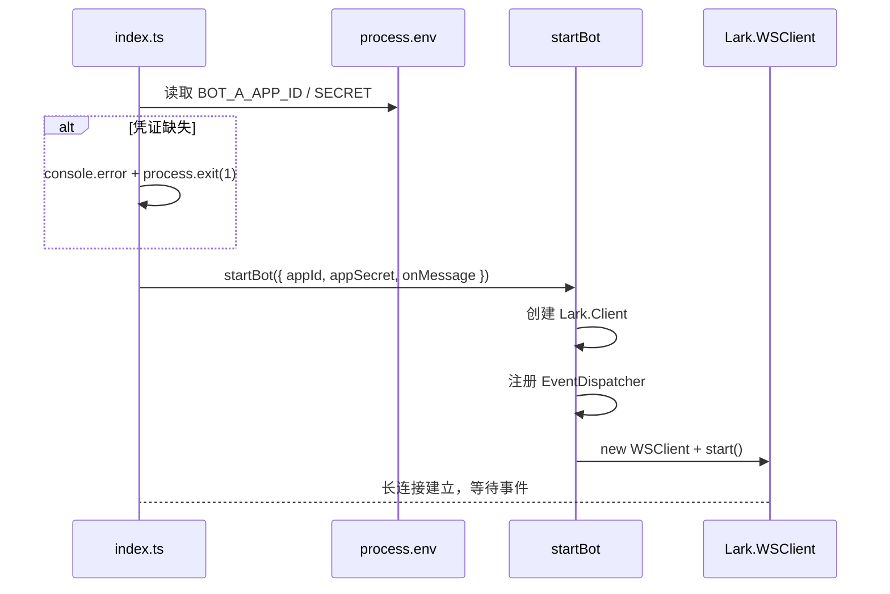

# 架构总览

## 三层架构

Agent-Team 采用经典的入站 / 分发 / 出站三层结构，全部基于飞书 OpenAPI SDK（`@larksuiteoapi/node-sdk`）。

<!-- openwiki: mermaid parse failed and this diagram was converted to a text fence so it does not break rendering. Fix the diagram source and restore the mermaid fence. Parser error: Heuristic: an unescaped angle bracket inside a label breaks rendering; rephrase the label. -->
```text
flowchart TD
    subgraph IN["入站层"]
        WS["Lark.WSClient<br/>WebSocket 长连接"] --> DISP["Lark.EventDispatcher<br/>事件路由"]
    end
    subgraph CORE["核心逻辑层"]
        DISP --> CB["onMessage 回调<br/>src/index.ts"]
        CB --> MP["消息解析<br/>src/im/message-parser.ts"]
    end
    subgraph OUT["出站层"]
        CB --> CARD["卡片构建<br/>src/im/card.ts"]
        CARD --> BOT["Bot 接口<br/>src/im/lark.ts"]
        BOT --> CLIENT["Lark.Client<br/>REST API"]
    end
```

从 WebSocket 入站到 REST API 出站的核心组件流转。

## 组件职责

### Lark.WSClient（入站）

负责建立并维持与飞书的 WebSocket 长连接，断线自动重连。所有飞书事件通过这条连接推送下来。

- 源文件：`src/im/lark.ts`，`startBot()` 内部创建
- 初始化：`new Lark.WSClient({ appId, appSecret })`
- 启动：`wsClient.start({ eventDispatcher: dispatcher })`

### Lark.EventDispatcher（分发）

将 WS 连接上收到的原始事件按事件名路由到处理函数。当前只注册了一个事件处理器：

| 事件 | 处理逻辑 |
|------|----------|
| `im.message.receive_v1` | 解析消息内容，组装为 `IncomingMessage`，回调 `onMessage` |

### onMessage 回调（核心逻辑）

入口文件 `src/index.ts` 中的业务逻辑。当前实现：

1. 调用 [消息解析](../workflows/message-flow.md) 还原 @ 提及
2. 提取并下载图片/文件附件
3. 回复一张初始任务卡片，获取 `message_id`
4. 后台异步执行 `runCardDemo`，模拟 8 步进度更新

### Bot 接口（出站）

`Bot` 接口封装了所有主动调飞书 API 的能力：

| 方法 | 飞书 API | 用途 |
|------|----------|------|
| `reply()` | `im.v1.message.reply` | 回复纯文本消息 |
| `replyCard()` | `im.v1.message.reply`（`msg_type: interactive`） | 回复交互卡片 |
| `updateCard()` | `im.v1.message.patch` | 更新已有卡片内容 |
| `downloadResource()` | `im.v1.messageResource.get` | 下载消息中的图片/文件 |

### 消息解析层（src/im/message-parser.ts）

提供三个纯函数：

- `parseMentions()` — 从飞书事件中提取结构化提及信息
- `resolveMentions()` — 把 `@_user_N` 占位符还原为 `@显示名`
- `extractResourceKeys()` — 从消息内容中提取图片/文件 key

详见 [消息处理流程](../workflows/message-flow.md)。

### 卡片系统（src/im/card.ts）

负责构建飞书 2.0 Schema 交互卡片，以及节流更新机制。详见 [任务卡片系统](../domain/task-card.md)。

## 入口与启动流程

入口文件 `src/index.ts` 的启动序列：



应用启动时的初始化序列。

## 关键设计决策

- **事件回调尽快返回**：`onMessage` 回调中先回复初始卡片，后续模拟更新通过 `void runCardDemo(...)` 在后台异步执行，不阻塞飞书事件确认
- **卡片更新复用 message_id**：先 `replyCard` 拿到 `message_id`，后续用 `updateCard` 同卡刷新
- **ESM only**：所有导入使用 `.js` 后缀（TypeScript 的 ESM 约定）
- **凭证安全**：飞书凭证只从 `process.env` 读取，不硬编码，详见 [运维手册](../operations/runbook.md)
