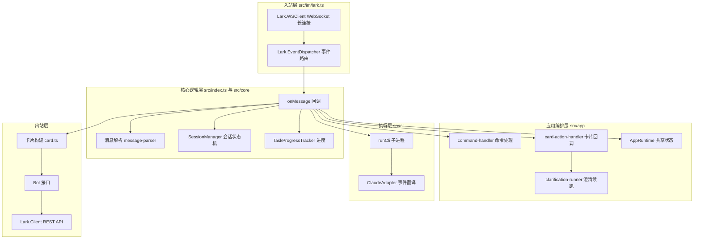
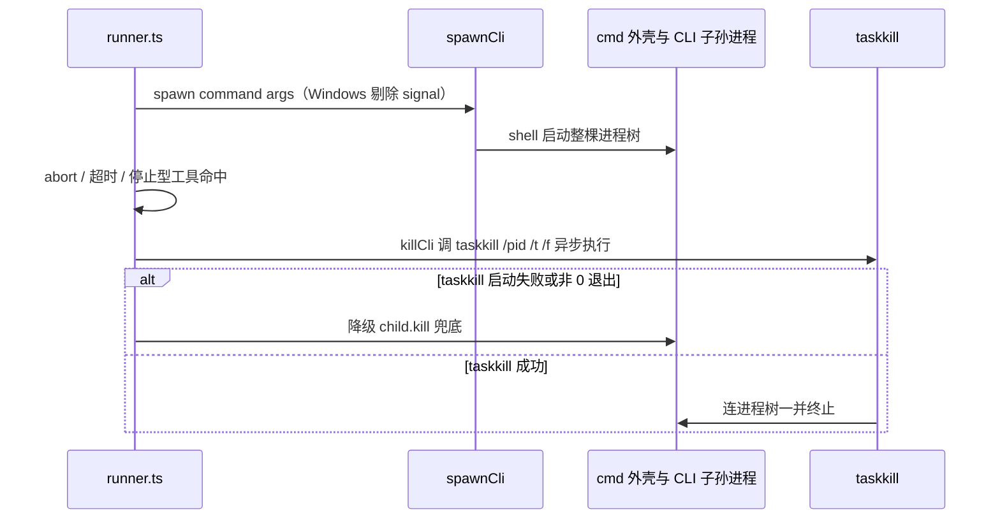
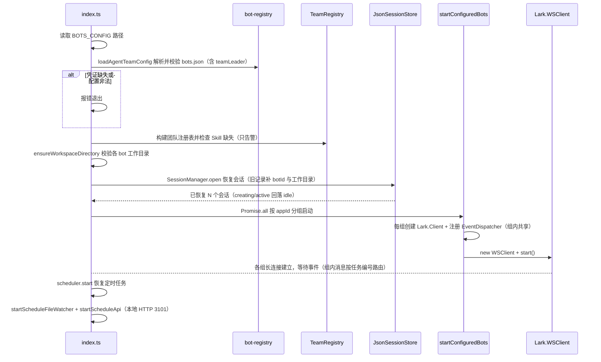

# 架构总览

## 分层架构

Agent-Team 由飞书接入层（入站/出站）、核心逻辑层和 CLI 执行层组成，飞书侧全部基于 OpenAPI SDK（`@larksuiteoapi/node-sdk`）。

从 WebSocket 入站、会话/进度核心处理、CLI 子进程执行到 REST API 出站的核心组件流转。

## 组件职责

### Lark.WSClient（入站）

负责建立并维持与飞书的 WebSocket 长连接，断线自动重连。所有飞书事件通过这条连接推送下来。

- 源文件：`src/im/lark.ts`，`startBot()` 内部创建
- 初始化：`new Lark.WSClient({ appId, appSecret })`
- 启动：`wsClient.start({ eventDispatcher: dispatcher })`

### Lark.EventDispatcher（分发）

将 WS 连接上收到的原始事件按事件名路由到处理函数。当前注册了三个事件处理器：

| 事件 | 处理逻辑 |
|------|----------|
| `im.message.receive_v1` | 解析消息内容，组装为 `IncomingMessage`，回调 `onMessage` |
| `card.action.trigger` | 卡片按钮回调（「停止任务」「恢复会话」「澄清作答」「方案确认」「审批决定」），解析操作者、表单值与 value 后回调 `onCardAction` |
| `drive.notice.comment_add_v1` | 飞书文档评论事件（需 bot 配 `lark-drive` skill 并在连接后订阅）：组装 `IncomingDocumentComment` 回调 `onDocumentComment`，驱动待确认方案的评论区修改 |

### onMessage 回调（核心逻辑）

入口文件 `src/index.ts` 中、每个 bot 各自注册的业务逻辑。当前实现：

1. 机器消息（`senderType` 为 `app`/`bot`）先走 [多 bot 协作](../domain/collaboration.md) 的取件逻辑：确认 @ 了当前 bot、提取任务编号、领取交接单，领取不到即忽略
2. 调用 [消息解析](../workflows/message-flow.md) 还原 @ 提及，识别 `/help`、`/status`、`/team`、`/close`、`/new`、`/newall`、`/resume`、`/compact`、`/cd` 斜杠命令与 `/claude` `/codex` 引擎选择；话题里存在未完成的 [需求澄清](../domain/clarification.md) 流程时，人类消息按补充说明并入而非新任务
3. 通过 [会话管理](../domain/session.md) 按话题解析或创建会话（会话键含 `botId`），并按会话状态守卫（closed/creating/active 拒绝追问）
4. 提取并下载图片/文件附件，回复一张带「停止任务」按钮的初始任务卡片
5. 后台异步执行所选引擎（`runCli` + `ClaudeAdapter` / `CodexAdapter`，或 `/compact` 走 `compactCliSession`），用工具级进度事件驱动卡片节流刷新；任务完成后按 [多 bot 协作](../domain/collaboration.md) 的路由回传或发起审查

任务提示词由 `buildBotPrompt()` 组装（角色 + systemPrompt + 团队名单 + Skill 加载规则 + 飞书输出规则 + 任务，见 [多 bot 注册](../domain/bot-registry.md)）。

### 应用编排层（src/app/）

入口组装一次 `AppRuntime`（`src/app/runtime.ts`：会话、运行中任务、协作收件箱、澄清 / 产品方案 / 审批流程等共享状态），传给各处理模块，避免各自持有引用：

| 模块 | 职责 |
|------|------|
| `command-handler.ts` | 斜杠命令与引擎切换守卫（`/team` 团队卡片、`/schedules` 列表、`/schedule` 管理子命令也在此） |
| `card-action-handler.ts` | 卡片回调五动作：方案确认、澄清作答、审批决定、恢复会话、停止任务 |
| `clarification-runner.ts` / `approval-runner.ts` | 澄清答案收齐 / 审批出结果后的 CLI 续跑（见 [需求澄清](../domain/clarification.md)、[高危操作审批](../domain/approval.md)） |
| `collaboration-service.ts` | `CollaborationService`：协作派发三步（登记收件箱 → 发卡片 → @ 目标 bot），失败回滚（见 [多 bot 协作](../domain/collaboration.md)） |
| `scheduler.ts` / `schedule-*.ts` | 定时任务调度中枢、文件热更新对账、本地 HTTP 管理接口与到期执行（见 [定时任务调度](../domain/scheduling.md)） |
| `product-spec-*.ts` / `product-comment-runner.ts` | 产品方案提交校验、落盘校验与评论区修改（见 [产品方案交付](../domain/product-spec.md)） |
| `cli-execution.ts` / `notification-service.ts` / `session-view.ts` | `runCli` 薄封装（含 `stopToolNames`）、@ 通知发送、`/status` 渲染与会话 idle 回落 |

### Bot 接口（出站）

`Bot` 接口封装了所有主动调飞书 API 的能力：

| 方法 | 飞书 API | 用途 |
|------|----------|------|
| `reply()` | `im.v1.message.reply` | 回复纯文本消息 |
| `replyCard()` | `im.v1.message.reply`（`msg_type: interactive`） | 回复交互卡片 |
| `sendCardToChat()` / `sendMentionToChat()` | `im.v1.message.create`（`receive_id_type: chat_id`） | 无可回复原消息时直接往群里发卡片 / @ 通知（协作直发场景） |
| `updateCard()` | `im.v1.message.patch` | 更新已有卡片内容 |
| `downloadResource()` | `im.v1.messageResource.get` | 下载消息中的图片/文件 |

### 消息解析层（src/im/message-parser.ts）

提供三个纯函数：

- `parseMentions()` — 从飞书事件中提取结构化提及信息
- `resolveMentions()` — 把 `@_user_N` 占位符还原为 `@显示名`
- `extractResourceKeys()` — 从消息内容中提取图片/文件 key

详见 [消息处理流程](../workflows/message-flow.md)。

### 卡片系统（src/im/card.ts）

负责构建飞书 2.0 Schema 交互卡片，以及节流更新机制。详见 [任务卡片系统](../domain/task-card.md)。

### 核心域（src/core/）

- `bot-registry.ts` — 读取并校验 `config/bots.json`（含 `teamLeader` 与 `defaultProductDeliveryMode`），解析凭证环境变量、默认引擎与工作目录，`buildBotPrompt` 组装任务提示词（详见 [多 bot 注册](../domain/bot-registry.md)）
- `team-registry.ts` — `TeamRegistry` 团队注册表：团队名单上下文、Skill 缺失检查、`/team` 数据源
- `clarification.ts` — [需求澄清](../domain/clarification.md) 的数据模型（zod 校验）、流程存储 `ClarificationFlowStore` 与身份/文案工具函数
- `approval.ts` / `approval-store.ts` — [高危操作审批](../domain/approval.md) 的请求校验、`ApprovalFlowStore` 与 JSON 持久化
- `product-spec.ts` / `product-spec-store.ts` — [产品方案交付](../domain/product-spec.md) 的 local / lark-doc 请求校验与流程存储
- `schedule.ts` / `schedule-store.ts` / `schedule-run-store.ts` — [定时任务调度](../domain/scheduling.md) 的规则模型、管理协议、任务与运行记录持久化
- `collaboration.ts` — bot 间协作的交接单（`CollaborationMessage`）、共享收件箱 `CollaborationInbox`、`dispatch_task` 请求校验与按单次投递 `dispatchId` 的去重键（详见 [多 bot 协作](../domain/collaboration.md)）
- `model-config-store.ts` / `model-fetcher.ts` — [角色模型动态配置](../domain/model-config.md) 的持久化与热重载（`data/bot-model-overrides.json`，直接改写各 bot 的 `cliEnv`）与端点可用模型探测
- `session-manager.ts` / `session-store.ts` — 话题级会话状态机与 JSON 持久化（zod 校验、原子写入、重启恢复、旧记录迁移）
- `topic-task.ts` — `topicTaskId`：把 `chatId + 话题` 哈希成稳定短任务 id，澄清 / 方案 / 审批流程按它归属话题
- `task-progress.ts` — 把 CLI 事件折叠成工具级进度快照，供卡片渲染
- `task-abort.ts` — 「停止任务」的发起人权限校验
- `command-parser.ts` — 斜杠命令（含 `/schedule` `/schedules` `/model`）与 `/claude` `/codex` 引擎选择解析
- `workspace.ts` — 工作目录解析与存在性校验（`/cd` 与 bot 配置共用）

详见 [会话与任务管理](../domain/session.md)。

### CLI 执行层（src/cli/）

- `types.ts` — `CliAdapter` / `CliEvent` 统一事件协议，隔离各家 CLI 的原生输出差异；`tool_call` 事件专为应用层工具（如 `request_clarification`）携带原始入参，`stats` 事件供适配器中途汇报用量
- `app-tools.ts` — 五个应用层工具名常量与 stdio MCP 服务（`src/mcp/app-tools-server.ts`）的注册参数：Claude 走 `--mcp-config` JSON，Codex 走 `-c` 配置覆盖（见 [需求澄清](../domain/clarification.md)）
- `registry.ts` — 按 `CliId` 取适配器（`claude` / `codex`），并列出启动日志中打印的引擎清单
- `claude-adapter.ts` — 把 Claude Code `--output-format stream-json` 的一行输出翻译为 `CliEvent`
- `codex-adapter.ts` — 把 Codex `exec --json` 的事件流翻译为同一套 `CliEvent`
- `runner.ts` — `spawn` CLI 子进程，逐行读取 stdout、默认 2 小时超时（可用 `CLAUDE_TIMEOUT_MS` / `CODEX_TIMEOUT_MS` / `CLI_TIMEOUT_MS` 覆盖）、支持 `AbortSignal` 取消；`env` 选项以 `{...process.env, ...env}` 合并注入 per-bot `cliEnv` 模型覆盖与 `AGENT_TEAM_*` 会话上下文（见 [多 bot 注册](../domain/bot-registry.md)）；`stopToolNames` 命中应用层工具调用时立即终止子进程并把该次调用随结果返回；`tool_call` 按 `toolUseId` 去重收集，失败的调用在 `tool_end` 剔除，只把成功的随结果返回
- `native-compact.ts` — `/compact` 的原生上下文压缩：Claude 走 stream-json，Codex 走 app-server JSON-RPC
- `native-sessions.ts` — `/resume` 的会话清单：Claude 扫本地 JSONL，Codex 走 app-server `thread/list`
- `spawn-cli.ts` — 跨平台 spawn 封装：Windows 下以 shell 启动 `.cmd` 包装的 CLI 并剔除 `options.signal`，`killCli` 用 `taskkill /pid <pid> /t /f` 异步整树清理（见下节）
- `timeout.ts` — `armTimeout` 钳制 setTimeout 延迟上限（2^31-1ms），防溢出立即触发

### Windows 中止与进程树清理（spawn-cli）

Windows 下 `claude` / `codex` 多以 `.cmd` 批处理存在，`spawnCli` 必须 `shell: true` 启动，实际进程树是 `cmd.exe → claude.exe / codex.exe → …`。两个关键约定决定了 `src/cli/spawn-cli.ts` 的形态：

- **AbortSignal 不透传给 spawn**：若把 `signal` 交给 Node 的 spawn，abort 时 Node 会直接 `TerminateProcess` 杀掉最外层 `cmd.exe` 外壳，其子进程瞬间脱壳变成孤儿进程继续在后台运行；且随后 `killCli` 调 `taskkill /pid` 也会因 cmd.exe 已死而无法顺树清杀。因此 Windows 下 `spawnCli` 显式剔除 `options.signal`，中止完全交给上层监听器。
- **killCli 异步降级**：`killCli` 在 Windows 异步 spawn `taskkill /pid <pid> /t /f`（`stdio: 'ignore'`）；`taskkill` 启动失败（`error` 事件）或非 0 退出（`close`）时降级回 `child.kill(signal)` 兜底，spawn 抛异常同样兜底。非 Windows 或无 pid 时直接 `child.kill`。`runner.ts` 的 abort 监听器、超时回调与 `stopToolNames` 命中都走这一个入口。

Windows 中止链路：为何不把 AbortSignal 交给 spawn、以及 `killCli` 的 `taskkill` 异步降级（`src/cli/spawn-cli.ts`、`src/cli/runner.ts`）。

详见 [消息处理流程](../workflows/message-flow.md)。

## 入口与启动流程

入口文件 `src/index.ts` 的启动序列：

应用启动时的初始化序列（按 appId 分组共享长连接、组内按任务编号路由到目标 bot，收尾拉起定时调度，见 [定时任务调度](../domain/scheduling.md)）。

## 关键设计决策

- **事件回调尽快返回**：`onMessage` 回调中先回复初始卡片，后续执行通过 `void executeCli(...)` 在后台异步执行，不阻塞飞书事件确认；卡片回调同理——澄清答案收齐后先返回 toast + 过渡卡片，CLI 续跑放进 `queueMicrotask`
- **卡片更新复用 message_id**：先 `replyCard` 拿到 `message_id`，后续用 `updateCard` 同卡刷新
- **统一事件协议**：Runner 只消费适配器翻译后的 `CliEvent`，新增 CLI 只需实现 `CliAdapter` 并在 `registry.ts` 注册，不动执行与展示逻辑；应用层 MCP 工具（五个 agent_team 工具）通过额外的 `tool_call` 事件携带原始入参，应用层据此截获并渲染交互卡片；主任务执行时把 `request_approval` 声明为**停止型工具**——runner 一看到就终止子进程，CLI 不必等审批结果再退出
- **bot 配置与凭证分离**：bots.json 只存环境变量名（飞书凭证与 per-bot CLI 模型后端的 `cliEnv` 映射同理），真实值只从 `process.env` 读取，详见 [多 bot 注册](../domain/bot-registry.md) 与 [运维手册](../operations/runbook.md)
- **ESM only**：所有导入使用 `.js` 后缀（TypeScript 的 ESM 约定）
