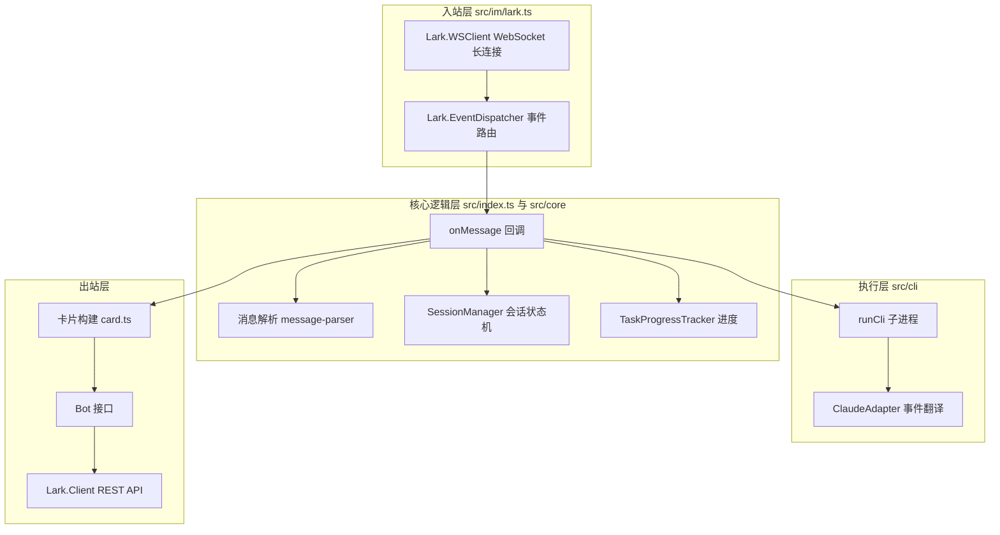
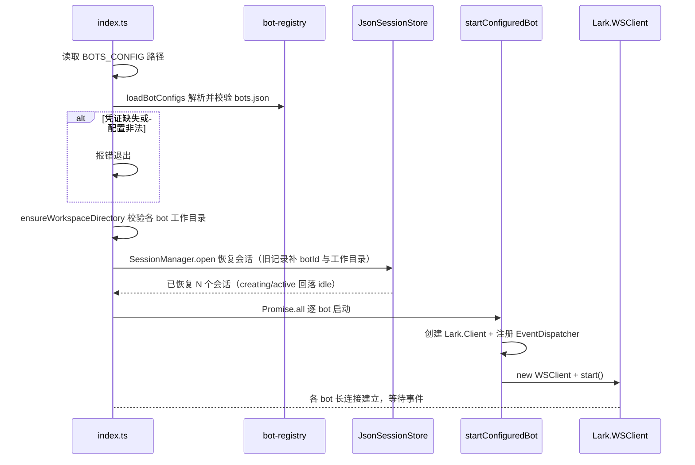

# 架构总览

## 分层架构

Agent-Team 由飞书接入层（入站/出站）、核心逻辑层和 CLI 执行层组成，飞书侧全部基于 OpenAPI SDK（`@larksuiteoapi/node-sdk`）。

从 WebSocket 入站、会话/进度核心处理、CLI 子进程执行到 REST API 出站的核心组件流转。

## 组件职责

### Lark.WSClient（入站）

负责建立并维持与飞书的 WebSocket 长连接，断线自动重连。所有飞书事件通过这条连接推送下来。

- 源文件：`src/im/lark.ts`，`startBot()` 内部创建
- 初始化：`new Lark.WSClient({ appId, appSecret })`
- 启动：`wsClient.start({ eventDispatcher: dispatcher })`

### Lark.EventDispatcher（分发）

将 WS 连接上收到的原始事件按事件名路由到处理函数。当前注册了两个事件处理器：

| 事件 | 处理逻辑 |
|------|----------|
| `im.message.receive_v1` | 解析消息内容，组装为 `IncomingMessage`，回调 `onMessage` |
| `card.action.trigger` | 卡片按钮回调（如「停止任务」），解析操作者与 value 后回调 `onCardAction` |

### onMessage 回调（核心逻辑）

入口文件 `src/index.ts` 中、每个 bot 各自注册的业务逻辑。当前实现：

1. 机器消息（`senderType` 为 `app`/`bot`）先走 [多 bot 协作](../domain/collaboration.md) 的取件逻辑：确认 @ 了当前 bot、提取任务编号、领取交接单，领取不到即忽略
2. 调用 [消息解析](../workflows/message-flow.md) 还原 @ 提及，识别 `/help`、`/status`、`/close`、`/new`、`/resume`、`/compact`、`/cd` 斜杠命令与 `/claude` `/codex` 引擎选择
3. 通过 [会话管理](../domain/session.md) 按话题解析或创建会话（会话键含 `botId`），并按会话状态守卫（closed/creating/active 拒绝追问）
4. 提取并下载图片/文件附件，回复一张带「停止任务」按钮的初始任务卡片
5. 后台异步执行所选引擎（`runCli` + `ClaudeAdapter` / `CodexAdapter`，或 `/compact` 走 `compactCliSession`），用工具级进度事件驱动卡片节流刷新；任务完成后按 [多 bot 协作](../domain/collaboration.md) 的路由回传或发起审查

### Bot 接口（出站）

`Bot` 接口封装了所有主动调飞书 API 的能力：

| 方法 | 飞书 API | 用途 |
|------|----------|------|
| `reply()` | `im.v1.message.reply` | 回复纯文本消息 |
| `replyCard()` | `im.v1.message.reply`（`msg_type: interactive`） | 回复交互卡片 |
| `updateCard()` | `im.v1.message.patch` | 更新已有卡片内容 |
| `downloadResource()` | `im.v1.messageResource.get` | 下载消息中的图片/文件 |

### 消息解析层（src/im/message-parser.ts）

提供三个纯函数：

- `parseMentions()` — 从飞书事件中提取结构化提及信息
- `resolveMentions()` — 把 `@_user_N` 占位符还原为 `@显示名`
- `extractResourceKeys()` — 从消息内容中提取图片/文件 key

详见 [消息处理流程](../workflows/message-flow.md)。

### 卡片系统（src/im/card.ts）

负责构建飞书 2.0 Schema 交互卡片，以及节流更新机制。详见 [任务卡片系统](../domain/task-card.md)。

### 核心域（src/core/）

- `bot-registry.ts` — 读取并校验 `config/bots.json`，解析凭证环境变量、默认引擎与工作目录（详见 [多 bot 注册](../domain/bot-registry.md)）
- `collaboration.ts` — bot 间协作的交接单（`CollaborationMessage`）、共享收件箱 `CollaborationInbox` 与按「任务 + 轮次 + 接收方」的去重键（详见 [多 bot 协作](../domain/collaboration.md)）
- `session-manager.ts` / `session-store.ts` — 话题级会话状态机与 JSON 持久化（zod 校验、原子写入、重启恢复、旧记录迁移）
- `task-progress.ts` — 把 CLI 事件折叠成工具级进度快照，供卡片渲染
- `task-abort.ts` — 「停止任务」的发起人权限校验
- `command-parser.ts` — 斜杠命令与 `/claude` `/codex` 引擎选择解析
- `workspace.ts` — 工作目录解析与存在性校验（`/cd` 与 bot 配置共用）

详见 [会话与任务管理](../domain/session.md)。

### CLI 执行层（src/cli/）

- `types.ts` — `CliAdapter` / `CliEvent` 统一事件协议，隔离各家 CLI 的原生输出差异
- `registry.ts` — 按 `CliId` 取适配器（`claude` / `codex`），并列出启动日志中打印的引擎清单
- `claude-adapter.ts` — 把 Claude Code `--output-format stream-json` 的一行输出翻译为 `CliEvent`
- `codex-adapter.ts` — 把 Codex `exec --json` 的事件流翻译为同一套 `CliEvent`
- `runner.ts` — `spawn` CLI 子进程，逐行读取 stdout、10 分钟超时、支持 `AbortSignal` 取消
- `native-compact.ts` — `/compact` 的原生上下文压缩：Claude 走 stream-json，Codex 走 app-server JSON-RPC
- `native-sessions.ts` — `/resume` 的会话清单：Claude 扫本地 JSONL，Codex 走 app-server `thread/list`
- `spawn-cli.ts` — Windows 下以 shell 启动 `.cmd` 包装的 CLI，并用 `taskkill /t /f` 连进程树清理

详见 [消息处理流程](../workflows/message-flow.md)。

## 入口与启动流程

入口文件 `src/index.ts` 的启动序列：

应用启动时的初始化序列（每个启用的 bot 一条独立连接）。

## 关键设计决策

- **事件回调尽快返回**：`onMessage` 回调中先回复初始卡片，后续执行通过 `void executeCli(...)` 在后台异步执行，不阻塞飞书事件确认
- **卡片更新复用 message_id**：先 `replyCard` 拿到 `message_id`，后续用 `updateCard` 同卡刷新
- **统一事件协议**：Runner 只消费适配器翻译后的 `CliEvent`，新增 CLI 只需实现 `CliAdapter` 并在 `registry.ts` 注册，不动执行与展示逻辑
- **bot 配置与凭证分离**：bots.json 只存环境变量名，真实凭证只从 `process.env` 读取，详见 [多 bot 注册](../domain/bot-registry.md) 与 [运维手册](../operations/runbook.md)
- **ESM only**：所有导入使用 `.js` 后缀（TypeScript 的 ESM 约定）
