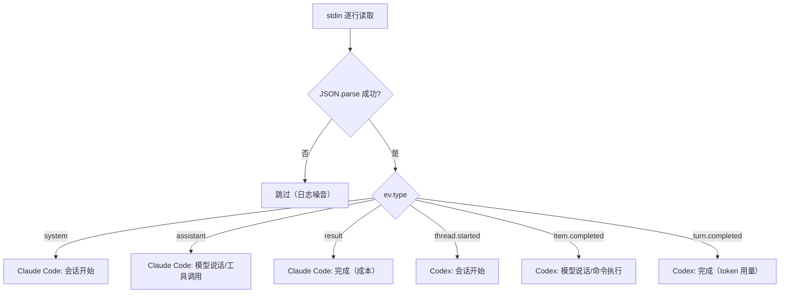

# AI CLI 输出解析

## 概述

Agent-Team 的终极目标是把飞书消息路由到 AI 编程 CLI（Claude Code 或 Codex），解析其 headless 输出，驱动任务卡片更新。当前项目中，`src/probe-cli.ts` 是一个独立的调试工具，用于从 stdin 读取并格式化输出 Claude Code / Codex 的 JSON 事件流。

> 这一模块是未来 [消息处理流程](../workflows/message-flow.md) 中替换 `DEMO_STEPS` 模拟逻辑的基础。

## 两种 CLI 的输出结构对比

以下是 Claude Code 和 Codex 在 headless 模式下的事件结构对照表（源文件：`docs/ClaudeCode和Codex在headless输出结构.md`）：

| 概念 | Claude Code | Codex |
|------|-------------|-------|
| 会话标识 | `session_id`（init 事件） | `thread_id`（`thread.started`） |
| 模型说话 | `assistant` 事件 | `item.completed` + `agent_message` |
| 执行命令 | `tool_use` 内容块 | `item.completed` + `command_execution` |
| 结束信号 | `result` 事件 | `turn.completed` 事件 |
| 成本信息 | `total_cost_usd`（直接给美元） | `usage`（仅 token 用量，费用需自算） |
| 续接会话 | `--resume <id>` 参数 | `exec resume <id>` 子命令 |

## probe-cli.ts 工作原理

### 输入

从 `process.stdin` 逐行读取，期望每行是一个独立的 JSON 对象（Claude Code / Codex 的 streaming 输出格式）。非 JSON 行（日志噪音）自动跳过。

### 事件路由

解析 JSON 后按 `ev.type` 分发：



probe-cli 按事件类型分发的处理逻辑。

### Claude Code 事件处理

| 事件 | 子类型 | 处理 |
|------|--------|------|
| `system` | `subtype === "init"` | 打印会话开始：session_id、model |
| `assistant` | — | 遍历 `message.content` 数组：`text` 块打印文本，`tool_use` 块打印工具名 |
| `result` | — | 打印轮次、耗时、成本（`total_cost_usd`）、最终回答 |

### Codex 事件处理

| 事件 | 条件 | 处理 |
|------|------|------|
| `thread.started` | — | 打印会话开始：`thread_id` |
| `item.completed` | `item.type === "agent_message"` | 打印模型文本 |
| `item.completed` | `item.type === "command_execution"` | 打印执行的命令 |
| `turn.completed` | — | 打印 token 用量（`usage`） |

### 时间戳格式

每行输出带相对时间戳：`[X.Xs]`，从脚本启动开始计时。

## 运行方式

```bash
# 通过 pnpm 脚本运行
pnpm probe:cli

# 实际执行的是
tsx src/probe-cli.ts

# 用法示例（管道 headless 输出）
claude --headless "实现一个函数" | pnpm probe:cli
# 或
codex exec "实现一个函数" | pnpm probe:cli
```

## 未来集成方向

当前 `probe-cli.ts` 是独立工具，未来需要将其解析逻辑集成到主流程中：

1. **消息路由**：飞书消息 → 选择 Claude Code 或 Codex
2. **进程管理**：spawn CLI 子进程，通过 stdin/stdout 管道交互
3. **事件解析**：复用 probe-cli 的事件路由逻辑
4. **卡片驱动**：将解析结果映射到 [任务卡片系统](task-card.md) 的进度更新

## 源文件索引

| 文件 | 职责 |
|------|------|
| `src/probe-cli.ts` | stdin → JSON 解析 → 格式化输出，支持 Claude Code / Codex 双协议 |
| `docs/ClaudeCode和Codex在headless输出结构.md` | 两种 CLI 输出结构对照表 |
