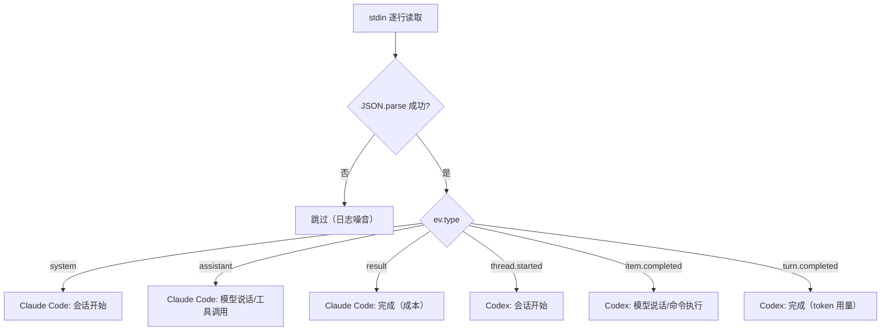

# AI CLI 输出解析

## 概述

Agent-Team 的目标是把飞书消息路由到 AI 编程 CLI（Claude Code 或 Codex），解析其 headless 输出，驱动任务卡片更新。两个引擎都已落地：`src/cli/claude-adapter.ts` 与 `src/cli/codex-adapter.ts` 分别把各家输出翻译成统一 `CliEvent`（详见 [消息处理流程](../workflows/message-flow.md)），`src/cli/registry.ts` 按 `CliId` 分发；`src/probe-cli.ts` 仍是独立的调试工具，用于从 stdin 读取并格式化输出 Claude Code / Codex 的 JSON 事件流。

## 两种 CLI 的输出结构对比

以下是 Claude Code 和 Codex 在 headless 模式下的事件结构对照表（源文件：`docs/ClaudeCode和Codex在headless输出结构.md`）：

| 概念 | Claude Code | Codex |
|------|-------------|-------|
| 会话标识 | `session_id`（init 事件） | `thread_id`（`thread.started`） |
| 模型说话 | `assistant` 事件 | `item.completed` + `agent_message` |
| 执行命令 | `tool_use` 内容块 | `item.completed` + `command_execution` |
| 结束信号 | `result` 事件 | `turn.completed` 事件 |
| 成本信息 | `total_cost_usd`（直接给美元） | `usage`（仅 token 用量，费用需自算） |
| 续接会话 | `--resume <id>` 参数 | `exec resume <id>` 子命令 |

## probe-cli.ts 工作原理

### 输入

从 `process.stdin` 逐行读取，期望每行是一个独立的 JSON 对象（Claude Code / Codex 的 streaming 输出格式）。非 JSON 行（日志噪音）自动跳过。

### 事件路由

解析 JSON 后按 `ev.type` 分发：



probe-cli 按事件类型分发的处理逻辑。

### Claude Code 事件处理

| 事件 | 子类型 | 处理 |
|------|--------|------|
| `system` | `subtype === "init"` | 打印会话开始：session_id、model |
| `assistant` | — | 遍历 `message.content` 数组：`text` 块打印文本，`tool_use` 块打印工具名 |
| `result` | — | 打印轮次、耗时、成本（`total_cost_usd`）、最终回答 |

### Codex 事件处理

| 事件 | 条件 | 处理 |
|------|------|------|
| `thread.started` | — | 打印会话开始：`thread_id` |
| `item.completed` | `item.type === "agent_message"` | 打印模型文本 |
| `item.completed` | `item.type === "command_execution"` | 打印执行的命令 |
| `turn.completed` | — | 打印 token 用量（`usage`） |

### 时间戳格式

每行输出带相对时间戳：`[X.Xs]`，从脚本启动开始计时。

## 运行方式

```bash
# 通过 pnpm 脚本运行
pnpm probe:cli

# 实际执行的是
tsx src/probe-cli.ts

# 用法示例（管道 headless 输出）
claude --headless "实现一个函数" | pnpm probe:cli
# 或
codex exec "实现一个函数" | pnpm probe:cli
```

## 集成现状

两个引擎均已集成进主流程，`probe-cli.ts` 仍可作为调试工具独立使用：

- **统一事件协议**：`src/cli/types.ts` 定义 `CliAdapter` / `CliEvent`，Runner 与卡片只消费翻译后的事件；Windows 上 prompt 一律走 stdin（`promptInputForPlatform`）。协议中还有两类应用层事件：`tool_call` 携带应用层 MCP 工具的原始入参供应用层重建状态，`stats` 由适配器在执行中途汇报（如 Codex 每个 `turn.completed`），runner 记下最后一份，`result` 事件本身没带统计时用它兜底——`tool_start` 面向进度展示，两者职责不同（详见 [需求澄清](clarification.md)）
- **Claude 适配器**：`src/cli/claude-adapter.ts` 实现 `CliAdapter`，覆盖 `system/init`、`assistant`、`user`、`result` 四类原生事件（事件翻译对照表见 [消息处理流程](../workflows/message-flow.md)）
- **Codex 适配器**：`src/cli/codex-adapter.ts` 把 `thread.started` / `item.started` / `item.completed` / `turn.completed` / `error` 翻译成同一套 `CliEvent`；命令行加 `--yolo`（Windows 用 `--dangerously-bypass-approvals-and-sandbox`），续跑走 `exec resume <thread_id>`
- **注册表**：`src/cli/registry.ts` 的 `getCliAdapter` / `listCliAdapters` 是取适配器的唯一入口，新增引擎在此登记
- **应用层工具探测**：`src/probe-app-tool.ts`（`pnpm probe:tool <claude|codex>`）端到端验证 MCP 注册与统一工具名
- **进程管理**：`src/cli/runner.ts` spawn 子进程、逐行读 stdout、默认 2 小时超时（`DEFAULT_TIMEOUT_MS`，可用 `CLAUDE_TIMEOUT_MS` / `CODEX_TIMEOUT_MS` 或统一 `CLI_TIMEOUT_MS` 按引擎覆盖，设 0 或非法值回退默认，不再支持「不限时」）、支持 AbortSignal 取消；`stopToolNames` 命中应用层工具调用时会立即杀掉子进程、只把该次调用随结果返回（应用层据此截获 `request_approval` 等停止型工具）；Windows 下的 `.cmd` shell 启动与中止时的进程树清理见 [架构总览](../architecture/overview.md) 的 Windows 中止与进程树清理一节
- **原生压缩（native-compact）**：`src/cli/native-compact.ts` 的 `compactCliSession()` 支撑 `/compact` 命令，两家协议不同各走各的通道——Claude Code 用 `-p - --resume <id>` 把 `/compact` 指令写进 stdin 并解析 stream-json，收到 `compact_boundary` 才算完成；Codex 的 exec 模式不支持压缩指令，起 `app-server --stdio` 走 JSON-RPC（`initialize` → `thread/resume` → `thread/compact/start`），收到 `contextCompaction` item 即成功。结果包装成与普通任务相同的形状，复用成功/取消/失败收尾；超时与 run 路径共用 `src/cli/timeout.ts`（`envTimeoutMs` 覆盖 + `armTimeout` 钳制，默认 2 小时），两条路径行为一致
- **原生会话清单（native-sessions）**：`src/cli/native-sessions.ts` 的 `listNativeCliSessions()` 支撑 `/resume` 命令，同样双协议——Claude Code 直接扫 `~/.claude/projects/<cwd 转义目录>` 下的会话 JSONL（标题取 ai-title > last-prompt > 首条用户消息，并校验记录里的 cwd 防串目录）；Codex 起 `app-server` 调 `thread/list`（按 cwd 精确过滤、按更新时间倒序，上限 8 条）
- **卡片驱动**：`CliEvent` 经 `TaskProgressTracker` 折叠成进度快照，驱动 [任务卡片系统](task-card.md) 刷新
- **应用层工具集（agent_team）**：`src/mcp/app-tools-server.ts` 向两家 CLI 注册五个 stdio MCP 工具——`request_clarification`（[需求澄清](clarification.md)）、`request_spec_approval`（[产品方案交付](product-spec.md)）、`dispatch_task`（[多 bot 协作](collaboration.md)）、`schedule_manage`（[定时任务调度](scheduling.md)，经本地 HTTP 接口回传）、`request_approval`（[高危操作审批](approval.md)）。工具名常量与 `mcp__agent_team__` 前缀归一定义在 `src/cli/app-tools.ts`，两家适配器各维护一份截获分支
- **入参注册的 union 陷阱**：MCP SDK 的 `normalizeObjectSchema` 识别不了顶层 `z.discriminatedUnion`，会静默降级成 `{ type: 'object', properties: {} }`，AI 拿不到字段说明就无法传参。因此 `request_spec_approval` 与 `schedule_manage` 注册时用的是专门的扁平 `ProductSpecToolInputSchema` / `ScheduleManageToolInputSchema`（带逐字段 describe），运行时仍由各自的 discriminatedUnion 做最终校验；其余三个工具是普通 `z.object`，可直接注册。改这两个工具的入参结构时，两份 schema 必须同步（见各领域页的变更指引）

## 源文件索引

| 文件 | 职责 |
|------|------|
| `src/probe-cli.ts` | stdin → JSON 解析 → 格式化输出，支持 Claude Code / Codex 双协议 |
| `docs/ClaudeCode和Codex在headless输出结构.md` | 两种 CLI 输出结构对照表 |
