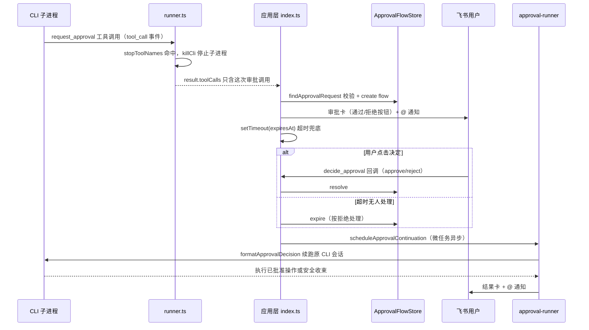

# 高危操作审批

## 概述

开发类 bot 执行可能影响服务可用性或数据安全的操作（重启服务、删文件、改生产配置、数据库写操作）前，调用应用层工具 `request_approval` 请求人类拍板。与 [需求澄清](clarification.md) 的「答案回流」模式不同，审批的关键差异是 **stopToolNames 停止机制**：`src/index.ts` 调 `executeCli` 时传入 `['request_approval']`，runner 一看到该工具的 `tool_call` 事件就 kill 掉 CLI 子进程，只把这次调用随结果返回——CLI 必须先停下，等审批结果决定后续。涉及代码：

- `src/core/approval.ts` — `ApprovalRequestSchema`、`ApprovalFlow` 流程模型、`ApprovalFlowStore`
- `src/core/approval-store.ts` — JSON 持久化（`data/approval-flows.json`）
- `src/app/approval-runner.ts` — 决定（或超时）后的 CLI 续跑
- `src/app/card-action-handler.ts` — `decide_approval` 卡片回调
- `src/im/card.ts` — 审批卡 / 已决定卡 / 继续执行卡

## 审批请求与流程模型

zod `ApprovalRequestSchema` 约束：`operation`（≤120 字符）、`detail`（≤2_000）、`impact`（≤500）、`rollback`（≤500）四个必填文案字段，可选 `timeoutSeconds`（60–3_600，默认 `DEFAULT_APPROVAL_TIMEOUT_SECONDS = 300` 即 5 分钟）。

`ApprovalFlow` 在请求之外记录 `token`（32 位 hex，卡片按钮携带）、`taskId` + `botId` + `sessionId`（话题与 [会话](session.md) 归属）、`ownerOpenId` / `ownerUnionId`（发起人，通知与归属用）、可选 `collaboration`（[协作派发](collaboration.md) 的来源信息，审批可发生在协作任务中）、`originalMessageId` / `cardMessageId` / `replyInThread`（续跑回原话题）与 `expiresAt`。

`ApprovalFlowStore` 的规则：同一 `taskId + botId` 只保留一个 pending 流程，重新请求让旧流程置 `expired`；`resolve` / `expire` 只对 pending 生效，重复点击由卡片回调分支挡住。`JsonApprovalFlowStore` 每次变更后落盘。

## 审批流程时序

停止 CLI、等待人类拍板、带着决定续跑的完整闭环。

## 决定回传与续跑

`formatApprovalDecision(flow)` 把决定翻译成续跑 prompt：approved 时指示「继续执行已批准的操作并完成修复，完成后给出最终结论」；rejected / expired 时指示「不要执行该操作，停止相关动作，把当前进展和阻塞原因汇报给用户」。

`src/app/approval-runner.ts` 的 `continueApprovalFlow` 复用普通任务管线：回原话题发 running 卡（仍带停止按钮）、每秒心跳 + `ThrottledCardUpdater` 节流、成功/取消/失败三分支收尾、`finally` 注销 `activeRuns` 并回落 idle（见 [会话与任务管理](session.md) 与 [任务卡片系统](task-card.md)）。

入口 `scheduleApprovalContinuation`（`src/app/card-action-handler.ts`）先同步校验会话存在且非 active、`transition active` 并登记 `activeRuns`，再把续跑放进 `queueMicrotask`——卡片回调先返回 toast + 过渡卡，不被续跑拖住。

## 卡片回调校验

`decide_approval` 回调（`decision` 为 `reject` 或默认 `approve`）的校验顺序：

| 校验 | 响应 |
|------|------|
| flow 不存在 / bot 不符 / 缺 messageId | toast「这份审批请求已经失效」 |
| 已处理过 | toast「这份审批已经处理过」+ 已决定卡 |
| 点击时已过 `expiresAt` | 自动 expire 并按拒绝收束，toast「审批已超时，按拒绝处理」 |
| 无法识别操作者 | toast「无法识别操作者，无法审批」 |
| resolve 失败（并发处理） | toast「审批状态已经更新」 |

通过后返回「已放行 / 已拒绝」toast + 继续执行卡。注意审批**不校验操作者必须是发起人**——群内任何能点卡片的人都可以拍板，这一点与澄清/产品确认的 owner 校验不同。

## 超时兜底

应用层在创建流程后 `setTimeout(expiresAt - now)`（unref），到期时若流程仍 pending 则 `expire` 并触发同一套 `scheduleApprovalContinuation` 收束。重启后磁盘上的 pending 流程没有对应计时器，但卡片回调里也有同样的过期检查，点击过期卡会走超时拒绝分支。

## 变更指引

- **改请求字段**：`ApprovalRequestSchema` 与 `src/mcp/app-tools-server.ts` 里 `request_approval` 的 `inputSchema` 是同一 schema 引用，同步改；两家适配器的 `tool_call` 截获分支也要收录（见 [AI CLI 输出解析](ai-cli-probe.md)）
- **新增需要「先停再问」的工具**：在 `src/index.ts` 调 `executeCli` 的 `stopToolNames` 数组里追加工具名，并保证 MCP 服务注册了该工具；不需要停止的工具（如 `schedule_manage`）不要加进去
- **审批并发**：`continueApprovalFlow` 自行管理会话状态与 `activeRuns`，与主路径、澄清续跑是并行管线，改动收尾逻辑三处都要看
- **持久化**：`data/approval-flows.json` 变更即落盘（原子写），重启后 pending 流程仍可被卡片回调处理
