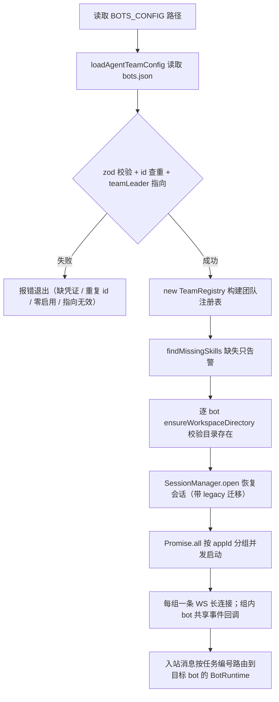

# 多 bot 注册

## 概述

Agent-Team 通过 `config/bots.json`（路径由环境变量 `BOTS_CONFIG` 指定，默认 `config/bots.json`）注册多个飞书 bot：顶层声明 `teamLeader`，每个 bot 有自己的凭证、默认执行引擎（`defaultCli`）、角色（`role`）、角色提示词（`systemPrompt`）、项目 Skill 清单（`skills`）和工作目录。注册逻辑在 `src/core/bot-registry.ts`（校验）与 `src/core/team-registry.ts`（团队注册表），是 [架构总览](../architecture/overview.md) 中所有长连接与 [会话与任务管理](session.md) 中会话归属的起点。

## 配置结构

模板见 `config/bots.example.json`（顶层必须声明 `teamLeader`，指向某个启用的 bot）：

```json
{
  "teamLeader": "ceo-assistant",
  "defaultProductDeliveryMode": "lark-doc",
  "bots": [
    {
      "id": "developer",
      "appIdEnv": "FEISHU_DEVELOPER_APP_ID",
      "appSecretEnv": "FEISHU_DEVELOPER_APP_SECRET",
      "defaultCli": "claude",
      "role": "开发",
      "systemPrompt": "你是主力开发助手，负责理解需求并完成实现。"
    }
  ]
}
```

顶层字段（`BotConfigFileSchema`）：`teamLeader` 必填，指向某个启用的 bot；`defaultProductDeliveryMode` 可选（`local` / `lark-doc`，默认 `lark-doc`），决定产品类 bot 的默认产物交付方式，进入 `buildBotPrompt` 的交付规则与定时任务派发（见 [产品方案交付](product-spec.md)）。

bot 字段说明（zod `BotSchema` 校验）：

| 字段 | 校验规则 | 说明 |
|------|----------|------|
| `id` | `/^[a-z0-9][a-z0-9_-]{0,31}$/`，不可重复 | bot 标识，进入会话键 `botId:chatId:threadId` |
| `group` | 可选，`/^[a-z0-9][a-z0-9_-]{0,31}$/` | 同组成员互为会话限额时的代班候选（模板中 `developer` / `developer2` 同属 `developer` 组）；未配置时自身单独成组，详见 [多 bot 协作](collaboration.md) 的会话限额一节 |
| `appIdEnv` / `appSecretEnv` | `/^[A-Z_][A-Z0-9_]*$/` | 凭证**环境变量名**（不是凭证本身），启动时从 `process.env` 读取 |
| `defaultCli` | `claude` 或 `codex` | 该 bot 新话题的默认执行引擎 |
| `role` | 必填非空字符串 | 一句话角色（如「开发」「审查」），进入团队名单与任务提示词 |
| `skills` | 可选字符串数组（`/^[a-z0-9][a-z0-9-]{0,63}$/`），默认 `[]` | 项目 Skill 清单，见下文 |
| `workspace` | 可选非空字符串 | 该 bot 的工作目录，相对路径按进程 cwd 解析 |
| `systemPrompt` | 可选，默认空串 | 角色说明，拼接在任务前 |
| `reviewBy` | 可选，bot id 格式 | 历史字段：启动时仍做指向校验，但运行时不再自动触发审查；协作派发统一走 `dispatch_task` 工具（见 [多 bot 协作](collaboration.md)） |
| `collaborationMaxRounds` | 整数 1–32，默认 16 | 协作允许的交接总次数（见 [多 bot 协作](collaboration.md)） |
| `enabled` | 可选，默认 `true` | 为 `false` 的 bot 在解析阶段即被过滤，不索取凭证、不建连接 |
| `cliEnv` | 可选 `Record<string, string>`，键值均须匹配 `/^[A-Z_][A-Z0-9_]*$/`，默认 `{}` | per-bot CLI 模型配置：键为传给 CLI 子进程的环境变量名，值为 `.env` 中保存实际值的变量名，见下文 |

启动期校验（失败即退出）：`teamLeader` 指向未启用的 bot、`reviewBy` 指向未启用或指向自己、bot id 重复、启用的 bot 缺凭证、全部停用。

## 团队注册表（TeamRegistry）

`src/core/team-registry.ts` 的 `TeamRegistry` 由 `AgentTeamConfig`（`loadAgentTeamConfig` 返回 `teamLeaderId + bots`）构造，提供三件事：

- **`contextFor(botId)`**：生成团队名单文本（成员 id、是否 Team Leader、role、Skills），由 `buildBotPrompt` 拼进每条任务提示词，并声明「团队成员都是真实飞书 bot，CLI 内部子 Agent 不能冒充」
- **`findMissingSkills()`**：启动时逐 bot 检查 skills 是否存在于五级候选路径（工作区 `.agents/skills/<skill>/SKILL.md` → 工作区 `.claude/skills/` → `~/.agents/skills/` → `~/.claude/skills/` → `~/.codex/skills/`），全部缺失才打 `[Skill]` 告警，不阻断启动；各 Skill 的来源仓库与一键安装命令见根 README「安装与准备工作流 Skills」对照表（全局装到 `~/.agents/skills/` 即可被所有 bot 的工作区共享）
- **`/team` 命令数据源**：成员卡片（名称、role、默认引擎、Skills、是否 Leader、是否就绪）由 `TeamRegistry.members` 驱动，见 [消息处理流程](../workflows/message-flow.md)

## 启动流程



从 bots.json 到多条长连接的启动链路。

- **`loadAgentTeamConfig`**：文件不存在时报「请复制 config/bots.example.json 后填写配置」；JSON/校验错误统一包装为「bot 配置文件格式错误」
- **凭证解析**：`parseAgentTeamConfig` 按 `appIdEnv` / `appSecretEnv` 读环境变量，**支持系统级凭证回退**——某 bot 的专属变量未配置时，依次回退 `FEISHU_APP_ID`/`APP_ID` 与 `FEISHU_APP_SECRET`/`APP_SECRET`（均未配置时再取 teamLeader 的凭证变量名兜底）；两级都为空才抛「bot xxx 缺少环境变量 FOO，且未配置系统级凭证」。这就是 README 的「极简模式」：只配一套全局 `FEISHU_APP_ID` / `FEISHU_APP_SECRET` 即可跑全员（未配独立凭证的 bot 自动回退），两种模式可混用
- **按 appId 分组共享连接**：多个 bot 复用同一套凭证时只建**一条** WS 长连接（`src/index.ts` 的 `startConfiguredBots` 按 `appId` 分组，每组一次 `startBot`）；同连接的入站消息先按文本中的「任务编号」查 `collaborationInbox.peek` 路由到真正的目标 bot，卡片回调则依次询问该组每个 bot 的 handler。共享时控制台打印 `(共享 appId: xxx)`。代价是这些 bot 在飞书里共用同一个头像与名称，需要独立身份就为 bot 配独立凭证
- **至少一个 bot**：全部停用时抛「至少需要启用一个 bot」
- **每个 bot 独立运行时**：`BotRuntime`（config + bot + identity）仍按 bot 各自登记进 `botRuntimes`，会话、工作目录与 `cliEnv` 互不影响；`[Bot XXX] 已连接` 与 `default_cli=... workspace=...` 日志也按 bot 打印

## per-bot CLI 模型配置（cliEnv）

默认情况下，Claude Code 与 Codex 的模型后端使用各自的用户级配置（`~/.claude/settings.json` 或 CC Switch）。`cliEnv` 允许**单个 bot 覆盖**这套默认：配置文件只保存「环境变量名 → 环境变量名」的引用，真实值（如 `ANTHROPIC_BASE_URL`、`ANTHROPIC_AUTH_TOKEN`、`ANTHROPIC_MODEL` 及各档位模型映射）放 `.env`，模型供应商密钥不会写进 `bots.json`。

模板示例（`config/bots.example.json` 的 ceo-assistant，把 11 个 `ANTHROPIC_*` 键映射到 `CEO_ZHIPU_*` 变量）：

```json
{
  "id": "ceo-assistant",
  "cliEnv": {
    "ANTHROPIC_BASE_URL": "CEO_ZHIPU_ANTHROPIC_BASE_URL",
    "ANTHROPIC_AUTH_TOKEN": "CEO_ZHIPU_ANTHROPIC_AUTH_TOKEN",
    "ANTHROPIC_MODEL": "CEO_ZHIPU_ANTHROPIC_MODEL"
  }
}
```

行为要点（`src/core/bot-registry.ts` 的 `parseAgentTeamConfig`）：

- **启动期严格解析**：逐条按 source 变量名读 `.env`，缺失或为空即抛 `bot xxx 的 CLI 环境变量 ANTHROPIC_BASE_URL 缺少 CEO_ZHIPU_ANTHROPIC_BASE_URL` 并退出——与 `.env.example`「留空表示不启用」的注释不同，**写了 cliEnv 映射就必须填值**；不启用覆盖就不要在 bots.json 里写该映射
- **注入是合并而非替换**：`runCli` 以 `{ ...process.env, ...env }` 注入子进程（`src/cli/runner.ts`），未覆盖的变量照常继承用户级 CLI 配置
- **不配 cliEnv 的 bot 完全继承用户级配置**，与其他 bot 的覆盖互不影响
- **覆盖只按 bot 生效**，与话题使用的引擎无关：映射变量名由 CLI 自行解释（示例用 Claude 的 `ANTHROPIC_*` 族），给 Codex bot 配覆盖需用 `CODEX_*` 相应变量

注入点覆盖该 bot 的**每一次** CLI 子进程执行，保证续跑不丢后端：

| 执行路径 | 注入位置 |
|----------|----------|
| 主任务与 `/compact` 压缩 | `src/index.ts`（`cliEnv` 与 `AGENT_TEAM_CHAT_ID` / `AGENT_TEAM_OWNER_OPEN_ID` 一并注入 `executeCli` / `compactCliSession`） |
| 澄清答案收齐续跑、方案重试 | `src/app/clarification-runner.ts` |
| 审批决定回传续跑 | `src/app/approval-runner.ts` |
| 方案评论区修改 | `src/app/product-comment-runner.ts` |
| 定时任务直接执行 | `src/app/scheduled-task-runner.ts`（`target.cliEnv` + `AGENT_TEAM_*`） |

## 工作目录优先级

`workspaceDir` 的取值链（`parseAgentTeamConfig` 内）：

```
bot.workspace（bots.json）→ CLI_WORKDIR（.env）→ CLAUDE_WORKDIR（旧键兜底）→ '.'（进程 cwd）
```

路径解析复用 `src/core/workspace.ts` 的 `resolveWorkspacePath`（绝对路径直接 resolve，相对路径基于 `baseDirectory`），启动时 `ensureWorkspaceDirectory` 校验目录存在且是文件夹。会话级 `/cd` 命令可在运行时切换单个话题的工作目录，详见 [消息处理流程](../workflows/message-flow.md)。

## systemPrompt 与任务拼接

`buildBotPrompt(config, prompt, teamContext, defaultProductDeliveryMode)` 组装最终任务提示词，各段落用空行连接：

```
你的角色：<role>
<systemPrompt>
<teamContext（TeamRegistry.contextFor 的团队名单）>
产品方案交付规则（配置 to-spec / to-tickets / lark-doc skill 时）：默认交付方式、用户明确指定时覆盖、必须实际调用 request_spec_approval
项目 Skill 加载规则（配了 skills 时）：工作区 .agents/skills 优先于 .claude/skills，最后才允许全局同名 Skill
飞书输出规则（必须遵守）：最终回复 ≤1200 中文字符、不贴完整代码/长日志/Markdown 表格、详细产物写文件、需要用户决策时调用 request_clarification
命令执行规则（必须遵守）：所有命令与测试在前台同步运行并等待退出，严禁 &、nohup、disown、run_in_background 等后台派发

当前任务：<用户消息、协作 prompt 或定时任务包装>
```

飞书输出规则、Skill 加载顺序与命令执行规则**写死在提示词里**：第一条是因为飞书是聊天界面，大段内容会刷屏；第二条防止 CLI 跳过工作区版本直接用全局同名 Skill；第三条防止 CLI 把测试/命令丢到后台异步执行、任务在结果出来前就提前收尾（workspace-template 的 `verify` Skill 边界里有同样的前台运行要求）。`skills` 含 `grill-me` 的 bot 才会启用 [需求澄清](clarification.md) 闭环；`to-spec` / `lark-doc` 启用 [产品方案交付](product-spec.md)；`lark-drive` 额外订阅飞书文档评论事件。

这让同一套执行链路可以承载「开发」「审查」等不同分工的 bot，同时把长产物引导进工作区文件而不是聊天窗口。

## 与执行引擎的关系

`defaultCli` 只影响**新会话**的引擎选择；已有会话沿用创建时选定的 `cliId`，用户在新话题发 `/claude <任务>` 或 `/codex <任务>` 可显式覆盖默认值。引擎实例由 `src/cli/registry.ts` 的 `getCliAdapter()` 提供，事件协议见 [AI CLI 输出解析](ai-cli-probe.md)。

## 变更指引

- **新增配置字段**：同时改 `BotSchema` 与 `BotConfig` 接口；字段是可选的注意给默认值，否则旧 bots.json 启动即失败
- **会话迁移**：`JsonSessionStore` 用 `legacyBotId`（取 `botConfigs[0].id`）和 `defaultWorkspaces` 给缺 `botId` / `workspaceDir` 的旧记录补值，改动字段时要同步 `migrateSessionRecord`，详见 [会话与任务管理](session.md)
- **凭证安全**：bots.json 只写环境变量**名**（飞书凭证与 `cliEnv` 模型后端同理），真实凭证放 `.env`（见 [运维手册](../operations/runbook.md)），不要把密钥写进配置文件
- **cliEnv 覆盖**：新增映射时必须同步在 `.env` 补上 source 变量的值，否则启动即抛「缺少 xxx」；调整后用 [运维手册](../operations/runbook.md) 的启动检查验证
- **协作字段**：新增或调整 `reviewBy` / `collaborationMaxRounds` 时，同步检查 `parseAgentTeamConfig` 里的指向校验；`collaborationMaxRounds` 是 `dispatch_task` 发起协作的轮次上限（见 [多 bot 协作](collaboration.md)）
- **新增 Skill**：除 bots.json 的 `skills` 数组外，还要让 SKILL.md 落在五级候选路径之一（工作区 `.agents/skills/` / `.claude/skills/`，或全局 `~/.agents/skills/` / `~/.claude/skills/` / `~/.codex/skills/`），否则启动只有 `[Skill]` 告警、提示词里的加载规则落空；安装方式见根 README 的技能对照表（`npx skills add larksuite/cli -g -y`、`npx skills add mattpocock/skills -g -y`，或复制 `workspace-template/` 的定制版到全局）。`workspace-template/` 提供了 `grill-me` / `to-spec` / `to-tickets` / `implement-ticket` / `verify` 五个工作流 Skill 与 `code-reviewer` / `tester` 子代理定义（`.claude` 的 md 与 `.codex` 的 toml），可作为新工作区的起点。模板里 tester bot 的 `verify` Skill 按验收标准操作真实运行的应用给出独立结论，页面级端到端验收可搭配 `agent-browser`（`npm install -g agent-browser && agent-browser install`，受限网络用 `AGENT_BROWSER_EXECUTABLE_PATH` 指向本机 Chrome；详见根 README 的技能对照表）
