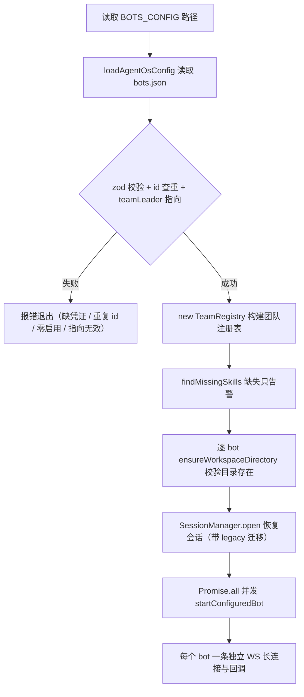

# 多 bot 注册

## 概述

Agent-Team 通过 `config/bots.json`（路径由环境变量 `BOTS_CONFIG` 指定，默认 `config/bots.json`）注册多个飞书 bot：顶层声明 `teamLeader`，每个 bot 有自己的凭证、默认执行引擎（`defaultCli`）、角色（`role`）、角色提示词（`systemPrompt`）、项目 Skill 清单（`skills`）和工作目录。注册逻辑在 `src/core/bot-registry.ts`（校验）与 `src/core/team-registry.ts`（团队注册表），是 [架构总览](../architecture/overview.md) 中所有长连接与 [会话与任务管理](session.md) 中会话归属的起点。

## 配置结构

模板见 `config/bots.example.json`（顶层必须声明 `teamLeader`，指向某个启用的 bot）：

```json
{
  "teamLeader": "ceo-assistant",
  "defaultProductDeliveryMode": "lark-doc",
  "bots": [
    {
      "id": "developer",
      "appIdEnv": "FEISHU_DEVELOPER_APP_ID",
      "appSecretEnv": "FEISHU_DEVELOPER_APP_SECRET",
      "defaultCli": "claude",
      "role": "开发",
      "systemPrompt": "你是主力开发助手，负责理解需求并完成实现。"
    }
  ]
}
```

顶层字段（`BotConfigFileSchema`）：`teamLeader` 必填，指向某个启用的 bot；`defaultProductDeliveryMode` 可选（`local` / `lark-doc`，默认 `lark-doc`），决定产品类 bot 的默认产物交付方式，进入 `buildBotPrompt` 的交付规则与定时任务派发（见 [产品方案交付](product-spec.md)）。

bot 字段说明（zod `BotSchema` 校验）：

| 字段 | 校验规则 | 说明 |
|------|----------|------|
| `id` | `/^[a-z0-9][a-z0-9_-]{0,31}$/`，不可重复 | bot 标识，进入会话键 `botId:chatId:threadId` |
| `appIdEnv` / `appSecretEnv` | `/^[A-Z_][A-Z0-9_]*$/` | 凭证**环境变量名**（不是凭证本身），启动时从 `process.env` 读取 |
| `defaultCli` | `claude` 或 `codex` | 该 bot 新话题的默认执行引擎 |
| `role` | 必填非空字符串 | 一句话角色（如「开发」「审查」），进入团队名单与任务提示词 |
| `skills` | 可选字符串数组（`/^[a-z0-9][a-z0-9-]{0,63}$/`），默认 `[]` | 项目 Skill 清单，见下文 |
| `workspace` | 可选非空字符串 | 该 bot 的工作目录，相对路径按进程 cwd 解析 |
| `systemPrompt` | 可选，默认空串 | 角色说明，拼接在任务前 |
| `reviewBy` | 可选，bot id 格式 | 历史字段：启动时仍做指向校验，但运行时不再自动触发审查；协作派发统一走 `dispatch_task` 工具（见 [多 bot 协作](collaboration.md)） |
| `collaborationMaxRounds` | 整数 1–32，默认 16 | 协作允许的交接总次数（见 [多 bot 协作](collaboration.md)） |
| `enabled` | 可选，默认 `true` | 为 `false` 的 bot 在解析阶段即被过滤，不索取凭证、不建连接 |

启动期校验（失败即退出）：`teamLeader` 指向未启用的 bot、`reviewBy` 指向未启用或指向自己、bot id 重复、启用的 bot 缺凭证、全部停用。

## 团队注册表（TeamRegistry）

`src/core/team-registry.ts` 的 `TeamRegistry` 由 `AgentOsConfig`（`loadAgentOsConfig` 返回 `teamLeaderId + bots`）构造，提供三件事：

- **`contextFor(botId)`**：生成团队名单文本（成员 id、是否 Team Leader、role、Skills），由 `buildBotPrompt` 拼进每条任务提示词，并声明「团队成员都是真实飞书 bot，CLI 内部子 Agent 不能冒充」
- **`findMissingSkills()`**：启动时逐 bot 检查 skills 是否存在于 `<workspace>/.agents/skills/<skill>/SKILL.md` 或 `.claude/skills/` 路径，缺失只打 `[Skill]` 告警不阻断启动
- **`/team` 命令数据源**：成员卡片（名称、role、默认引擎、Skills、是否 Leader、是否就绪）由 `TeamRegistry.members` 驱动，见 [消息处理流程](../workflows/message-flow.md)

## 启动流程



从 bots.json 到多条长连接的启动链路。

- **`loadAgentOsConfig`**：文件不存在时报「请复制 config/bots.example.json 后填写配置」；JSON/校验错误统一包装为「bot 配置文件格式错误」
- **凭证解析**：`parseAgentOsConfig` 按 `appIdEnv` / `appSecretEnv` 读环境变量，缺失即抛「bot xxx 缺少环境变量 FOO」
- **至少一个 bot**：全部停用时抛「至少需要启用一个 bot」
- **每个 bot 独立连接**：`src/index.ts` 的 `startConfiguredBot()` 为每个配置创建 `startBot()`（各自 `Lark.Client` + `WSClient`），`Promise.all` 并发拉起，控制台打印 `[Bot XXX] default_cli=... workspace=...` 与 `[Bot XXX] 已连接`

## 工作目录优先级

`workspaceDir` 的取值链（`parseAgentOsConfig` 内）：

```
bot.workspace（bots.json）→ CLI_WORKDIR（.env）→ CLAUDE_WORKDIR（旧键兜底）→ '.'（进程 cwd）
```

路径解析复用 `src/core/workspace.ts` 的 `resolveWorkspacePath`（绝对路径直接 resolve，相对路径基于 `baseDirectory`），启动时 `ensureWorkspaceDirectory` 校验目录存在且是文件夹。会话级 `/cd` 命令可在运行时切换单个话题的工作目录，详见 [消息处理流程](../workflows/message-flow.md)。

## systemPrompt 与任务拼接

`buildBotPrompt(config, prompt, teamContext, defaultProductDeliveryMode)` 组装最终任务提示词，各段落用空行连接：

```
你的角色：<role>
<systemPrompt>
<teamContext（TeamRegistry.contextFor 的团队名单）>
产品方案交付规则（配置 to-spec / to-tickets / lark-doc skill 时）：默认交付方式、用户明确指定时覆盖、必须实际调用 request_spec_approval
项目 Skill 加载规则（配了 skills 时）：工作区 .agents/skills 优先于 .claude/skills，最后才允许全局同名 Skill
飞书输出规则（必须遵守）：最终回复 ≤1200 中文字符、不贴完整代码/长日志/Markdown 表格、详细产物写文件、需要用户决策时调用 request_clarification

当前任务：<用户消息、协作 prompt 或定时任务包装>
```

飞书输出规则与 Skill 加载顺序**写死在提示词里**：前者是因为飞书是聊天界面，大段内容会刷屏；后者防止 CLI 跳过工作区版本直接用全局同名 Skill。`skills` 含 `grill-me` 的 bot 才会启用 [需求澄清](clarification.md) 闭环；`to-spec` / `lark-doc` 启用 [产品方案交付](product-spec.md)；`lark-drive` 额外订阅飞书文档评论事件。

这让同一套执行链路可以承载「开发」「审查」等不同分工的 bot，同时把长产物引导进工作区文件而不是聊天窗口。

## 与执行引擎的关系

`defaultCli` 只影响**新会话**的引擎选择；已有会话沿用创建时选定的 `cliId`，用户在新话题发 `/claude <任务>` 或 `/codex <任务>` 可显式覆盖默认值。引擎实例由 `src/cli/registry.ts` 的 `getCliAdapter()` 提供，事件协议见 [AI CLI 输出解析](ai-cli-probe.md)。

## 变更指引

- **新增配置字段**：同时改 `BotSchema` 与 `BotConfig` 接口；字段是可选的注意给默认值，否则旧 bots.json 启动即失败
- **会话迁移**：`JsonSessionStore` 用 `legacyBotId`（取 `botConfigs[0].id`）和 `defaultWorkspaces` 给缺 `botId` / `workspaceDir` 的旧记录补值，改动字段时要同步 `migrateLegacySession`，详见 [会话与任务管理](session.md)
- **凭证安全**：bots.json 只写环境变量**名**，真实凭证放 `.env`（见 [运维手册](../operations/runbook.md)），不要把密钥写进配置文件
- **协作字段**：新增或调整 `reviewBy` / `collaborationMaxRounds` 时，同步检查 `parseAgentOsConfig` 里的指向校验；`collaborationMaxRounds` 是 `dispatch_task` 发起协作的轮次上限（见 [多 bot 协作](collaboration.md)）
- **新增 Skill**：除 bots.json 的 `skills` 数组外，还要在工作区放 `.agents/skills/<skill>/SKILL.md`（或 `.claude/skills/`），否则启动只有 `[Skill]` 告警、提示词里的加载规则落空
