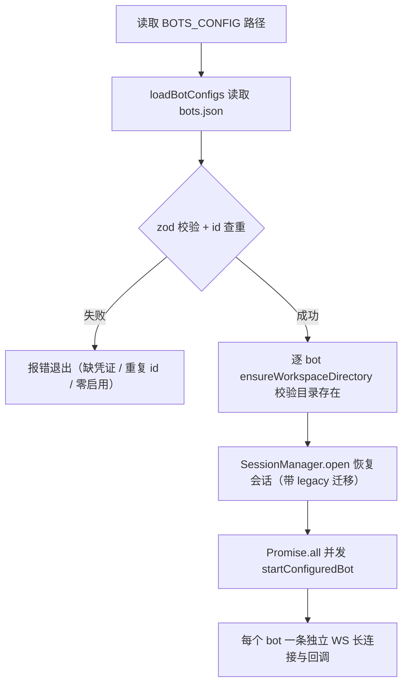

# 多 bot 注册

## 概述

Agent-Team 通过 `config/bots.json`（路径由环境变量 `BOTS_CONFIG` 指定，默认 `config/bots.json`）注册多个飞书 bot，每个 bot 有自己的凭证、默认执行引擎（`defaultCli`）、角色提示词（`systemPrompt`）和工作目录。注册逻辑在 `src/core/bot-registry.ts`，是 [架构总览](../architecture/overview.md) 中所有长连接与 [会话与任务管理](session.md) 中会话归属的起点。

## 配置结构

模板见 `config/bots.example.json`：

```json
{
  "bots": [
    {
      "id": "developer",
      "appIdEnv": "FEISHU_DEVELOPER_APP_ID",
      "appSecretEnv": "FEISHU_DEVELOPER_APP_SECRET",
      "defaultCli": "claude",
      "systemPrompt": "你是主力开发助手，负责理解需求并完成实现。"
    }
  ]
}
```

字段说明（zod `BotSchema` 校验）：

| 字段 | 校验规则 | 说明 |
|------|----------|------|
| `id` | `/^[a-z0-9][a-z0-9_-]{0,31}$/`，不可重复 | bot 标识，进入会话键 `botId:chatId:threadId` |
| `appIdEnv` / `appSecretEnv` | `/^[A-Z_][A-Z0-9_]*$/` | 凭证**环境变量名**（不是凭证本身），启动时从 `process.env` 读取 |
| `defaultCli` | `claude` 或 `codex` | 该 bot 新话题的默认执行引擎 |
| `workspace` | 可选非空字符串 | 该 bot 的工作目录，相对路径按进程 cwd 解析 |
| `systemPrompt` | 可选，默认空串 | 角色说明，拼接在任务前 |
| `enabled` | 可选，默认 `true` | 为 `false` 的 bot 在解析阶段即被过滤，不索取凭证、不建连接 |

## 启动流程



从 bots.json 到多条长连接的启动链路。

- **`loadBotConfigs`**：文件不存在时报「请复制 config/bots.example.json 后填写配置」；JSON/校验错误统一包装为「bot 配置文件格式错误」
- **凭证解析**：`parseBotConfigs` 按 `appIdEnv` / `appSecretEnv` 读环境变量，缺失即抛「bot xxx 缺少环境变量 FOO」
- **至少一个 bot**：全部停用时抛「至少需要启用一个 bot」
- **每个 bot 独立连接**：`src/index.ts` 的 `startConfiguredBot()` 为每个配置创建 `startBot()`（各自 `Lark.Client` + `WSClient`），`Promise.all` 并发拉起，控制台打印 `[Bot XXX] default_cli=... workspace=...` 与 `[Bot XXX] 已连接`

## 工作目录优先级

`workspaceDir` 的取值链（`parseBotConfigs` 内）：

```
bot.workspace（bots.json）→ CLI_WORKDIR（.env）→ CLAUDE_WORKDIR（旧键兜底）→ '.'（进程 cwd）
```

路径解析复用 `src/core/workspace.ts` 的 `resolveWorkspacePath`（绝对路径直接 resolve，相对路径基于 `baseDirectory`），启动时 `ensureWorkspaceDirectory` 校验目录存在且是文件夹。会话级 `/cd` 命令可在运行时切换单个话题的工作目录，详见 [消息处理流程](../workflows/message-flow.md)。

## systemPrompt 与任务拼接

`buildBotPrompt(systemPrompt, prompt)` 把角色说明放到真实任务前面：

```
角色：<systemPrompt>

任务：<用户消息>
```

`systemPrompt` 为空时原样返回用户消息。这让同一套执行链路可以承载「开发」「审查」等不同分工的 bot。

## 与执行引擎的关系

`defaultCli` 只影响**新会话**的引擎选择；已有会话沿用创建时选定的 `cliId`，用户在新话题发 `/claude <任务>` 或 `/codex <任务>` 可显式覆盖默认值。引擎实例由 `src/cli/registry.ts` 的 `getCliAdapter()` 提供，事件协议见 [AI CLI 输出解析](ai-cli-probe.md)。

## 变更指引

- **新增配置字段**：同时改 `BotSchema` 与 `BotConfig` 接口；字段是可选的注意给默认值，否则旧 bots.json 启动即失败
- **会话迁移**：`JsonSessionStore` 用 `legacyBotId`（取 `botConfigs[0].id`）和 `defaultWorkspaces` 给缺 `botId` / `workspaceDir` 的旧记录补值，改动字段时要同步 `migrateLegacySession`，详见 [会话与任务管理](session.md)
- **凭证安全**：bots.json 只写环境变量**名**，真实凭证放 `.env`（见 [运维手册](../operations/runbook.md)），不要把密钥写进配置文件
