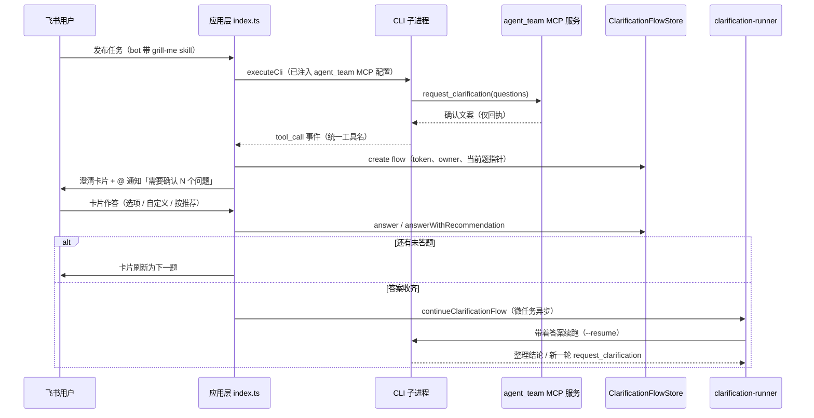

# 需求澄清

## 概述

需求澄清解决「CLI 拿着模糊需求直接开干」的问题：当方案存在会实质影响结果的歧义时，CLI 调用应用层工具 `request_clarification` 提交结构化问题，Agent-Team 截获这次调用，在飞书话题里渲染逐题作答的卡片；发起人答完后，答案被拼进 prompt，回到**同一话题、同一 CLI 会话**续跑整理。整个链路由 bot 的 `grill-me` skill 开关（见 [多 bot 注册](bot-registry.md)），涉及四块代码：

- `src/mcp/app-tools-server.ts` — stdio MCP 服务，把 `request_clarification`（连同其余四个应用层工具，见 [AI CLI 输出解析](ai-cli-probe.md)）注册给两家 CLI
- `src/cli/app-tools.ts` — 工具名归一与两家 CLI 的 MCP 注册参数
- `src/core/clarification.ts` — zod 数据模型、`ClarificationFlowStore` 流程存储、prompt 拼接
- `src/app/clarification-runner.ts` / `src/app/card-action-handler.ts` — 答案收齐后的续跑与卡片回调

## 完整时序

CLI 调工具、应用层收答案、答案回流续跑的完整闭环。

## 工具如何到达 CLI

`src/cli/app-tools.ts` 在两家适配器组装命令行时**无条件**注入 `agent_team` stdio MCP 服务（`buildArgs` 与 `buildResumeArgs` 都带）：Claude Code 吃 `--mcp-config` JSON；Codex 只能用多段 `-c mcp_servers.agent_team.*=` 覆盖。服务端 `src/mcp/app-tools-server.ts` 注册的工具描述明确要求「一次最多 5 个问题、每题 2–4 个选项、提交后不要自行补全答案」。

MCP 返回给 CLI 的只是一句确认文案——**真正的卡片渲染与答案回传发生在应用层**，依赖事件截获：

| 引擎 | 截获点 | 归一 |
|------|--------|------|
| Claude Code | `tool_use` 块，工具名为 `mcp__agent_team__request_clarification` | 归一成 `request_clarification` 再吐 `tool_call`（`src/cli/claude-adapter.ts`） |
| Codex | `item.started` + `mcp_tool_call` 且 `server === 'agent_team'` | 直接用统一名吐 `tool_call`（`src/cli/codex-adapter.ts`） |

`tool_call` 是 `CliEvent` 里专为应用层工具新增的事件类型（见 [AI CLI 输出解析](ai-cli-probe.md)）：`tool_start` 面向进度展示（带中文标签），`tool_call` 携带原始入参供应用层重建状态。`src/cli/runner.ts` 按 `toolUseId` 去重收集、失败的调用在 `tool_end` 移出成功集合（单独收进 `rejectedToolCalls`，供产品方案等流程带真实原因重试，见 [产品方案交付](product-spec.md)），最终随 `CliRunResult.toolCalls` 返回——所以 CLI 重试或提交多份时，`findClarificationRequest()` **从后往前**只认最后一份通过校验的请求。

## 数据模型（core/clarification.ts）

zod `ClarificationRequestSchema` 约束：`title`（≤80 字符，默认「需求澄清」）、`intro`（仅第一题展示）、`questions` 1–5 道；每题 `prompt` ≤300 字符、`options` 2–4 个、可选 `recommendedOptionId`，且选项 ID / 问题 ID 各自不能重复、推荐项必须指向当前问题的选项。

`ClarificationFlow` 在请求之外记录：`token`（32 位 hex，卡片按钮 value 携带）、`taskId` + `botId`（话题任务归属，来自 [会话与任务管理](session.md) 的话题定位）、`ownerOpenId` / `ownerUnionId`（发起人，权限校验用）、`originalMessageId`（续跑回到的原话题消息）、`currentIndex`（当前题指针）与 `answers[]`。

`ClarificationFlowStore` 的关键规则：

- **同任务单流程**：`create()` 会先删掉同 `taskId + botId` 的旧流程，重新提问即让旧卡片上的 token 失效
- **只收当前题**：`answer()` 校验 `questionId === questions[currentIndex].id`，旧卡片或乱序点击直接返回 `undefined`
- **按推荐作答**：`answerWithRecommendation()` 用 `source: 'agent'` 标记答案；推荐项缺失时回退第一个选项
- **unionId 优先**：`isClarificationOwner()` 优先比对 `unionId`（跨应用稳定身份），缺失时才退回 `openId`

## 卡片交互

三种卡片均由 `src/im/card.ts` 构建（样式细节见 [任务卡片系统](task-card.md)）：逐题问答卡（选项按钮 + 自定义答案表单 + 两个「交给 Agent 决定」按钮）、整理中过渡卡、已被新消息取代卡。

`src/app/card-action-handler.ts` 处理 `answer_clarification` 回调，校验顺序与提示：

| 校验 | toast |
|------|-------|
| flow 不存在 / bot 不符 / 缺 messageId | 这组澄清问题已经失效 |
| 操作者不是发起人 | 只有任务发起人可以回答 |
| `questionId` 对不上当前题 | 问题已经更新，请按当前卡片作答 |
| 自定义答案为空 / 选项失效 | 请先输入你的答案 / 这个选项已经失效 |
| 会话已关闭或失效 | 对应的 CLI 会话已经失效 |
| 会话仍在执行 | 当前会话仍在执行，请稍后重试 |

通过后先把 toast + 过渡卡片**同步返回**给飞书，`continueClarificationFlow` 放进 `queueMicrotask` 异步跑，避免拖住卡片回调。

## 续跑与多轮

`continueClarificationFlow` 复用普通任务的完整管线：回原话题发 running 卡片（仍带停止按钮）、每秒心跳 + `ThrottledCardUpdater` 节流、成功/取消/失败三分支收尾、`finally` 注销 `activeRuns` 并回落 idle。差异在于 prompt 是 `formatClarificationAnswers(flow)`——把每题「用户回答 / Agent 采用推荐方案」逐条列出，并指示「仍有实质歧义就再次调用 request_clarification，否则整理可验收结论」。

续跑结果里再次出现 `request_clarification` 时（仍要求 `grill-me` skill），会基于同一 `taskId` 创建新流程、把进度卡片刷成下一张问答卡，由此形成**多轮**问答。

## 话题新消息取代卡片

用户不点卡片、直接在话题里发新消息时（`src/index.ts`）：`findForTask(taskId, botId)` 命中未完成流程 → 旧卡片被更新为「已被新消息取代」样式并删除流程；新消息不另起任务，而是经 `formatClarificationMessage()` 拼成补充说明——带上此前已确认的答案、上一张卡片正问的问题和用户的新消息，请 CLI 优先理解新消息对需求的修正。该分支只对人类消息且非命令时生效。

## 变更指引

- **改问题结构**：同步 `ClarificationRequestSchema` 与 MCP 服务里 `server.registerTool` 的 `inputSchema`（同一 zod schema 引用），以及卡片渲染对 `options` 数量的假设
- **新增应用层工具**：在 `src/mcp/app-tools-server.ts` 注册、`src/cli/app-tools.ts` 命名，再在两家适配器各加 `tool_call` 截获分支——工具名必须归一到统一名，`src/probe-app-tool.ts`（`pnpm probe:tool <claude|codex>`）会验证两家返回一致且过校验
- **续跑入口**：`continueClarificationFlow` 自行管理会话状态与 `activeRuns`，改动收尾逻辑时注意它与 `src/index.ts` 主路径是两条并行的执行管线
- **答案丢失排查**：先看 flow 是否被「话题新消息」分支删除，再看 `questionId` 是否因新一轮提问而失配
