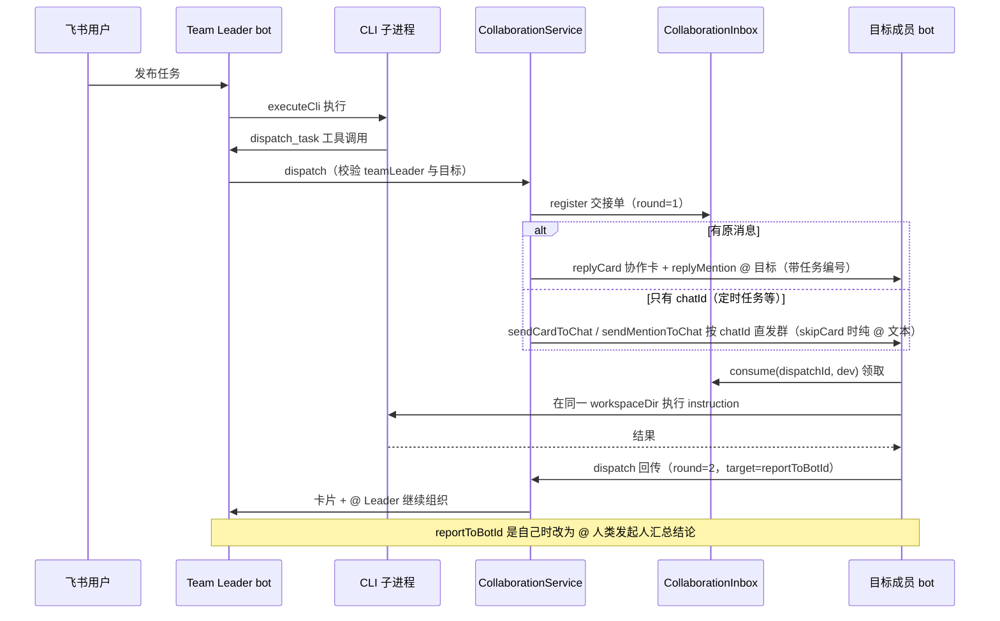

# 多 bot 协作

## 概述

bot 之间通过交接单（`CollaborationMessage`）传递任务：Team Leader（CEO 助理）在运行时调用 `dispatch_task` 工具把任务派给团队成员，成员完成后把结果交回 `reportToBotId` 继续组织后续工作，形成多轮「派发 → 执行 → 回传」的协作链。核心实现分布在：

- `src/core/collaboration.ts` — `CollaborationMessage` 交接单模型、`CollaborationInbox` 收件箱与 `DispatchTaskRequestSchema`
- `src/app/collaboration-service.ts` — `CollaborationService` 派发服务：登记 inbox → 发协作卡 → @ 目标 bot，三步全成才算派发完成
- `src/index.ts` — 工具调用的截获校验、领取与收尾路由（消息处理细节见 [消息处理流程](../workflows/message-flow.md)）
- `src/im/card.ts` — `buildCollaborationCard()` 协作通知卡片（见 [任务卡片系统](task-card.md)）

设计文档见 `docs/完整的内部交接单.md`。

> 历史注记：协作最早由 `bots.json` 的 `reviewBy` 字段自动触发「实现 → 审查 → 返工」闭环；现在派发统一收敛到 `dispatch_task` 工具，`reviewBy` 字段仍保留于配置校验（指向校验、不能指向自己），但运行时不再读取，审查等分工改由 Team Leader 在提示词层面组织。

## 交接单模型

每次 bot 间交接由三个标识共同刻画：

| 字段 | 说明 |
|------|------|
| `taskId` | 贯穿整项协作的任务编号；首轮派发用 `randomUUID()` 生成 |
| `dispatchId` | 只服务于**这一次投递**的 12 位十六进制取件码（`randomUUID()` 去连字符截前 12 位） |
| `round` / `maxRounds` | 当前是第几次交接与上限；用户发起任务不计入轮次 |

内容字段：`objective`（协作目标，≤200 字符）、`instruction`（完整执行要求，≤2_000）、可选 `expectedOutput`（期望产出，≤500）——三者构成 `buildCollaborationPrompt()` 拼出的接收方任务文本；`workspaceDir` 随单传递，接收方会把话题会话切到同一工作目录（`setWorkspaceDir`，见 [会话与任务管理](session.md)）；`reportToBotId` 指定结果交回给谁，`ownerOpenId` / `ownerUnionId` 记录最终归属的人类发起人。

## 派发服务（CollaborationService）

`dispatch()` 的三步全成语义，任一步失败都会撤销 inbox 登记并抛错（否则这条协作永远等不到目标 bot 回话）。投递目标有两种形态：

- **有原消息**（`replyToMessageId`）：回复到话题里——协作卡片 + 卡片下 @ 目标 bot 的通知，round=1 用「新的协作任务」话术，其余用「协作结果已经返回」
- **无原消息**（如定时任务触发、只有 `chatId`）：`sendCardToChat` / `sendMentionToChat` 按 chatId 直接发群，@ 挂在群里保证与卡片相邻；置 `skipCard: true` 时完全省掉卡片，把任务详情（objective / instruction / expectedOutput / 任务编号）全部塞进这条 @ 正文里

三步全成：1. `collaborationInbox.register(collaboration)` 登记 → 2. 发协作卡片（带 workspace 名、目标、要求、轮次）或直发文本 → 3. `replyMention` / `sendMentionToChat` @ 目标 bot，文本带任务编号。

派发前校验（`src/index.ts`）：只有 `teamLeaderId` 可以调用 `dispatch_task`（其他 bot 调用抛错）、目标必须在团队名单中且不能是自己、协作任务已到轮次上限时不能再派发。

## 收件箱与取件码

`CollaborationInbox` 是进程内的 `Map<dispatchId, CollaborationMessage>`，只做两件事：

- `register()`：派发方在发送飞书消息**之前**登记交接单
- `consume(dispatchId, toBotId)`：接收方领取时核对目标 bot，成功后**立即删除**——同一条派活消息不会重复执行，飞书重推也天然幂等

接收 bot 收到 `senderType` 为 `app`/`bot` 的富文本消息时，先确认消息真的 @ 了自己，再用正则 `任务编号：([a-f0-9]{12})` 从文本提取 `dispatchId` 去收件箱领取。提取不到时：@ 了当前 bot 的按「外部派活」继续走正常消息管线，没 @ 的直接忽略。领取之外还有第二层去重：`processedCollaborationTurns` 用 `taskId:round:toBotId` 三元组挡住同一轮的重复处理，且因为键里带 `round`，上一轮领取过不会挡住下一轮的新交接。

> 多台 bot 由同一进程启动（见 [架构总览](../architecture/overview.md)），所以它们共享同一个 `CollaborationInbox` 实例，无需跨进程存储。

## 协作时序

dispatch_task 派发、结果按 reportToBotId 回传直至收尾的完整链路。

## 完成后的路由分支

任务成功收尾时（`/compact` 除外），`src/index.ts` 按以下优先级路由：

1. **本次结果截获到 `dispatch_task`**（且通过 teamLeader / 目标 / 轮次校验）→ `CollaborationService.dispatch` 派发：非协作上下文用新 `taskId`、`maxRounds` 取发起方 `collaborationMaxRounds`；已在协作中则 `round + 1` 沿用同一 `taskId`，目标为 `collaboration.reportToBotId`
2. **本次是协作任务** → 按 `reportToBotId` 分流：接收方是自己（即最后一棒回到 Leader）→ @ 人类发起人「协作任务已经完成」；`round >= maxRounds` → @ 发起人说明已达上限请决定下一步；否则把「本 bot 的结果 + 继续组织后续工作」作为 instruction 交回 `reportToBotId`（接收方仍可用 dispatch_task 继续派发或直接向用户汇总结论）
3. **普通任务** → 不触发协作，直接 @ 发起人发结果通知

派发任何一步失败（找不到目标 bot、飞书未返回 message_id）都会回滚收件箱登记并回复「协作派发失败：原因」。协作任务完成后结果通知由回传分支接管；任务失败或被取消时不触发协作路由。另外 [产品方案交付](product-spec.md) 的确认卡也可以触发派发：带协作来源的方案被用户确认后，同样经 `CollaborationService` 交回 `reportToBotId`。

## 配置与校验

| 字段 | 校验（zod `BotSchema`） | 说明 |
|------|------------------------|------|
| `reviewBy` | 可选，bot id 格式 | 指向未启用的 bot 或指向自己都会在启动时报错退出；运行时已不读取（见历史注记） |
| `collaborationMaxRounds` | 整数 1–32，默认 16 | 该 bot 发起协作时允许的交接总次数上限 |

## 变更指引

- **改交接单字段**：`CollaborationMessage`、`docs/完整的内部交接单.md` 与飞书消息里的取件码格式（12 位 hex）需保持一致，接收方正则 `任务编号：([a-f0-9]{12})` 同步改
- **跨进程协作**：当前 Inbox 是进程内存，若未来拆成多进程部署，需要把 `register`/`consume` 换成共享存储，并保留「领取即删」语义
- **协作触发点**：路由只在成功分支且 `!isCompacting` 时执行，改动收尾逻辑时注意不要让失败/取消路径意外派发；dispatch 与 [产品方案交付](product-spec.md) 的提交互斥，同轮同时出现要抛错
