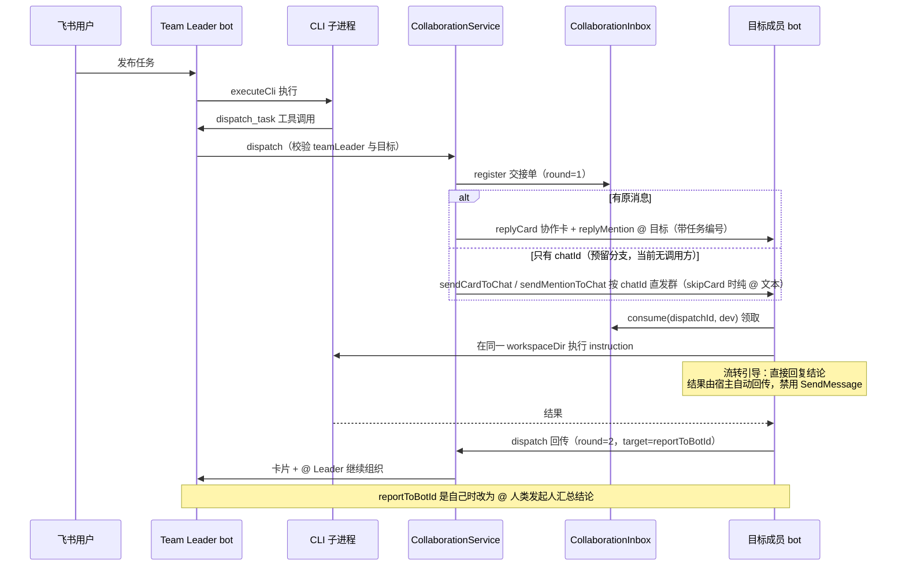
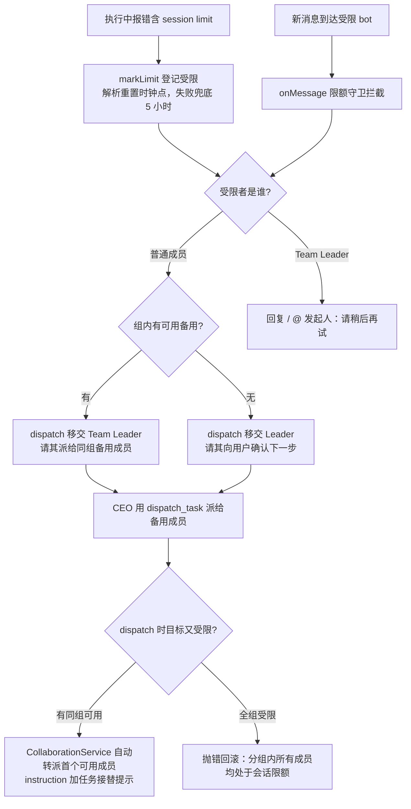

# 多 bot 协作

## 概述

bot 之间通过交接单（`CollaborationMessage`）传递任务：Team Leader（CEO 助理）在运行时调用 `dispatch_task` 工具把任务派给团队成员，成员完成后把结果交回 `reportToBotId` 继续组织后续工作，形成多轮「派发 → 执行 → 回传」的协作链。核心实现分布在：

- `src/core/collaboration.ts` — `CollaborationMessage` 交接单模型、`CollaborationInbox` 收件箱与 `DispatchTaskRequestSchema`
- `src/app/collaboration-service.ts` — `CollaborationService` 派发服务：登记 inbox → 发协作卡 → @ 目标 bot，三步全成才算派发完成
- `src/index.ts` — 工具调用的截获校验、领取与收尾路由（消息处理细节见 [消息处理流程](../workflows/message-flow.md)）
- `src/im/card.ts` — `buildCollaborationCard()` 协作通知卡片（见 [任务卡片系统](task-card.md)）

设计文档见 `docs/完整的内部交接单.md`。

> 历史注记：协作最早由 `bots.json` 的 `reviewBy` 字段自动触发「实现 → 审查 → 返工」闭环；现在派发统一收敛到 `dispatch_task` 工具，`reviewBy` 字段仍保留于配置校验（指向校验、不能指向自己），但运行时不再读取，审查等分工改由 Team Leader 在提示词层面组织。

## 交接单模型

每次 bot 间交接由三个标识共同刻画：

| 字段 | 说明 |
|------|------|
| `taskId` | 话题级任务编号，取 `topicTaskId(msg)`（`chatId` + 话题 ID 哈希成 24 位 hex，见 `src/core/topic-task.ts`）；同话题内所有协作共用，同一话题里发起的新协作会重新从第 1 轮开始 |
| `dispatchId` | 只服务于**这一次投递**的 12 位十六进制取件码（`randomUUID()` 去连字符截前 12 位） |
| `round` / `maxRounds` | 当前是第几次交接与上限；用户发起任务不计入轮次 |

内容字段：`objective`（协作目标，≤200 字符）、`instruction`（完整执行要求，≤2_000）、可选 `expectedOutput`（期望产出，≤500）——三者构成 `buildCollaborationPrompt()` 拼出的接收方任务文本，末尾还会追加一段固定的**流转引导**：要求接收方在当前回复中直接给出最终结论、结果由 Agent Team 宿主系统自动交回 `reportToBotId` 组织后续工作，并明确禁止自行调用 `SendMessage` 等内部工具（防止 CLI 试图绕过宿主回传链路）；`workspaceDir` 随单传递，接收方会把话题会话切到同一工作目录（`setWorkspaceDir`，见 [会话与任务管理](session.md)）；`reportToBotId` 指定结果交回给谁，`ownerOpenId` / `ownerUnionId` 记录最终归属的人类发起人。

## 派发服务（CollaborationService）

`dispatch()` 的三步全成语义，任一步失败都会撤销 inbox 登记并抛错（否则这条协作永远等不到目标 bot 回话）。投递目标有两种形态：

- **有原消息**（`replyToMessageId`）：回复到话题里——协作卡片 + 卡片下 @ 目标 bot 的通知，round=1 用「新的协作任务」话术，其余用「协作结果已经返回」；也可配合 `skipCard: true` + 自定义 `mentionText` 只发 @ 不发卡（见会话限额一节的移交用法）
- **无原消息**（只有 `chatId`）：`sendCardToChat` / `sendMentionToChat` 按 chatId 直接发群，@ 挂在群里保证与卡片相邻；置 `skipCard: true` 时完全省掉卡片，把任务详情（objective / instruction / expectedOutput / 任务编号）全部塞进这条 @ 正文里。这是预留的派发形态，当前仓库内没有调用方（定时任务已改为直接执行 CLI，见 [定时任务调度](scheduling.md)）

三步全成：1. `collaborationInbox.register(collaboration)` 登记 → 2. 发协作卡片（带 workspace 名、目标、要求、轮次）或直发文本 → 3. `replyMention` / `sendMentionToChat` @ 目标 bot，文本带任务编号。

派发前校验（`src/index.ts`）：只有 `teamLeaderId` 可以调用 `dispatch_task`（其他 bot 调用抛错）、目标必须在团队名单中且不能是自己、协作任务已到轮次上限时不能再派发。

## 收件箱与取件码

`CollaborationInbox` 是进程内的 `Map<dispatchId, CollaborationMessage>`，只做三件事：

- `register()`：派发方在发送飞书消息**之前**登记交接单
- `peek(dispatchId)`：只读查单不删除——共享 appId 长连接收到消息时先按文本里的任务编号查收件箱，把消息路由给 `toBotId` 对应的那个 bot（见 [多 bot 注册](bot-registry.md) 的共享长连接）
- `consume(dispatchId, toBotId)`：接收方领取时核对目标 bot，成功后**立即删除**——同一条派活消息不会重复执行，飞书重推也天然幂等

接收 bot 收到 `senderType` 为 `app`/`bot` 的富文本消息时，先确认消息真的 @ 了自己，再用正则 `任务编号：([a-f0-9]{12})` 从文本提取 `dispatchId` 去收件箱领取。领取不到时分三种情况（`src/index.ts` 的 `handleBotMessage`）：

- **发送方是内部团队 bot**（openId 命中本进程任何 `botRuntimes`）：直接忽略并记日志——内部 bot 之间的非派发消息严禁走普通消息管线，否则会互相触发形成死循环
- **外部 bot @ 了当前 bot**：按「外部派活」继续走正常消息管线，发起人以 `OWNER_OPEN_ID` 兜底
- **没 @ 当前 bot**：直接忽略

领取之外还有第二层去重：`processedCollaborationTurns` 以 `dispatchId` 为键（`collaborationTurnKey`），挡住飞书对同一条派活消息的重推；因为键是单次投递的取件码而不是「任务 + 轮次 + 接收方」三元组，同一话题里后续新协作从第 1 轮重新派发时不会被误拦截（源码注释记录了这个坑：taskId 是话题级标识，新协作会重新从第 1 轮开始）。

> 多台 bot 由同一进程启动（见 [架构总览](../architecture/overview.md)），所以它们共享同一个 `CollaborationInbox` 实例，无需跨进程存储。

## 协作时序

dispatch_task 派发、结果按 reportToBotId 回传直至收尾的完整链路。

## 完成后的路由分支

任务成功收尾时（`/compact` 除外），`src/index.ts` 按以下优先级路由：

1. **本次结果截获到 `dispatch_task`**（且通过 teamLeader / 目标 / 轮次校验）→ `CollaborationService.dispatch` 派发：非协作上下文 `round=1`、`maxRounds` 取发起方 `collaborationMaxRounds`，`taskId` 用当前话题的 `topicTaskId`；已在协作中则 `round + 1` 沿用同一 `taskId`，目标为 `collaboration.reportToBotId`
2. **本次是协作任务** → 按 `reportToBotId` 分流：接收方是自己（即最后一棒回到 Leader）→ @ 人类发起人「协作任务已经完成」；`round >= maxRounds` → @ 发起人说明已达上限请决定下一步；否则把「本 bot 的结果 + 继续组织后续工作」作为 instruction 交回 `reportToBotId`（接收方仍可用 dispatch_task 继续派发或直接向用户汇总结论）
3. **普通任务** → 不触发协作，直接 @ 发起人发结果通知

派发任何一步失败（找不到目标 bot、飞书未返回 message_id）都会回滚收件箱登记并回复「协作派发失败：原因」。协作任务完成后结果通知由回传分支接管；任务失败或被取消时不触发协作路由。另外 [产品方案交付](product-spec.md) 的确认卡也可以触发派发：带协作来源的方案被用户确认后，同样经 `CollaborationService` 交回 `reportToBotId`。

## 会话限额与同组代班

Claude Code 触发订阅会话限额（报错文本含 `session limit` / `resets`）时不会让任务直接失败，而是进入一条「受限登记 → 同组代班 / 移交 Leader」的保障链。三个协作组件：

- **`SessionLimitTracker`**（`src/core/session-limit-tracker.ts`，导出单例 `sessionLimitTracker`）：`isSessionLimitError()` 从错误文本识别限额、`extractResetTime()` 提取重置时间；`markLimit(botId, resetsText)` 会先用 `parseResetDurationMs()` 解析重置文案里的**纯时钟点**（12/24 小时制、可选时区后缀、支持跨夜推算，最后加 30 秒缓冲防止服务端尚未刷新），解析不出或时钟点已过去才兜底 **5 小时**；`isLimited()` 到期自动清除，`getLimitInfo()` 额外暴露 `resetsText` / `expireAt` 供接单守卫与派发兜底文案引用，状态只在进程内存
- **`group` 字段**（`BotSchema`，可选）：同组即互为代班候选。模板里 `developer` 与 `developer2` 同属 `"developer"` 组，`developer2` 的角色说明就是「同组开发限流时代班」
- **`TeamRegistry.getGroupMembers` / `getAvailableFallbackMembers`**：前者取同组全部成员（未配 group 的 bot 自身单独成组），后者在组内排除自己与**当前受限**的成员

限额在两个时机被拦截处理，派发时还有第三层兜底：

- **执行中触发**（`src/index.ts` 失败分支）：卡片置为 failed 并注明「任务已移交 Team Leader 接续派发」，随后把「成员限额 + 同组可用备用名单 + 原任务目标 + 工作区目录 + 请 CEO 调度」组装成 instruction，经 `CollaborationService.dispatch` 派给 Leader（`round` 在协作上下文中 +1，否则从 1 起），再 @ 发起人说明已移交；受限者就是 Leader 本身时不移交，卡片只注明已触发限额，另 @ 发起人「Team Leader 已达到会话额度限制…无法继续处理。请稍后重试。」
- **接单前触发**（`onMessage` 前置守卫，位于会话守卫之前）：受限 bot 收到新任务不执行，同样移交 Leader 调度；受限的是 Leader 本身则直接回复「请稍后再试」。两个方向的 dispatch 移交本身失败（Leader 运行时不在或派发抛错）时都不静默：回复 / @ 发起人「任务移交 Team Leader 失败，请重试」（接单前守卫回复原消息，执行中分支改为 @ 发起人并把卡片 detail 改写为「任务移交 Team Leader 失败，请重试」）
- **派发时兜底**（`CollaborationService.dispatch` 开头）：目标受限且有同组可用者时**自动转派**首个可用成员（instruction 前加「任务接替提示」前缀，完成后仍交回 CEO 助理）；整组均受限时抛「分组 "xxx" 内所有成员均处于会话限额状态…请直接向用户汇报」——这条错误会作为协作派发失败回滚收件箱并回复用户

代班只切**执行者**：交接单携带的 `workspaceDir` 与 `taskId` 不变，备用成员在同一个工作区现场接续。

## 配置与校验

| 字段 | 校验（zod `BotSchema`） | 说明 |
|------|------------------------|------|
| `reviewBy` | 可选，bot id 格式 | 指向未启用的 bot 或指向自己都会在启动时报错退出；运行时已不读取（见历史注记） |
| `collaborationMaxRounds` | 整数 1–32，默认 16 | 该 bot 发起协作时允许的交接总次数上限 |
| `group` | 可选，`/^[a-z0-9][a-z0-9_-]{0,31}$/` | 同组成员互为会话限额时的代班候选（见上一节）；字段含义详见 [多 bot 注册](bot-registry.md) |

## 变更指引

- **改交接单字段**：`CollaborationMessage`、`docs/完整的内部交接单.md` 与飞书消息里的取件码格式（12 位 hex）需保持一致，接收方正则 `任务编号：([a-f0-9]{12})` 同步改
- **改去重键**：`collaborationTurnKey` 现在只返回 `dispatchId`。不要轻易改回「任务 + 轮次 + 接收方」组合键——taskId 是话题级标识，同话题的新协作会重新从第 1 轮开始，组合键会误拦这些新派发
- **跨进程协作**：当前 Inbox 是进程内存，若未来拆成多进程部署，需要把 `register`/`consume` 换成共享存储，并保留「领取即删」语义
- **限额状态也是进程内存**：`SessionLimitTracker` 重启即清零，受限 bot 重启后立即可用；受限时长优先取自 Claude 报错文案里的重置时钟点（解析规则见上文），5 小时只是兜底。改动时注意与「执行中触发」「接单前守卫」「派发兜底」三个消费点保持一致
- **协作触发点**：路由只在成功分支且 `!isCompacting` 时执行，改动收尾逻辑时注意不要让失败/取消路径意外派发；dispatch 与 [产品方案交付](product-spec.md) 的提交互斥，同轮同时出现要抛错
