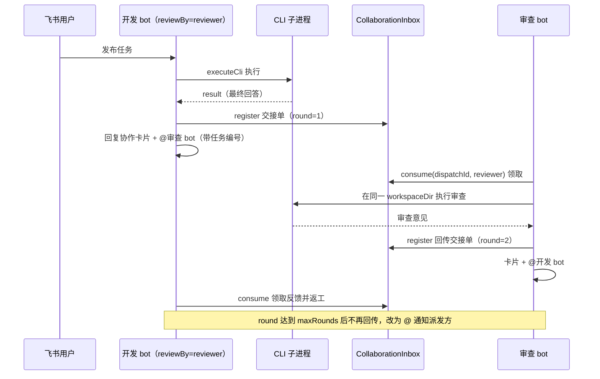

# 多 bot 协作

## 概述

开发 bot 完成任务后，可以自动把结果交给另一个 bot 独立审查，审查意见再回传给开发 bot 处理，形成「实现 → 审查 → 返工」的闭环。协作由 `config/bots.json` 的 `reviewBy` 字段开启（见 [多 bot 注册](bot-registry.md)），核心实现分布在：

- `src/core/collaboration.ts` — `CollaborationMessage` 交接单模型与 `CollaborationInbox` 收件箱
- `src/index.ts` — `sendCollaborationMessage()` 派发与 `onMessage` 中的领取、路由分支（消息处理细节见 [消息处理流程](../workflows/message-flow.md)）
- `src/im/card.ts` — `buildCollaborationCard()` 协作通知卡片（见 [任务卡片系统](task-card.md)）

设计文档见 `docs/完整的内部交接单.md`。

## 交接单模型

每次 bot 间交接由三个标识共同刻画：

| 字段 | 说明 |
|------|------|
| `taskId` | 贯穿整项协作的任务编号；`reviewBy` 触发首轮时用 `randomUUID()` 生成 |
| `dispatchId` | 只服务于**这一次投递**的 12 位十六进制取件码（`randomUUID()` 去连字符截前 12 位） |
| `round` / `maxRounds` | 当前是第几次交接与上限；用户发起任务不计入轮次 |

`workspaceDir` 与 `prompt` 随交接单传递：接收方会把话题会话切到同一工作目录（`setWorkspaceDir`，见 [会话与任务管理](session.md)），并以交接单的 `prompt` 作为任务文本（优先级高于普通消息解析）。

## 收件箱与取件码

`CollaborationInbox` 是进程内的 `Map<dispatchId, CollaborationMessage>`，只做两件事：

- `register()`：派发方在发送飞书消息**之前**登记交接单
- `consume(dispatchId, toBotId)`：接收方领取时核对目标 bot，成功后**立即删除**——同一条派活消息不会重复执行，飞书重推也天然幂等

飞书消息本身只承载取件码：接收 bot 收到 `senderType` 为 `app`/`bot` 的富文本消息时，先确认消息真的 @ 了自己，再用正则 `任务编号：([a-f0-9]{12})` 从文本提取 `dispatchId` 去收件箱领取。提取不到（非目标 bot、伪造消息）直接忽略。领取之外还有第二层去重：`processedCollaborationTurns` 用 `taskId:round:toBotId` 三元组挡住同一轮的重复处理，且因为键里带 `round`，上一轮领取过不会挡住下一轮的新交接。

> 多台 bot 由同一进程启动（见 [架构总览](../architecture/overview.md)），所以它们共享同一个 `CollaborationInbox` 实例，无需跨进程存储。

## 协作时序

reviewBy 触发首轮审查、结果按轮次往返直至上限的完整链路。

## 完成后的路由三分支

任务成功收尾时（`/compact` 除外），`src/index.ts` 按以下优先级路由：

1. **本次是协作任务且 `round < maxRounds`** → 结果带着 `round + 1` 交回 `fromBotId`，作为对方的下一项任务（返工/复审）
2. **普通任务完成且 bot 配置了 `reviewBy`** → 发起第 1 轮独立审查，`taskId` 新生成、`maxRounds` 取 `collaborationMaxRounds`，审查 prompt 固定为「独立检查刚完成的实现 + 原始任务 + 没有问题时说明检查通过」
3. **协作已到轮次上限** → 流程结束，把最终结果 @ 回派发方（「本轮协作已完成」）

派发任何一步失败（找不到目标 bot、飞书未返回 message_id）都会回滚收件箱登记并回复「协作派发失败：原因」。协作任务完成后**不再** @ 人类发起人（结果通知由回传分支接管）；任务失败或被取消时不触发协作路由。

## 配置与校验

| 字段 | 校验（zod `BotSchema`） | 说明 |
|------|------------------------|------|
| `reviewBy` | 可选，bot id 格式 | 指向未启用的 bot 或指向自己都会在启动时报错退出 |
| `collaborationMaxRounds` | 整数 1–32，默认 16 | 协作允许的交接总次数：2 = 发起审查 + 回传反馈各一次，再大则可继续「返工 + 复审」往返 |

## 变更指引

- **改交接单字段**：`CollaborationMessage`、`docs/完整的内部交接单.md` 与飞书消息里的取件码格式（12 位 hex）需保持一致，接收方正则 `任务编号：([a-f0-9]{12})` 同步改
- **跨进程协作**：当前 Inbox 是进程内存，若未来拆成多进程部署，需要把 `register`/`consume` 换成共享存储，并保留「领取即删」语义
- **协作触发点**：路由只在成功分支且 `!isCompacting` 时执行，改动收尾逻辑时注意不要让失败/取消路径意外派发
