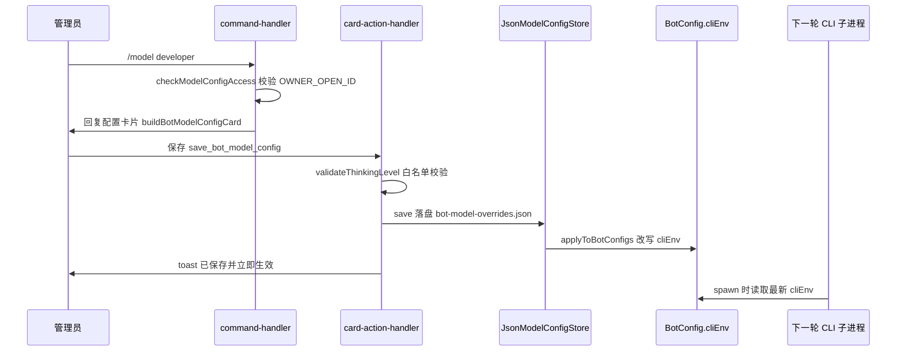

# 角色模型动态配置

## 概述

[多 bot 注册](bot-registry.md) 的 `cliEnv` 解决的是**启动期**的静态模型后端覆盖：改配置要动 `bots.json` + `.env` 并重启。本域在其上补齐**运行期**能力——管理员在飞书卡片上按「角色 × 引擎（Claude Code / Codex）」直接改 Base URL、API Key、模型与思考/推理等级，保存即落盘并改写该 bot 的 `config.cliEnv`，**下一轮任务即刻生效，无需重启进程**。

核心文件：

| 文件 | 职责 |
|------|------|
| `src/core/model-config-store.ts` | `JsonModelConfigStore`（持久化 + 热重载 + env 注入）、`validateThinkingLevel`、`checkModelConfigAccess`、`maskApiKey` |
| `src/core/model-fetcher.ts` | `fetchAvailableModels`：探测端点 `/models` 返回的可用模型列表 |
| `src/app/command-handler.ts` | `/model` 命令分支（弹出配置卡片） |
| `src/app/card-action-handler.ts` | 配置卡片的七个回调动作 |
| `src/im/card.ts` | `buildBotModelConfigCard` / `buildClosedBotModelConfigCard` 卡片构建 |

入口在 `src/index.ts` 启动时创建 store、`load(botConfigs)` 后挂到 `AppRuntime.modelConfigStore`，与 [任务卡片系统](task-card.md) 共用同一套卡片回调管线。

## 入口与鉴权

两个入口都会先过 `checkModelConfigAccess(operatorOpenId)`：

- **命令**：`/model [角色ID]`（`/config` 同义，`src/core/command-parser.ts` 的 `MODEL_RE`）。目标角色取「参数指定的角色 → 当前 bot → 第一个成员」，默认选中该角色的默认引擎（`src/app/command-handler.ts`）
- **卡片**：`/team` 团队卡片底部的「⚙️ 角色模型与端点配置」按钮，callback `open_bot_model_config`（进入后默认选第一个成员）

鉴权规则（`checkModelConfigAccess`）：操作者 openId 必须与 `.env` 的 `OWNER_OPEN_ID` **精确匹配**；未配置 `OWNER_OPEN_ID` 时直接拒绝并提示先配置（宁禁勿开放）。七个卡片动作每个都重复校验，不只挡入口。

## 三级来源合并

`getEffectiveConfig(bot, cliId)` 逐字段（baseUrl / apiKey / model / thinkingLevel）按优先级取值，并标注每个字段的来源徽章：

```
卡片覆盖（bot-model-overrides.json，override）
  → bot 的 cliEnv 已解析值（启动时缓存的 originalCliEnvs，env）
    → 进程级 process.env（env）
      → CLI 用户级本地配置（default，不经过本项目）
```

Claude 查 `ANTHROPIC_BASE_URL` / `ANTHROPIC_AUTH_TOKEN`·`ANTHROPIC_API_KEY` / `ANTHROPIC_MODEL` / `MAX_THINKING_TOKENS`；Codex 查 `OPENAI_BASE_URL` / `OPENAI_API_KEY` / `OPENAI_MODEL`·`CODEX_MODEL` / `CODEX_REASONING_EFFORT`·`OPENAI_REASONING_EFFORT`。卡片上每项当前值都会带 `(角色独立覆盖)` 或 `(全局默认 .env)` 徽章，密钥只显示 `maskApiKey` 掩码（前 3 后 4），永不明文回显。

与 `cliEnv` 的关系是**改写而非并存**：`applyToBotConfigs` 直接把覆盖值合入 `BotConfig.cliEnv`（见 [多 bot 注册](bot-registry.md) 的注入点覆盖表——所有执行路径读的都是同一个 config 对象，因此运行期改写对主任务、续跑、定时任务全部生效）。首次 `load` 时缓存 `originalCliEnvs`，没有覆盖或 reset 后恢复这份启动基线。

## 持久化与热重载（JsonModelConfigStore）

`data/bot-model-overrides.json`（`data/` 整目录已 gitignore），结构为 `{ [botId]: { claude?: 覆盖, codex?: 覆盖 } }`：

- **zod 严格校验**：结构非法时**保留最后一次有效内存配置**并告警，绝不回退到意外状态
- **旧格式迁移**：顶层直接挂 `baseUrl` 等字段的旧数据会迁到该 bot 默认引擎的键下
- **热重载**：`watchFile` 每秒轮询 mtime/size，外部改动自动重读并重新应用——与定时任务的 schedules.json 热更新同一思路（见 [定时任务调度](scheduling.md)）
- **原子写 + 串行队列**：先写 `.tmp` 临时文件再 `rename`，`writeQueue` Promise 链保证并发保存不交错（与 [会话与任务管理](session.md) 的 JsonSessionStore 同款模式）

保存语义：字段留空 = 取消该项覆盖；API Key 留空 = 沿用已存密钥；四项全空时整条删除。

## 环境变量注入映射

`applyToBotConfigs` 按引擎隔离注入，避免污染另一家端点：

| 覆盖项 | Claude（只写 `ANTHROPIC_*`） | Codex（只写 `OPENAI_*` / `CODEX_*`） |
|--------|------------------------------|--------------------------------------|
| baseUrl | `ANTHROPIC_BASE_URL` | `OPENAI_BASE_URL` |
| apiKey | `ANTHROPIC_AUTH_TOKEN` + `ANTHROPIC_API_KEY` | `OPENAI_API_KEY` |
| model | `ANTHROPIC_MODEL` + 8 个 `ANTHROPIC_DEFAULT_*(_NAME)` 档位键 | `OPENAI_MODEL` + `CODEX_MODEL` |
| thinkingLevel | `MAX_THINKING_TOKENS` | `CODEX_REASONING_EFFORT` + `OPENAI_REASONING_EFFORT` |

思考/推理等级有白名单校验（`validateThinkingLevel`，保存与热重载双处执行）：

- **Codex**：仅 `low` / `medium` / `high`（`src/cli/types.ts` 的 `CODEX_REASONING_EFFORTS`）
- **Claude**：预设 `low` / `medium` / `high` / `max` / `ultrathink` / `off` / `none` / `0`，或正整数 Token 预算直传；预设映射为 `low→4000`、`medium→8000`、`high→16000`、`max`/`ultrathink→31999`、`off`/`none`/`0→0`

## 端点探测（probe_bot_models）

配置卡片表单里的「🔍 检测端点并获取可用模型」按钮：优先用表单里**未保存的草稿** Base URL / API Key（未填则回退已保存或全局配置）调 `fetchAvailableModels`：

- Claude 先试 `<base>/v1/models` 再试 `<base>/models`，Codex 顺序相反；带 `Authorization: Bearer`，Claude 额外带 `x-api-key` + `anthropic-version: 2023-06-01`
- 默认 8 秒超时；成功后模型按 CLI 特征排序（Claude 优先 claude/glm 系、Codex 优先 gpt-5/o3 系），渲染成最多 100 项的下拉快速选择
- **草稿保留与密钥安全**：无论成败，Base URL 草稿都保留在重发的卡片里；表单里未保存的密钥因安全不回显，状态提示会明确要求「重新输入密钥后再保存」，避免保存时把空密钥当成取消覆盖

## 卡片动作族与关闭面板

`src/app/card-action-handler.ts` 处理七个动作，全部先过管理员鉴权：

| 动作 | 行为 |
|------|------|
| `open_bot_model_config` | 打开/重新打开配置卡片 |
| `switch_bot_model_config` | 切换目标角色（卡片内每行 3 个角色按钮） |
| `switch_bot_cli_tab` | 切换 Claude Code / Codex 引擎页签 |
| `probe_bot_models` | 表单提交，探测可用模型（见上节） |
| `save_bot_model_config` | 表单提交，校验思考等级后保存，toast「已保存并立即生效」 |
| `reset_bot_model_config` | 删除该角色该引擎的覆盖，恢复启动基线 |
| `close_bot_model_config` | 「✖ 关闭」按钮：把冗长表单卡片替换为轻量收起卡片（`buildClosedBotModelConfigCard`，灰色头部 +「⚙️ 重新打开配置」按钮），提示也可用 `/model` 重开；**只收起面板，已保存的覆盖不受影响** |

`/model` 配置闭环的时序：



`/model` 打开卡片、保存、落盘到改写 `cliEnv`、下一轮子进程生效的完整链路。

## 变更指引

- **新增覆盖字段**：同时改 `SingleCliOverrideSchema`、`getEffectiveConfig`（来源合并）与 `applyToBotConfigs`（env 注入映射）三处，缺一处会导致卡片显示与实际注入不一致
- **排查「改了没生效」**：先看 `data/bot-model-overrides.json` 是否真的落盘（坏结构只会告警并保留旧内存值），再看执行路径是否读了被改写的 config 对象；改动只对**之后**启动的子进程生效，运行中的任务不受影响
- **密钥安全**：覆盖文件里存的是明文密钥（`data/` 已 gitignore），卡片与日志只允许出现 `maskApiKey` 掩码；新增展示位时沿用掩码
- **鉴权扩展**：目前只有 `OWNER_OPEN_ID` 单管理员；放宽到多管理员时改 `checkModelConfigAccess` 一处即可，七个动作都会跟着走
