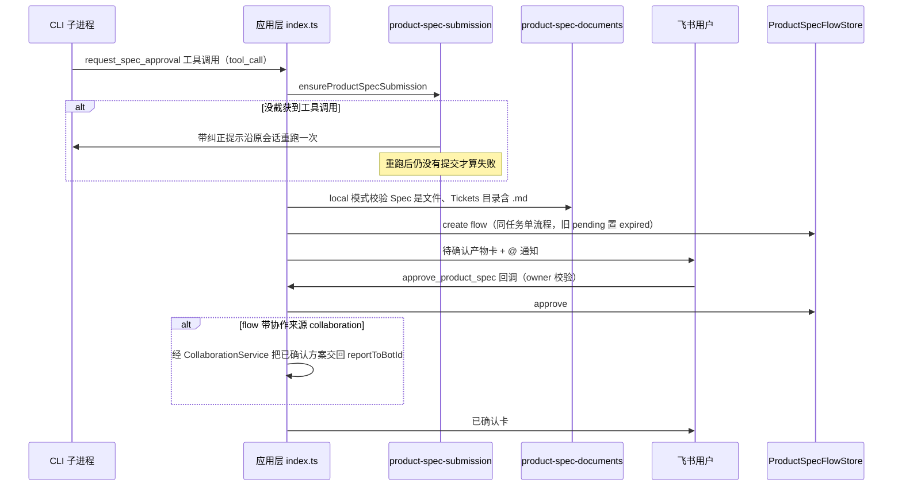

# 产品方案交付

## 概述

产品类 bot（配置 `to-spec` / `lark-doc` skill，见 [多 bot 注册](bot-registry.md)）产出方案后，必须调用应用层工具 `request_spec_approval` 提交**唯一**的待确认产物，应用层截获后展示确认卡，用户确认前不进入实现。涉及代码：

- `src/core/product-spec.ts` — `ProductSpecRequestSchema`（交付模式二选一）、`ProductSpecFlow` 与 `ProductSpecFlowStore`
- `src/core/product-spec-store.ts` — JSON 持久化（`data/product-spec-flows.json`）
- `src/app/product-spec-submission.ts` — 「没调工具就重跑一次」的兜底
- `src/app/product-spec-documents.ts` — local 模式的落盘校验
- `src/app/product-comment-runner.ts` — 云文档评论区的修订执行
- `src/app/card-action-handler.ts` — `approve_product_spec` 确认回调

## 交付模式

`ProductSpecRequestSchema` 是按 `deliveryMode` 判别的 union，基础字段 `title`（≤80）与 `summary`（≤500）：

| 模式 | 必填字段 | 校验 |
|------|----------|------|
| `local` | `specPath` + `ticketsPath` | 必须是工作区内的**相对**路径：拒绝绝对路径与 `..` 穿越（防止 CLI 提交工作区外的文件） |
| `lark-doc` | `documentUrl` | 必须是飞书 Docx 链接（URL path 含 `/docx/`，评论区流程暂不支持 wiki 形态） |

默认模式由 `bots.json` 顶层 `defaultProductDeliveryMode` 决定（默认 `lark-doc`），`buildBotPrompt` 会给配置了 `to-spec` / `to-tickets` / `lark-doc` skill 的 bot 注入交付规则：用户本次明确指定时覆盖默认值、不要为选格式单独发起澄清、方案完成后必须实际调用工具而不能只在回复里罗列字段。

## 提交与确认时序

从方案产出到用户确认、必要时交回团队编排的完整链路。

几个关键点：

- **落盘校验只做 local**：`assertProductSpecDocuments` 要求 Spec 是文件、Tickets 是目录且至少含一个 `.md` 的独立 ticket；CLI 声称写完但文件缺失时不允许进入确认环节。lark-doc 的产物在飞书侧，本地无文件可查
- **确认后不自动派发**：只有 flow 带 `collaboration` 来源（方案是在协作任务中产出的）时，确认回调才经 [协作派发](collaboration.md) 把已确认方案交回 `reportToBotId`，指示「需要开发者实现时用 dispatch_task 交给 developer」；普通任务确认即结束
- **owner 校验**：`isProductSpecOwner` 优先比对 `unionId`（跨应用稳定身份），缺失才退回 `openId`；只有任务发起人可以确认
- **同任务单流程**：`create()` 先把同 `taskId + botId` 的 pending 流程置 `expired`，重新提交即让旧卡片上的 token 失效

## 云文档评论区修订流

配置 `lark-drive` skill 的 bot 会在启动时 `subscribeToDocumentComments()`（飞书 `drive.v1.user.subscription`，事件 `drive.notice.comment_add_v1`），用户在**待确认**的飞书方案文档评论区 @ 该 bot 时触发修订：

1. `src/index.ts` 的 `scheduleDocumentComment` 只处理 @ 本 bot 且 `findPendingByDocument` 命中待确认文档的评论；其余忽略
2. 重复事件（飞书可能重推）按 `eventId` 去重，去重集合只记最近 1_000 条（Set 按插入序淘汰最旧）
3. 同会话的评论排队执行（`documentCommentQueues`），避免两个 CLI 并发改同一份文档；排队前先给评论加 Typing 表情当「处理中」反馈，结束后移除
4. `runProductDocumentComment` 在原会话（须 idle 且有 `cliSessionId`）里跑一轮 CLI：prompt 指示用 lark-drive 读评论、lark-doc 改原文档，**不产生新确认卡**、不调评论解决接口（是否解决由用户复查决定），最终回答回写到原评论（`drive.v1.fileCommentReply.create`，上限 1_000 字符）

## 与其他流程的关系

- 提交前必须完成 [需求澄清](clarification.md)：MCP 工具描述要求「提交前必须完成需求澄清，确保这份方案已经可以确认」
- 产品方案与 `dispatch_task` 互斥：同一次结果里两者同时出现会抛「不能同时提交产品方案和派发团队任务」
- 定时任务（见 [定时任务调度](scheduling.md)）里产品类 bot 的交付方式沿用 `defaultProductDeliveryMode`

## 变更指引

- **改交付模式**：`ProductSpecRequestSchema` 的 union 分支、`src/mcp/app-tools-server.ts` 工具描述、`buildBotPrompt` 的交付规则三处联动
- **新增文档类型**：评论区流程目前只认 Docx；支持 wiki 等形态要改 `LarkDocumentUrlSchema` 与评论 API 的 file_type 处理
- **评论区并发**：排队键是 `flow.sessionId`，改会话模型时注意评论队列与 `activeRuns` 的一致性
