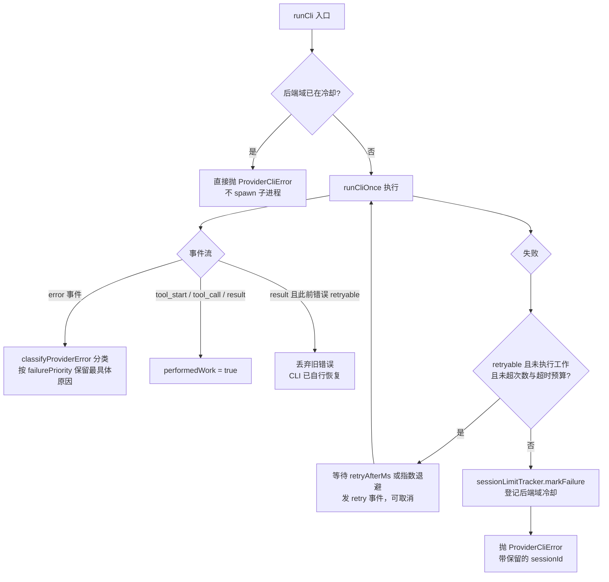

# 后端故障恢复

## 概述

Claude Code 与 Codex 只是**执行引擎**，同一引擎可以连接不同厂家的模型后端（本机登录、`ANTHROPIC_BASE_URL` / `OPENAI_BASE_URL` 直连、CC Switch 等）。系统不再把 Claude 的 `session limit · resets` 文案当作所有厂家的统一协议，而是按**实际错误内容 + 后端配置**做错误分类与恢复决策。设计文档见 `docs/模型后端故障恢复.md`，实现分两块：

- `src/core/provider-error.ts` — 七类错误模型、结构化字段提取、内置识别规则与扩展策略加载、重试提示解析
- `src/core/session-limit-tracker.ts` — 冷却登记与查询（`SessionLimitTracker`，按后端域隔离；文件名沿用历史「session limit」，语义已是通用后端冷却）

恢复链路贯穿三处：`src/cli/runner.ts` 的自动重试与冷却登记、`src/index.ts` 失败分支的移交代班、`src/app/collaboration-service.ts` 派发时的兜底转派（后两者见 [多 bot 协作](collaboration.md) 的后端故障一节）。

## 错误类别与默认处理

`ProviderFailureTypeSchema`（zod）定义七类错误，`classifyProviderError()` 产出 `ProviderFailure`（type / scope / message / retryable / cooldownMs / 可选 status·code·retryAfterMs·resetAt）：

| 类型 | 判定信号（内置规则节选） | 默认处理 |
|------|--------------------------|----------|
| `rate_limit` 短时限流 | HTTP 429、`rate_limit` / `too many requests` / 限流 / 并发超限 | **retryable**：未执行工作时最多自动重试 2 次；失败后默认冷却 60 秒 |
| `quota_exhausted` 额度耗尽 | `insufficient_quota` / `quota exceeded` / session·usage·weekly·monthly·daily limit / 额度配额用量不足耗尽 | 不自动重跑；默认冷却 5 分钟 |
| `billing` 余额计费 | HTTP 402、`insufficient_balance` / 余额不足 / 欠费 | 不自动重跑；默认冷却 60 秒 |
| `authentication` 认证 | HTTP 401、`invalid_api_key` / unauthorized | 不自动重跑；默认冷却 60 秒 |
| `configuration` 模型权限 | HTTP 403、`model_not_found` / permission denied | 不自动重跑；scope 默认**只限该模型**，冷却 60 秒 |
| `service_unavailable` 服务不可用 | HTTP 500/502/503/504、`overloaded` | **retryable**；默认冷却 30 秒 |
| `unknown` 未识别 | 以上都不命中 | 保留原始错误，不重试、**不登记冷却** |

额度/计费类在通用 429 之前判定，避免把不能短时恢复的额度耗尽误当成可立即重试的限流。冷却结束只代表允许重新尝试，不保证厂家额度已恢复；所有冷却都是进程内状态，重启清除。

## 识别优先级

1. **结构化字段优先**：`extractProviderErrorDetails()` 只遍历错误/响应包装层（`error` / `errors` / `response` / `details`，深度 5 层，支持字符串内嵌 JSON 与 `{...}` 前缀截取），提取 CLI 实际暴露的 `code` / `status` / `retry_after_ms` / `retry_after`（含 headers 的 `Retry-After`，支持秒数与 HTTP 日期）/ `reset_at`（Unix 秒、毫秒或日期字符串）；不扫描工具输入和任意用户内容，CLI 隐藏的 HTTP 信息不会被虚构。事件类型名（`error` / `turn.failed` / `result`）不会覆盖内部厂家错误码
2. **自定义规则**（见下节）优先于内置识别，按数组顺序取第一条全条件匹配
3. **明确的厂家错误码优先于文案与 HTTP 状态**；具体类别（额度/计费/认证/配置）优先于通用类别（限流/服务不可用）——CLI 收尾再包一层通用 429 不会覆盖更具体的余额或额度原因
4. 拿不到结构化信息再匹配**中英文文案**；状态码可从 `HTTP 500` / `API Error: 429` 等文本形态补出

## 扩展规则（config/provider-errors.json）

默认读取 `config/provider-errors.json`（仓库自带空规则模板），可用 `PROVIDER_ERROR_CONFIG` 换路径；修改后重启生效，规则与正则在加载时校验（非法正则、缺条件直接抛错）。冷却默认值（`maxRetries` / `baseDelayMs` / `maxRetryDelayMs` / 各类别 cooldown）也在此文件调整：

```json
{
  "rules": [
    {
      "endpointPattern": "vendor\\.example",
      "codePattern": "^VENDOR_QUOTA_EMPTY$",
      "type": "quota_exhausted",
      "scope": "account",
      "cooldownMs": 600000
    }
  ]
}
```

- 同一规则的 `endpointPattern`（匹配实际后端端点）/ `messagePattern` / `codePattern` / `status` 条件**必须全部满足**，且至少设置文案、错误码或状态中的一个
- `scope` 可选 `account`（默认）/ `model`；`type: "unknown"` 可用于排除某类误判
- 服务端提供的有效重试时间优先于本地冷却配置；超过 `maxRetryDelayMs` 时**不截短服务端时间强行重试**，而是记录冷却交给失败/团队交接流程

## 冷却作用域与共享后端

`SessionLimitTracker.markFailure()` 按 `backendScopeKey()`（引擎 + 端点 + 凭证的 SHA-256 哈希）登记，凭证不外泄：

- **账号级**（默认）：同一后端账号的多个 bot 共享冷却——换 bot 但复用同一 `OPENAI_API_KEY` 仍会被拦；模型级故障（如 `configuration`）只影响对应模型键
- **无显式凭证的 bot** 按引擎的本机登录归为同一账号（Claude 按 `CLAUDE_CONFIG_DIR`、Codex 按 `CODEX_HOME` 区分）
- **`AGENT_TEAM_QUOTA_GROUP`**：CLI 内部 profile、代理网关背后的共享额度无法仅凭环境变量推断，把该键加进 bot 的 `cliEnv` 映射（值放 `.env`，可跨端点跨引擎取同一名）即可显式合并账号级冷却
- 备用候选查询（`TeamRegistry.getAvailableFallbackMembers`）会排除仍处于冷却中的共享后端，避免「只换 bot 却继续用同一受限账号」；运行中更换端点、凭证或模型会实时按新配置查询可用性（`getAvailability` 每次读该 bot 当前 `cliEnv`）

## runner 自动重试边界

`runCli()` 是所有执行入口共用的策略点（主任务经 `executeCli`、澄清/审批/方案续跑、定时任务直跑全部经过它）：



runCli 的分类、重试与冷却决策链。

- **自动重试只在「未执行工作」时进行**：一旦观察到 `tool_start` / `tool_call` / `result`（`performedWork`），即使错误 retryable 也不再重跑整轮，避免重复写文件、发消息或执行命令；失败中已获取的 CLI 会话 ID 随 `ProviderCliError` 保留，主消息流程会持久化该 ID 供续跑
- **共享同一执行超时预算**：重试等待时间计入总 deadline（默认 2 小时，可用 `*_TIMEOUT_MS` 覆盖），等待支持 AbortSignal 取消；取消不登记冷却
- **`retry` 事件**进入统一 `CliEvent` 协议（attempt / delayMs / reason），`TaskProgressTracker` 把它折成卡片当前步骤（「短时限流，N 秒后进行第 M 次重试」）
- **重试延迟**优先取服务端提示（`retry_after_ms` / `Retry-After` / `reset_at` 差值 / 文本里的 `retry in 2 seconds`、`30秒后重试`、旧版 Claude 带时区时钟点），否则 `baseDelayMs × 2^attempt` 指数退避；超过 `maxRetryDelayMs` 或赶不上 deadline 就不再重试
- **冷却时长** = 服务端有效提示，否则规则 `cooldownMs`，否则类别默认值（下限 1 秒；`unknown` 为 0 不登记）
- **原生 `/compact` 有独立协议**，不经 `runCli`，只在主消息失败处理里复用错误分类补记冷却，不自动重试

## 与团队代班的衔接

冷却登记后的三个消费点（完整链路见 [多 bot 协作](collaboration.md) 的后端故障一节）：

1. **执行中触发**（`src/index.ts` 失败分支）：`ProviderCliError` 直接取 `failure`，普通错误用 `classifyProviderError()` 兜底分类；非 `unknown` 时持久化会话 ID、卡片标注故障原因与剩余冷却并移交 Team Leader，全组不可用时请 Leader 直接向用户确认
2. **接单前守卫**（`onMessage` 前置分支）：冷却中的 bot 收到新任务不执行，同样移交 Leader 调度
3. **派发时兜底**（`CollaborationService.dispatch`）：目标处于冷却时自动转派同组首个可用成员（排除共享同一受限后端的候选），整组不可用则抛错回滚

`getLimitInfo()` 返回的 `reason`（类别中文名）/ `guidance`（处理建议）/ `resetsText`（剩余秒数，明确「不保证厂家额度已恢复」）直接进入上述交接工单与用户文案。

## 变更指引

- **加内置规则**：优先补 `builtInRules` 的正则与 statuses，注意具体类别必须在 `rate_limit` / `service_unavailable` 之前或用 `specific()` 提升优先级；配套用例进 `tests/provider-error.test.ts`（多厂家文案、包装层提取、规则优先级都有现成范式）
- **改重试/冷却策略**：同步检查 `tests/cli-recovery.test.ts` 的九个场景（重试次数、工作边界、长窗口不截短、取消、停止型工具、CLI 自行恢复等），fixture 用真实子进程输出可控事件，改 `runCli` 行为时这些测试是最快反馈
- **改冷却作用域**：`backendScopeKey` 的键结构变化会让存量冷却失效（进程内状态，重启即清，影响有限），但要保持 `AGENT_TEAM_QUOTA_GROUP` 合并语义与 `getAvailableFallbackMembers` 的排除逻辑一致
- **两份文档**：`docs/模型后端故障恢复.md` 是面向使用者的设计说明（含错误类别表与配置示例），改行为时同步更新

## 源文件索引

| 文件 | 职责 |
|------|------|
| `src/core/provider-error.ts` | 七类错误模型、结构化提取、内置规则、策略加载（`PROVIDER_ERROR_CONFIG`）、重试提示解析、类别文案 |
| `src/core/session-limit-tracker.ts` | `SessionLimitTracker` 冷却登记/查询/清除、`backendScopeKey` / `backendEndpoint` 后端域哈希 |
| `src/cli/runner.ts` | `runCli` 重试循环、`ProviderCliError`、`performedWork` 边界、失败登记冷却 |
| `src/cli/claude-adapter.ts` / `codex-adapter.ts` | 错误事件附 `extractProviderErrorDetails` 的结构化 `details` |
| `config/provider-errors.json` | 扩展规则与冷却默认值（默认空规则） |
| `tests/provider-error.test.ts` / `tests/cli-recovery.test.ts` | 分类与作用域回归、runner 重试边界回归 |
| `docs/模型后端故障恢复.md` | 设计文档（错误类别、配置示例、作用域说明） |
