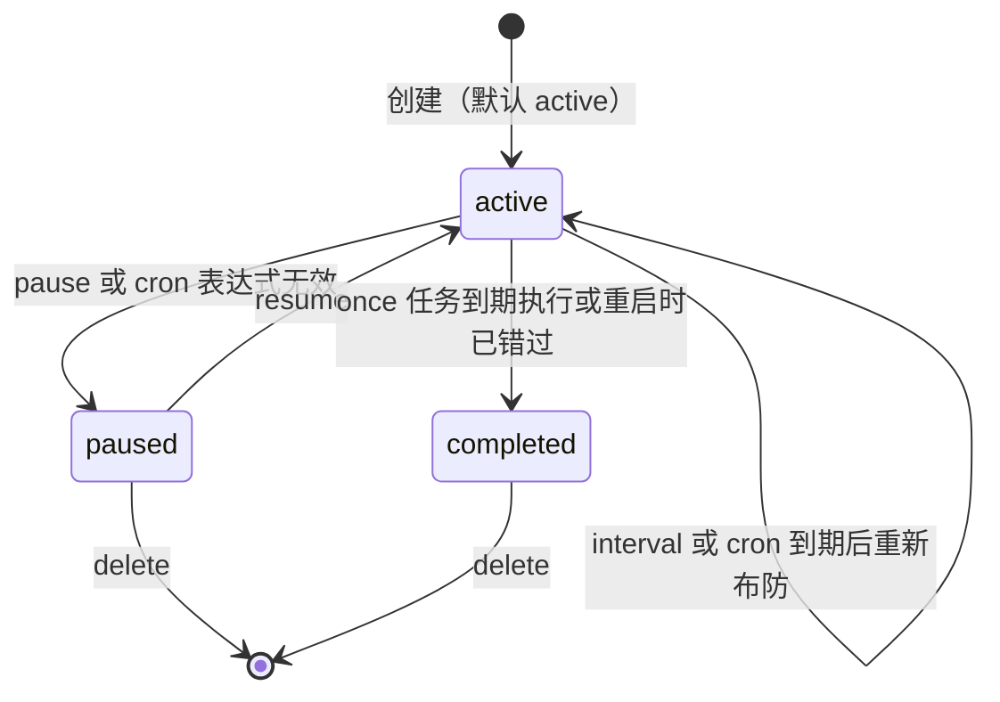
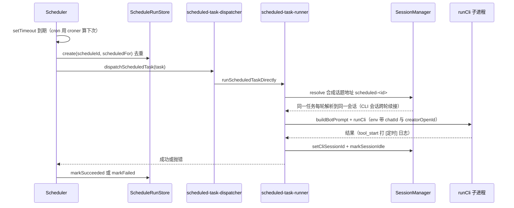

# 定时任务调度

## 概述

定时任务让 Agent-Team 可以在没有人类消息的情况下按计划驱动任意团队成员执行任务：到期后借用目标 bot 的既有会话跑一轮 CLI，结果与运行记录都持久化在 `data/` 下。实现分四层：

- `src/core/schedule.ts` — `ScheduleRule` 规则模型（once / interval / cron）与 `schedule_manage` 工具的 zod 入参协议
- `src/core/schedule-store.ts` / `src/core/schedule-run-store.ts` — 任务与运行记录的 JSON 持久化（原子写、失败回滚）
- `src/app/scheduler.ts` — 调度中枢：为 active 任务布防 setTimeout（cron 用 croner 算下一次触发点），到期经 dispatcher 执行
- `src/app/schedule-manage-service.ts` / `src/app/schedule-api.ts` / `src/app/schedule-watcher.ts` — 工具业务实现、本地 HTTP 管理接口与 `schedules.json` 热更新对账

创建入口有三个，都操作同一个 `Scheduler` 实例：CLI 调用 `schedule_manage` 工具（经 [AI CLI 输出解析](ai-cli-probe.md) 的 tool_call 截获后走 HTTP 接口）、飞书 `/schedule <需求>` 命令（转成任务提示词让 CLI 自己调工具，见 [会话与任务管理](session.md)）、直接 PUT `data/schedules.json`（热更新对账）。

## 调度规则（ScheduleRule）

| kind | 字段 | 约束 | 说明 |
|------|------|------|------|
| `once` | `runAt` | ISO 8601 时间 | 一次性任务，执行后 status 置 `completed` |
| `interval` | `everyMs` | 整数 60_000 – 86_400_000 | 固定间隔（1 分钟到 24 小时） |
| `cron` | `expression` + `timezone` | 表达式 ≤100 字符；时区默认 `Asia/Shanghai` | 用 croner 计算 `msToNext` |

`ScheduledTask` 在规则之外记录 `creatorOpenId` / `chatId`（结果发回哪个群、@ 谁）、`targetBotId`（哪个成员执行）、`status`（`active` / `paused` / `completed`）与运行态字段 `nextRunAt` / `lastRunAt`。

## 任务状态机

定时任务的状态流转；paused 与 completed 都需要先恢复或删除才能再次触发。

关键行为：

- **once 不补跑**：`start()` 恢复时发现 `runAt` 已过期，记一条 skipped（原因「重启时已经错过一次性任务」）后直接置 `completed`，不补执行
- **cron 失效自愈**：`nextRunDelay` 解析 cron 抛错时把任务置 `paused` 并打 `[定时] Cron 表达式无效` 日志，不影响其他任务
- **长延迟钳制**：once 任务 `runAt` 超过 2^31-1ms（约 24.8 天）时 setTimeout 会被 Node 改成 1ms 立即触发（`src/app/scheduler.ts` 注释引用错题本案底），定太远会提前到期
- **msToNext 余量**：cron 下一次触发至少留 1 秒，避免 `msToNext()` 返回 0 时连环立即到期

## 运行记录与防重叠

`ScheduleRunStore`（`src/core/schedule-run-store.ts`）以 `(scheduleId, scheduledFor)` 为去重键，每任务只保留最近 100 条：

- **同一计划时刻只执行一次**：`create()` 前先 `find()`，命中即拒绝——重启后靠这份持久化记录避免重复执行
- **防重叠**：`trigger()` 发现 `latestRunning()` 仍有运行中的记录时，把本轮记 skipped（「上一轮仍在执行，本轮跳过」），同任务不会并发跑两轮
- **重启补账**：`start()` 先 `recoverInterruptedRuns()` 把所有 `running` 记录标 failed（`进程重启，运行中断`），再逐任务布防

## 执行链路

到期触发、去重、执行与记录的完整链路。

- dispatcher（`src/app/scheduled-task-dispatcher.ts`）目前只有「直接执行」一条路，单独留层是为了以后接队列、并发上限等分发策略
- runner 用 `messageId = threadId = scheduled-<task.id>` 的合成地址 `resolve` 会话，**同一任务每一轮都回到同一话题会话**，CLI 会话得以续接而不是每轮新开；会话状态走 creating→idle→active→idle
- 会话仍处于 `active` 时抛「目标 bot 当前会话仍在执行」，由 scheduler 记 failed
- 子进程 env 注入 `AGENT_OS_CHAT_ID` / `AGENT_OS_OWNER_OPEN_ID`，让应用层工具（审批卡、确认卡）知道结果发回哪里；这些事件也要求 CLI 内部流程产生 tool_call 才能触发

## schedule_manage 工具

`ScheduleManageRequestSchema` 是 zod discriminated union，按 `action` 分发（业务实现在 `src/app/schedule-manage-service.ts`，产出 `notice` 回给 CLI）：

| action | 说明 |
|--------|------|
| `list` | 列出全部计划（回执附卡片 JSON） |
| `add` / `addMany` | 创建 / 批量创建（最多 20 个） |
| `update` | 编辑 targetBotId / prompt / rule |
| `remove` / `removeMany` / `removeAll` | 删除；removeAll 必须显式 `confirm: true`，防一句误操作清空 |
| `run` | 立即执行一次 |
| `pause` / `resume` | 暂停 / 恢复 |
| `logs` | 查看运行记录，只回最近 10 条避免刷爆 CLI 上下文 |

工具调用本身走 MCP 子进程 → 本地 HTTP 接口的回路：`schedule_manage` 在 `src/mcp/app-tools-server.ts` 里用 `fetch` POST `http://127.0.0.1:${SCHEDULE_API_PORT}/api/schedules/manage`（默认 3101 端口），body 里带 `AGENT_OS_CHAT_ID` / `AGENT_OS_OWNER_OPEN_ID` 环境变量提供的会话上下文；接口不存在或连不上时返回 isError 文案给 CLI。

## 本地 HTTP 管理接口

`src/app/schedule-api.ts` 在入口启动（`startScheduleApi`），给外部脚本/运维一条不经过飞书的管理通道：

| 方法与路径 | 用途 |
|------------|------|
| `GET /api/schedules` | 列出任务 |
| `POST /api/schedules` | 直接创建（`CreateScheduledTaskSchema` 校验） |
| `POST /api/schedules/manage` | schedule_manage 工具的同款协议 |
| `PATCH /api/schedules/:id`（body `action: pause/resume`） | 暂停/恢复 |
| `DELETE /api/schedules/:id` | 删除 |
| `POST /api/schedules/:id/run` | 立即执行 |
| `GET /api/schedules/:id/runs` | 运行记录 |

鉴权：未配置 token 时完全不设防（默认只当本机接口），配置 `SCHEDULE_API_TOKEN` 后要求 `x-api-token` 头精确匹配（见 [运维手册](../operations/runbook.md)）。

## schedules.json 热更新

`src/app/schedule-watcher.ts` 用 `watchFile` 轮询（1 秒间隔）检测 `data/schedules.json` 变更——Windows 上原子替换常收不到 `fs.watch` 事件，轮询最稳。变更后 300ms 防抖触发 `reconcileScheduleFile`：

- 只比对业务字段（chatId / creatorOpenId / targetBotId / prompt / rule / status），`nextRunAt` / `lastRunAt` 等运行态变化不算文件变更
- 文件里有、内存没有 → 新增；内存有、文件没有 → 删除；字段不同 → 更新
- 每条记录过 `ScheduledTaskSchema` 校验，第 N 条不合法直接抛错并打 `[定时] schedules.json 热更新失败` 日志，不影响进程
- 对账进行中又检测到变更会挂起（pending）补一轮，避免重入

这使外部脚本可以直接改 `schedules.json` 生效，同时调度器自身的写盘也会触发对账（内容一致时无操作）。

## 变更指引

- **新增 action**：`ScheduleManageRequestSchema` 加分支、`executeScheduleManageRequest` 加实现、`src/mcp/app-tools-server.ts` 的工具描述同步更新
- **新增规则类型**：`ScheduleRuleSchema` 加 kind、`nextRunDelay` 加计算分支、`ScheduledTaskSchema` 的 rule 校验联动
- **跨进程调度**：计时器纯内存、重启重建；拆多进程时 `Scheduler` 需要选主或改用共享调度存储
- **产物模式**：`dispatchScheduledTask` 带 `defaultProductDeliveryMode`，定时任务里产品类 bot 的交付方式与交互任务一致（见 [产品方案交付](product-spec.md)）
