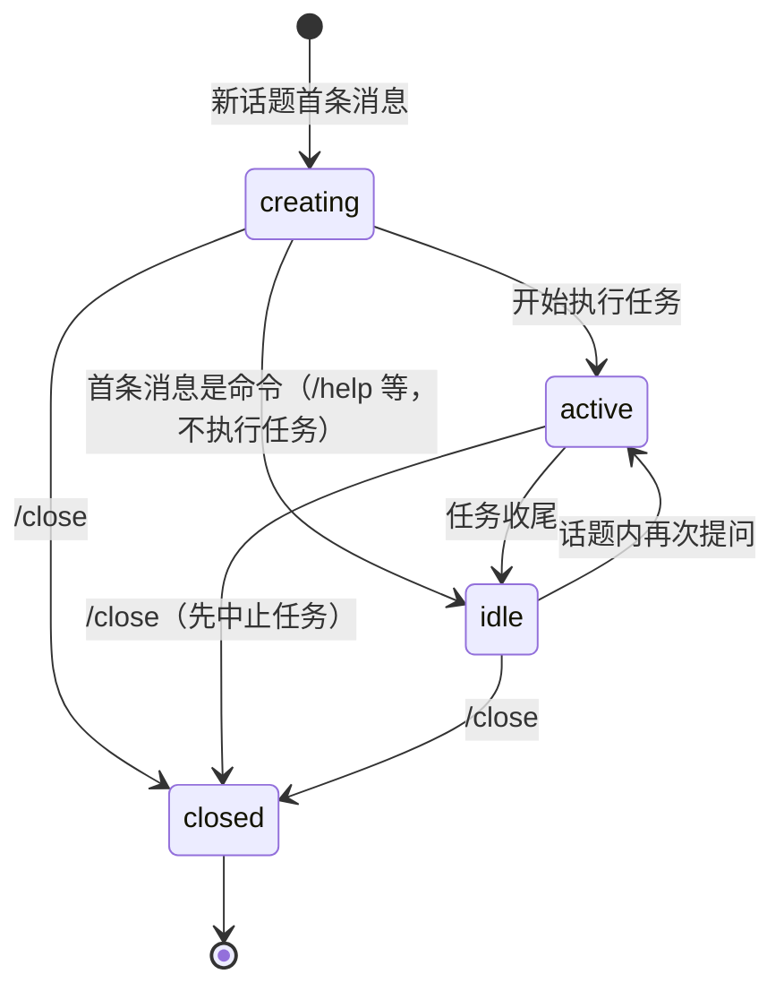

# 会话与任务管理

## 概述

核心域（`src/core/`）把「一个话题 = 一个任务上下文」落成可持久化的会话状态机，并管理运行中任务的登记与中止。它被 [消息处理流程](../workflows/message-flow.md) 在每条消息入口调用，是业务编排的地基。

## 会话模型

`Session`（`src/core/session-manager.ts`）的核心字段：

| 字段 | 说明 |
|------|------|
| `id` | Agent Team 自己生成的 UUID（`randomUUID()`），不是 CLI 的会话 id |
| `botId` | 归属的 bot（来自 [多 bot 注册](bot-registry.md)），参与会话键 |
| `chatId` + `threadId` | 会话键，`threadId` 取 `thread_id || root_id || message_id`，划定「话题」范围；完整键为 `botId:chatId:threadId` |
| `cliId` | 执行引擎标识，`'claude'` 或 `'codex'`，会话创建时锁定 |
| `cliSessionId` | CLI 自己的会话 id，首轮执行后补录，用于后续续跑（Claude `--resume` / Codex `exec resume`） |
| `workspaceDir` | 该会话执行任务的工作目录，可用 `/cd` 切换 |
| `status` | `creating` / `active` / `idle` / `closed` |

内存中按 `botId:chatId:threadId` 键存放在 Map 里；每次收到消息先 `resolve()` 查键，查到复用、查不到新建（初始 `creating`）。`resolve` 的 `cliId` 参数只影响新会话，已有会话沿用创建时选定的执行引擎。

## 会话状态机

会话状态流转，`transition()` 用 `ALLOWED_TRANSITIONS` 白名单强制约束。

`closed` 是终态，不允许再流转；`src/index.ts` 的 `markSessionIdle()` 只在当前状态是 `active` 时回落 `idle`，避免收尾时覆盖 `/close` 刚写入的终态。

## 持久化（JsonSessionStore）

`src/core/session-store.ts` 把会话数组写到 `data/sessions.json`：

- **zod 校验**：`SessionSchema` 逐行 `safeParse`，坏数据直接丢弃并触发清理重写
- **旧记录迁移**：`migrateLegacySession` 给缺少 `botId` / `workspaceDir` 的旧记录补默认值（归入首个 bot 的工作目录），迁移后同样触发清理重写
- **重启恢复**：加载时 `creating` / `active` 一律回落成 `idle`——进程重启意味着任务已死，不能让会话卡在假活跃状态
- **原子写入**：先写 `.tmp` 临时文件再 `rename`，避免写一半导致文件损坏
- **串行写队列**：`writeQueue` Promise 链保证并发保存不交错
- **回滚**：`SessionManager` 的 `transition` / `setCliSessionId` / `resolve` 保存失败时回滚内存状态，避免「磁盘没有、内存以为有」

启动时 `SessionManager.open()` 从磁盘恢复并打印 `[会话] 已恢复 N 个会话`。

## 斜杠命令

`src/core/command-parser.ts` 的 `parseCommand()` 只匹配「可选 @ 提及 + 一条命令」，支持 `/close`、`/status`、`/help`、`/cd`；`parseCliRequest()` 另行识别 `/claude` / `/codex` 引擎选择。命令在任务执行路径之前处理，不会触发 CLI。

## 运行中任务与停止（task-abort）

`src/index.ts` 用 `activeRuns: Map<sessionId, ActiveRun>` 登记运行中任务，`ActiveRun` 持有 `AbortController` 和发起人 `ownerOpenId`。`src/core/task-abort.ts` 的 `requestTaskAbort()` 是停止任务的唯一入口：

| 校验顺序 | 结果 | toast |
|----------|------|-------|
| `activeRuns` 里没有该会话 | `not_found` | 任务已经结束，无需再次停止 |
| 操作者 ≠ 发起人 | `forbidden` | 只有任务发起人可以停止它 |
| 已 abort 过 | `already_stopping` | 正在停止任务，请稍候 |
| 通过 | `stopped`（`cancelMode = "stop"` + `abort()`） | 已发送停止指令 |

`cancelMode` 区分两种结束方式：卡片「停止任务」是 `stop`（会话保留，可继续提问），`/close` 是 `close`（会话一并关闭），收尾卡片的文案据此不同。

## 变更指引

- **新增状态或流转**：同时改 `SessionStatus`、`ALLOWED_TRANSITIONS` 和 `session-store.ts` 的 zod `SessionSchema`，三处不一致会在加载时把会话当坏数据丢掉
- **新增命令**：在 `command-parser.ts` 的正则和 `SlashCommand` / `CliRequest` 里加，再到 `src/index.ts` 补处理分支
- **执行引擎扩展**：`cliId` 与 `src/cli/types.ts` 的 `CliId` 联动，`claude` / `codex` 均已实现，适配器在 `src/cli/registry.ts` 注册；对照表见 [AI CLI 输出解析](ai-cli-probe.md)
- **切换工作目录**：`setWorkspaceDir` 变更目录时会清空 `cliSessionId`，因为旧 CLI 会话绑定旧目录
- **并发任务**：会话守卫（`active` 状态拒绝追问）保证一个话题同时只有一个任务，改动守卫时要考虑 `activeRuns` 的一致性
