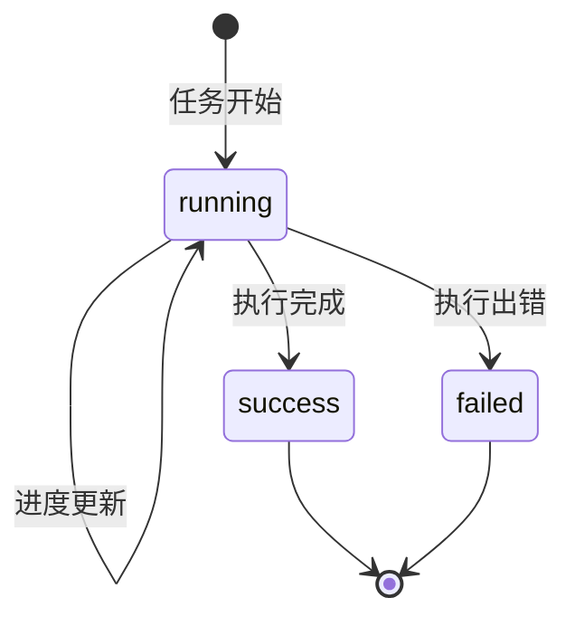
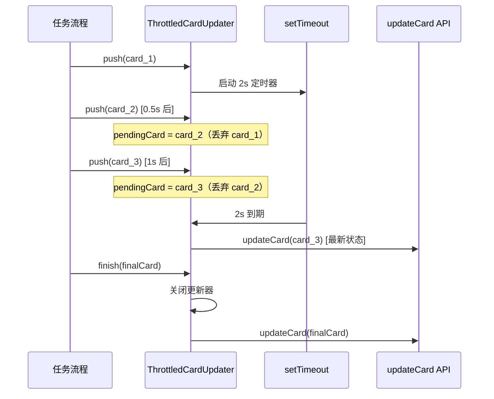

# 任务卡片系统

## 概述

任务卡片系统是 Agent-Team 将 AI 任务进度可视化展示给飞书用户的核心组件。它负责两件事：

1. **构建卡片**：根据任务状态、进度、活动列表生成飞书 2.0 Schema 交互卡片 JSON
2. **节流更新**：把高频的卡片状态变更合并为低频的实际 API 调用，避免卡片闪动和 API 超限

源文件：`src/im/card.ts`

## 任务状态机



任务卡片的三种状态及其流转。

### 状态样式映射

| 状态 | 模板色 | 标签 | 按钮样式 |
|------|--------|------|----------|
| `running` | 蓝色 (blue) | 运行中 | default |
| `success` | 绿色 (green) | 已完成 | primary |
| `failed` | 红色 (red) | 执行失败 | default |

## 卡片结构（buildTaskCard）

`buildTaskCard(options: TaskCardOptions): CardJson` 构建飞书 Schema 2.0 卡片：

```
CardJson
├── schema: "2.0"
├── config
│   ├── update_multi: true        // 共享卡片，所有人看到同一份更新
│   └── summary                   // 通知栏摘要文本
├── header
│   ├── template: 状态色
│   └── title: 任务标题
└── body
    └── elements
        ├── markdown 元素
        │   ├── 状态标签
        │   ├── 进度条 + 百分比
        │   ├── 当前步骤说明
        │   └── 最近进展列表（最多3条）
        └── button 元素（禁用，仅展示状态）
```

### 进度条渲染

使用 Unicode 字符渲染 10 格进度条：

```
进度 0%:  ░░░░░░░░░░ 0%
进度 50%: █████░░░░░ 50%
进度 100%: ██████████ 100%
```

- 满格字符：`█`
- 空格字符：`░`
- 进度值通过 `clampProgress()` 限制在 0–100 范围

### 活动列表

`activities` 数组展示最近的活动步骤。在消息流程中传入 `activities.slice(-3)`，即最近 3 条活动，以 `- ` 列表形式嵌入 markdown。

## 节流更新机制（ThrottledCardUpdater）

### 问题

AI CLI 执行过程中会产生大量进度事件（每秒可能多次），直接每次都调飞书 `updateCard` API 会导致：

- 卡片高频闪动，用户体验差
- 飞书 API 频率限制

### 解决方案

`ThrottledCardUpdater` 使用 **2 秒时间窗口合并 + 串行执行** 策略：



节流更新器的工作流程，2 秒窗口内只提交最新卡片。

### 关键设计

| 设计点 | 实现 | 目的 |
|--------|------|------|
| 时间窗口 | 默认 2000ms（`intervalMs`） | 合并高频更新 |
| 最新优先 | 只保留 `pendingCard`，丢弃中间态 | 用户看到最新进度 |
| 串行执行 | `updateChain` Promise 链 | 避免 API 乱序 |
| 优雅关闭 | `finish()` 清除定时器后发最终卡片 | 保证最终状态正确展示 |
| 幂等保护 | `closed` 标志防止关闭后再 push | 避免异常 |

### 使用方式

```typescript
const updater = new ThrottledCardUpdater(
  async (card) => { await bot.updateCard(cardId, card); }
);

// 任务执行中，频繁推送状态
updater.push(buildTaskCard({ status: "running", progress: 30, ... }));
updater.push(buildTaskCard({ status: "running", progress: 60, ... }));

// 任务完成，推送最终卡片并关闭
await updater.finish(
  buildTaskCard({ status: "success", progress: 100, ... })
);
```

## 与消息流程的集成

卡片系统被 [消息处理流程](../workflows/message-flow.md) 调用：

1. 收到消息 → `buildTaskCard` 构建初始卡片 → `Bot.replyCard` 发送
2. 后台异步执行 → 每步 `updater.push(buildTaskCard(...))` 节流更新
3. 完成 → `updater.finish(buildTaskCard({ status: "success", ... }))` 最终刷新

## 变更指引

修改卡片系统时注意：

- **新增状态**：在 `STATUS_STYLE` 中添加对应模板色和标签
- **调整节流频率**：修改 `intervalMs` 默认值（构造函数第二参数）
- **卡片 Schema**：飞书 Schema 2.0 的 `update_multi: true` 是共享卡片必需的，移除会导致不同用户看到不同版本
- **finish() 幂等**：多次调用 `finish()` 安全（`closed` 检查），但 `finish()` 后 `push()` 会抛异常
