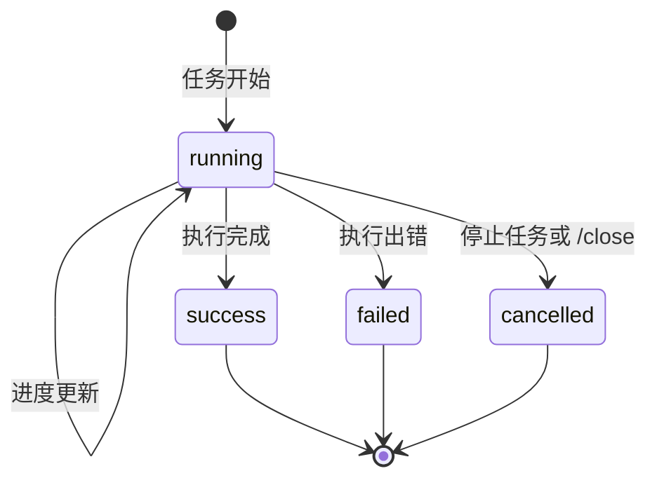
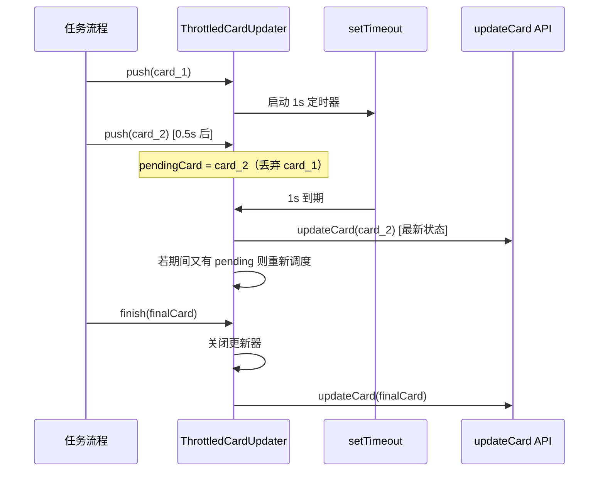

# 任务卡片系统

## 概述

任务卡片系统是 Agent-Team 将任务进度可视化展示给飞书用户的核心组件。它负责两件事：

1. **构建卡片**：根据任务状态、进度快照、回答文本生成飞书 2.0 Schema 交互卡片 JSON
2. **节流更新**：把高频的卡片状态变更合并为低频的实际 API 调用，避免卡片闪动和 API 超限

源文件：`src/im/card.ts`

## 任务状态机



任务卡片的四种状态及其流转。

### 状态样式映射

| 状态 | 模板色 | 标签 |
|------|--------|------|
| `running` | 蓝色 (blue) | 执行中 |
| `success` | 绿色 (green) | 已完成 |
| `failed` | 红色 (red) | 执行失败 |
| `cancelled` | 灰色 (grey) | 已取消 |

## 卡片结构（buildTaskCard）

`buildTaskCard(options: TaskCardOptions): CardJson` 构建飞书 Schema 2.0 卡片，body 按 `running` / 收尾态分两条构建路径：

```
CardJson
├── schema: "2.0"
├── config
│   ├── update_multi: true        // 共享卡片，所有人看到同一份更新
│   └── summary                   // 通知栏摘要「标题：状态」
├── header
│   ├── template: 状态色
│   └── title: 「标题 · 状态标签」
└── body.elements
    ├── running：当前步骤 + 上下文用量 + 最近完成轨迹 + 停止任务按钮
    └── 收尾态：回答/错误 + 执行详情折叠面板
```

### 执行中卡片（buildRunningElements）

- **当前步骤**：`progress.current` 加工具图标（`TOOL_ICONS` 映射，未收录回退 ⚙️），当前工具输入摘要用行内代码展示
- **元信息行**：耗时 · 工具调用次数；上下文用量行 `当前上下文 used / window（百分比）`；增量行区分「新会话基础」和「本轮开始」措辞
- **最近完成**：最近 3 条活动（执行中上限 `RUNNING_ACTIVITY_LIMIT = 3`），格式「图标 标签 · detail · 耗时」，失败的工具用 ⚠️
- **停止任务按钮**：传入 `abortSessionId` 时渲染红色 `danger` 按钮，callback value 携带 `{ action: "abort_task", sessionId }`，由 [消息处理流程](../workflows/message-flow.md) 的 `onCardAction` 处理

### 收尾卡片（buildFinishedElements）

- **成功**：回答不超过 900 字符（`COMPACT_ANSWER_LENGTH`）直接展示；超过则展示收起态预览（优先取第一个代码块之前的正文）+「查看完整回答」折叠面板（上限 6000 字符）；仍超长时卡片提示「剩余内容已继续发送」，由消息流程按 4000 字符拆条续发（`splitLongText`）
- **失败/取消**：展示 `detail` 文案；失败的 `technicalDetail` 放「查看错误详情」折叠面板
- **执行详情折叠面板**：耗时、工具调用次数、累计 token、当前上下文、本轮变化 + 最近执行轨迹（上限 `FINISHED_ACTIVITY_LIMIT = 8` 条）
- **署名**：成功且传入 `recipientOpenId` 时追加「Agent Team · 发送给：@某人」

### Markdown 安全处理

- `escapeInlineCode()` 把反引号替换为 `ˋ`，防止内容破坏行内代码
- `escapeFeishuMarkdown()` 在 HTML 标签前插入零宽连接符，防止回答里的 HTML 被飞书按 LaTeX/HTML 解析
- `markdownSplitIndex()` 截断点优先落在段落/换行边界且不早于 55% 处；`closeOpenFence()` 给被截断的代码块补 ` ``` ` 收尾

## 澄清卡片三件套

[需求澄清](clarification.md) 流程专用的一组卡片，同样由 `src/im/card.ts` 构建：

| 构建函数 | 触发时机 | 内容 |
|----------|----------|------|
| `buildClarificationCard` | CLI 调用 `request_clarification` 后 | 当前题（含题号进度）+ 选项按钮 + 「这一题交给 Agent 决定」+ 自定义答案表单 +「按推荐方案继续」+ 已确认答案摘要；每答一题，卡片经回调应答刷新为下一题 |
| `buildClarificationContinuingCard` | 答案收齐、CLI 开始整理 | 过渡卡片：「答案已收到，正在整理」，阻止在旧卡片上重复作答 |
| `buildClarificationSupersededCard` | 用户在话题里发新消息 | 旧卡片刷成「已收到新的补充」灰色态，说明新消息沿用同一任务上下文 |

澄清按钮的 callback value 携带 `flowToken` + `questionId`（选项另带 `optionId`，自定义表单带 `custom_answer` 表单值），由 [消息处理流程](../workflows/message-flow.md) 的 `onCardAction` 校验后推进流程。

## 节流更新机制（ThrottledCardUpdater）

### 问题

CLI 执行过程中每秒都会产生进度事件（工具开始/结束、上下文变化，加上 1 秒心跳），直接每次都调飞书 `updateCard` API 会导致：

- 卡片高频闪动，用户体验差
- 飞书 API 频率限制

### 解决方案

`ThrottledCardUpdater` 使用 **1 秒时间窗口合并 + 串行执行** 策略：



节流更新器的工作流程，1 秒窗口内只提交最新卡片。

### 关键设计

| 设计点 | 实现 | 目的 |
|--------|------|------|
| 时间窗口 | 默认 1000ms（`intervalMs`） | 合并高频更新 |
| 最新优先 | 只保留 `pendingCard`，丢弃中间态 | 用户看到最新进度 |
| 串行执行 | `updateChain` Promise 链 | 避免 API 乱序 |
| 优雅关闭 | `finish()` 清定时器后发最终卡片 | 保证最终状态正确展示 |
| 幂等保护 | `closed` 标志，关闭后 push/finish/cancel 均静默返回 | 避免异常 |
| 取消通道 | `cancel()` 只关闭不发卡 | 供异常路径丢弃未决更新 |

### 使用方式

```typescript
const updater = new ThrottledCardUpdater(
  async (card) => { await bot.updateCard(cardId, card); }
);

// 任务执行中，频繁推送状态
updater.push(buildTaskCard({ status: "running", progress: snapshot, ... }));
await updater.finish(buildTaskCard({ status: "success", answer, stats, ... }));
```

## 与消息流程的集成

卡片系统被 [消息处理流程](../workflows/message-flow.md) 调用：

1. 收到消息 → `buildTaskCard`（running + `abortSessionId`）→ `Bot.replyCard` 发送
2. 后台执行 CLI → 每秒心跳 `renderProgress()` → `updater.push(...)` 节流更新
3. 收尾 → `updater.finish(buildTaskCard({ status: success/failed/cancelled, ... }))` 最终刷新

除任务卡外，`card.ts` 还构建 `/resume` 会话选择卡（`buildResumeCard`）、`/new` / `/newall` 与 `/compact` 通知卡（`buildSessionNoticeCard`）、`/team` 团队卡（`buildTeamCard`，附模型配置入口）、角色模型配置双卡（`buildBotModelConfigCard` / `buildClosedBotModelConfigCard`，见 [角色模型动态配置](model-config.md)）、协作交接卡（`buildCollaborationCard`）、定时任务三卡（`buildScheduleCreatedCard` / `buildScheduleListCard` / `buildScheduleRunCard`，见 [定时任务调度](scheduling.md)）、产品方案三态卡（待确认 / 已确认 / 已失效，见 [产品方案交付](product-spec.md)）、审批三态卡（待决 / 已决 / 续跑中，见 [高危操作审批](approval.md)）与上文的澄清卡片三件套。

## 变更指引

修改卡片系统时注意：

- **新增状态**：在 `STATUS_STYLE` 中添加对应模板色和标签，并在 `buildRunningElements` / `buildFinishedElements` 的分派中处理
- **调整节流频率**：修改 `intervalMs` 默认值（构造函数第二参数）
- **卡片 Schema**：飞书 Schema 2.0 的 `update_multi: true` 是共享卡片必需的，移除会导致不同用户看到不同版本
- **关闭后静默**：`finish()` / `cancel()` 后再 `push()` 不抛异常而是静默返回，收尾代码无需额外判空
- **长度常量**：`COMPACT_ANSWER_LENGTH`（900）、`MAX_CARD_ANSWER_LENGTH`（6000）、续发拆条长度（4000）需与飞书卡片/消息限制一起调整
