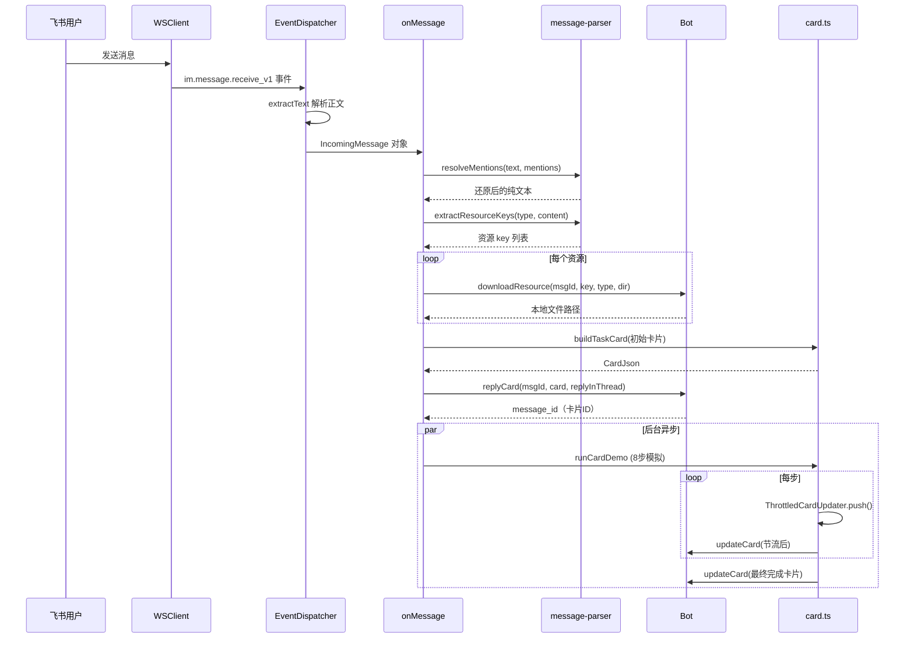

# 消息处理流程

## 端到端时序

当用户在飞书中发送消息时，系统经历以下完整流程：



从消息接收到卡片更新完成的完整调用链。

## 消息接收与解析

### 事件结构

飞书 `im.message.receive_v1` 事件中的 `data.message` 包含：

| 字段 | 说明 |
|------|------|
| `message_id` | 消息唯一标识，用于回复 |
| `chat_id` / `chat_type` | 会话 ID 与类型（`p2p` 单聊 / `group` 群聊） |
| `message_type` | `text` / `image` / `file` / `post` 等 |
| `content` | JSON 字符串，结构随 message_type 变化 |
| `root_id` / `thread_id` | 话题标识，判断是否在 thread 中 |
| `mentions` | @ 提及列表 |

### 文本提取（extractText）

`src/im/lark.ts` 中的 `extractText()` 函数处理两种消息类型：

- **text**：直接取 `parsed.text`
- **post**（飞书富文本）：遍历 `content` 数组，拼接所有 `tag === "text"` 的元素

### @ 提及还原

飞书消息中 @ 人的部分显示为占位符（如 `@_user_1`），需要用 `resolveMentions()` 还原为可读文本（如 `@MyBot`）。详见 [消息解析层](#)。

> 原文与还原文本的区别（来自 `src/index.ts` 日志）：
> ```
> 原文: @_user_1 帮我看看这个文件
> 还原: @MyBot 帮我看看这个文件
> ```

### 资源提取与下载

`extractResourceKeys()` 从消息内容中提取图片和文件的 key：

| 消息类型 | 提取内容 |
|----------|----------|
| `image` | `image_key` |
| `file` | `file_key` + `file_name` |
| `post` | 富文本中所有 `img` 元素的 `image_key` |

下载时通过 `Bot.downloadResource()` 调用飞书 `messageResource.get` API，根据 Content-Type 自动推断扩展名，保存到 `data/downloads/` 目录。

扩展名推断优先级：原始文件名 > Content-Type 映射 > 默认值（image→`img`，file→`bin`）。

## 卡片回复与线程判断

```typescript
const hasThread = !!msg.threadId || !!msg.rootId;
```

- 如果消息在 thread 中（`threadId` 或 `rootId` 存在），回复时设置 `reply_in_thread: true`，使回复留在同一话题内
- 否则普通回复

回复卡片后获得 `message_id`，后续所有进度更新都通过 `updateCard()` 刷新这张卡片。

## 异步进度更新

`runCardDemo` 是当前的模拟逻辑（8 步演示），用 `DEMO_STEPS` 数组模拟任务执行：

```typescript
const DEMO_STEPS = [
  "读取项目结构", "定位任务入口", "分析相关文件",
  "生成修改方案", "写入代码改动", "检查类型错误",
  "运行验证命令", "整理执行结果",
];
```

每步间隔 700ms，进度从 0% 递增到 90%，完成后刷为 100% + success 状态。卡片更新通过 [ThrottledCardUpdater](../domain/task-card.md) 节流，避免高频闪动。

> 未来这里将替换为真正的 AI CLI 调用（Claude Code / Codex），解析其 headless JSON 输出流驱动卡片更新。参见 [AI CLI 输出解析](../domain/ai-cli-probe.md)。

## 源文件索引

| 文件 | 职责 |
|------|------|
| `src/index.ts` | 入口，onMessage 业务逻辑，模拟任务演示 |
| `src/im/lark.ts` | WS 连接、事件分发、Bot 接口实现、消息解析 |
| `src/im/message-parser.ts` | @ 提及解析、资源 key 提取（纯函数） |
| `src/im/card.ts` | 卡片构建与节流更新（详见 [任务卡片系统](../domain/task-card.md)） |
