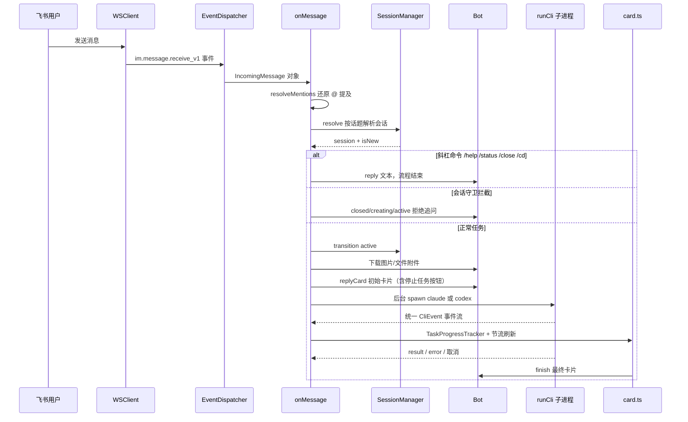
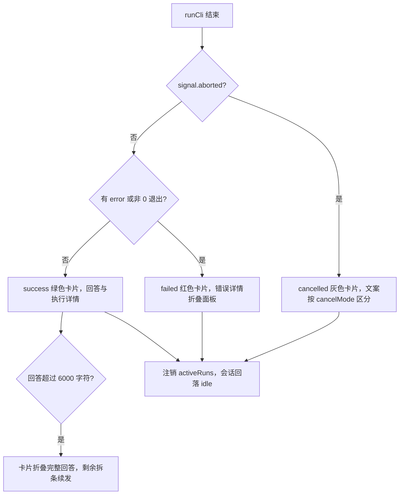

# 消息处理流程

## 端到端时序

当用户在飞书中发送消息时，系统经历以下完整流程：



从消息接收、会话守卫、CLI 执行到卡片收尾的完整调用链。

## 消息接收与解析

### 事件结构

飞书 `im.message.receive_v1` 事件中的 `data.message` 包含：

| 字段 | 说明 |
|------|------|
| `message_id` | 消息唯一标识，用于回复 |
| `chat_id` / `chat_type` | 会话 ID 与类型（`p2p` 单聊 / `group` 群聊） |
| `message_type` | `text` / `image` / `file` / `post` 等 |
| `content` | JSON 字符串，结构随 message_type 变化 |
| `root_id` / `thread_id` | 话题标识，判断是否在 thread 中 |
| `mentions` | @ 提及列表 |

### 文本提取（extractMessageText）

`src/im/lark.ts` 中的 `extractMessageText()` 函数处理两种消息类型：

- **text**：直接取 `parsed.text`
- **post**（飞书富文本）：遍历 `content` 数组，拼接 `text` / `a` / `code` / `code_block` / `md` 元素文本，`br` 转换行，按段落用换行连接

### @ 提及还原

飞书消息中 @ 人的部分显示为占位符（如 `@_user_1`），需要用 `resolveMentions()` 还原为可读文本（如 `@MyBot`）。

> 原文与还原文本的区别（来自 `src/index.ts` 日志）：
> ```
> 原文: @_user_1 帮我看看这个文件
> 还原: @MyBot 帮我看看这个文件
> ```

### 斜杠命令

`src/core/command-parser.ts` 的 `parseCommand()` 用正则匹配「可选 @ 提及 + 一条命令」，识别 `/close`、`/status`、`/help`、`/new`、`/resume`、`/team`、`/compact`、`/cd`、`/schedules`、`/schedule`；「帮我运行 /status 看看」这类句子不会命中。另有 `parseCliRequest()` 单独识别 `/claude <任务>` 与 `/codex <任务>` 的引擎选择请求。

| 命令 | 行为 |
|------|------|
| `/help` | 回复命令列表 |
| `/status` | 回复机器人、会话 id、状态、执行引擎、工作目录、CLI 会话 id、话题、更新时间 |
| `/team` | 回复团队成员卡片：名称、角色、默认引擎、Skills、Team Leader 标记与连接状态，附带「⚙️ 角色模型与端点配置」入口按钮（数据来自 `TeamRegistry`，见 [多 bot 注册](../domain/bot-registry.md)；配置入口见 [角色模型动态配置](../domain/model-config.md)） |
| `/schedule <需求>` | 把需求包装成「请使用 schedule_manage 工具创建任务」的提示，继续走 CLI 执行管线（bot 会代为创建定时任务）；不带需求时回复用法；`pause/resume/delete/run <id>` 子命令直接操作调度器不跑 CLI（见 [定时任务调度](../domain/scheduling.md)） |
| `/schedules` | 回复定时任务列表卡片（`buildScheduleListCard`） |
| `/new` | 清空话题绑定的 CLI 会话，下一条任务开新会话；旧会话保留，可用 `/resume` 找回 |
| `/newall` | 批量重置当前话题中所有 `idle` 成员（含其他 bot）的 CLI 会话绑定，`active` 会话自动跳过；用于协作结束后统一换新上下文（机制见 [会话与任务管理](../domain/session.md)） |
| `/resume` | 列出当前工作目录的 CLI 会话（`listNativeCliSessions`，上限 8 条），卡片「恢复」按钮完成实际切换 |
| `/compact [要求]` | 在当前 CLI 会话内执行原生上下文压缩（`compactCliSession`），无需整理时回「暂时无需整理」卡片 |
| `/cd` | 无参数查看当前工作目录；带参数切换话题工作目录（active 状态下拒绝，切换成功后清空 `cliSessionId`，下一条任务新建 CLI 会话） |
| `/close` | 中止运行中任务（`cancelMode = "close"`）并把会话置为 `closed` |
| `/model [角色ID]` | 回复角色模型配置卡片，管理员（`OWNER_OPEN_ID`）按「角色 × 引擎」免重启覆盖模型后端（`/config` 同义，见 [角色模型动态配置](../domain/model-config.md)） |
| `/claude` / `/codex` | 新话题显式选择执行引擎；已有话题引擎不同会被拒绝；不带任务文本时提示补写任务 |

### 资源提取与下载

`extractResourceKeys()` 从消息内容中提取图片和文件的 key：

| 消息类型 | 提取内容 |
|----------|----------|
| `image` | `image_key` |
| `file` | `file_key` + `file_name` |
| `post` | 富文本中所有 `img` 元素的 `image_key` |

下载通过 `Bot.downloadResource()` 调用飞书 `messageResource.get` API，根据 Content-Type 自动推断扩展名，保存到 `data/downloads/` 目录。扩展名推断优先级：原始文件名 > Content-Type 映射 > 默认值（image→`img`，file→`bin`）。

## 会话守卫

`onMessage` 入口最先处理**协作消息**：`senderType` 为 `app`/`bot` 的富文本消息先确认 @ 了当前 bot，再从文本提取「任务编号」取件码，向共享 `CollaborationInbox` 领取交接单（详见 [多 bot 协作](../domain/collaboration.md)）；领取不到时**内部团队 bot 的消息直接忽略**（防止互相触发死循环），只有外部 bot @ 当前 bot 才按「外部派活」继续，其余忽略。人类消息则按会话级检查放行（详见 [会话与任务管理](../domain/session.md)）。此外有三个前置分支：

- **限额守卫**：当前 bot 已被标记会话限额时不再接单——非 Leader 的话把「任务接续派发」工单移交 Team Leader（有备用成员时请其 `dispatch_task` 派给同组可用成员，无备用成员时请其直接向用户确认下一步），受限的 Team Leader 则回复「请稍后再试」；机制见 [多 bot 协作](../domain/collaboration.md) 的会话限额一节
- **引擎切换守卫**：已有话题里用 `/claude` 或 `/codex` 请求了与会话当前不同的引擎时，回复「当前话题已经在使用 X。如需切换执行引擎，请新开一个话题」
- **空任务守卫**：`/claude` / `/codex` 后面没有任务文本时，提示补写任务示例

| 会话状态 | 处理 |
|----------|------|
| `closed` | 回复「会话已关闭，请新开话题」 |
| `creating`（非新建） | 回复「正在准备，请稍后再追问」 |
| `active` | 回复「还在执行，请等任务结束」 |
| `idle` / 新话题 | `transition active`，继续执行 |

这样保证一个话题同一时间只有一个 CLI 任务在跑，追问会排队提示而不是并发执行。

### 未完成澄清流程的并入

人类消息且非命令时，若该话题存在未完成的需求澄清流程（`ClarificationFlowStore.findForTask`），不会另起任务：旧澄清卡片被刷成「已被新消息取代」样式并删除流程，新消息经 `formatClarificationMessage()` 与此前已确认的答案拼成补充说明，走正常执行管线交回 CLI。完整机制见 [需求澄清](../domain/clarification.md)。

## 卡片回复与线程判断

```typescript
const hasThread = !!msg.threadId || !!msg.rootId;
```

- 如果消息在 thread 中（`threadId` 或 `rootId` 存在），回复时设置 `reply_in_thread: true`，使回复留在同一话题内
- 否则普通回复

回复初始卡片后获得 `message_id`，后续所有进度更新都通过 `updateCard()` 刷新这张卡片。初始卡片带 `abortSessionId`，渲染出「停止任务」按钮。

## CLI 执行与进度更新

后台执行链路由 [架构总览](../architecture/overview.md) 中的执行层组成：

1. `runCli()`（`src/cli/runner.ts`）`spawn` CLI 子进程，命令与参数由所选适配器的 `buildArgs` / `buildResumeArgs` 生成：Claude Code 为 `-p <prompt> --output-format stream-json --verbose --dangerously-skip-permissions`（续跑加 `--resume <sessionId>`），Codex 为 `exec --json --skip-git-repo-check --yolo <prompt>`（续跑为 `exec resume --json ... <sessionId>`；Windows 下以 stdin 传 prompt 并用 `--dangerously-bypass-approvals-and-sandbox` 替代 `--yolo`）。两家都无条件注入 `agent_team` stdio MCP 服务（Claude `--mcp-config` / Codex `-c` 覆盖，见 [需求澄清](../domain/clarification.md)）。子进程环境为 `{...process.env, ...cliEnv, AGENT_TEAM_CHAT_ID, AGENT_TEAM_OWNER_OPEN_ID}`：`cliEnv` 是该 bot 的 per-bot CLI 模型后端覆盖（可选，见 [多 bot 注册](../domain/bot-registry.md)），两个 `AGENT_TEAM_*` 变量把会话上下文传给应用层工具
2. stdout 逐行进入适配器的 `parseEvents()`，翻译成统一 `CliEvent`（两套引擎的翻译对照见 [AI CLI 输出解析](../domain/ai-cli-probe.md)）
3. `onEvent` 回调只处理 `tool_start` / `tool_end` / `context` 三类事件，喂给 `TaskProgressTracker`
4. `TaskProgressTracker` 用 `toolUseId` 配对起止事件，维护当前工具、最近完成轨迹（上限 12 条）和上下文 token 基线，`snapshot()` 输出卡片所需快照
5. 每秒一次心跳 `renderProgress()` 把快照经 `ThrottledCardUpdater` 节流推送到飞书

### Claude Code 事件翻译

`ClaudeAdapter`（`src/cli/claude-adapter.ts`）：

| 原生事件 | 翻译为 | 说明 |
|----------|--------|------|
| `system` + `subtype=init` | `session` | 捕获 Claude 自己的会话 id |
| `assistant`（`message.usage`） | `context` | 运行时 token 用量，实时刷新卡片上下文行 |
| `assistant`（`tool_use` 块） | `tool_start` | 工具名映射中文标签，输入摘要做 detail（如文件短路径、命令描述） |
| `user`（`tool_result` 块） | `tool_end` | `is_error` 标记失败 |
| `result` | `result` | 最终回答 + 耗时/轮次/token 统计 |
| `result`（`is_error`） | `error` | 带错误信息 |

> `result.usage` 是整次执行的累计消耗（写入 `totalTokens`），与 `assistant.message.usage` 的运行时上下文用量是两回事；上下文窗口大小要等 `result.modelUsage` 才知道。

### Codex 事件翻译

`CodexAdapter`（`src/cli/codex-adapter.ts`）把 `codex exec --json` 的事件流翻成同一套 `CliEvent`：

| 原生事件 | 翻译为 | 说明 |
|----------|--------|------|
| `thread.started` | `session` | 捕获 Codex 的 `thread_id`，续跑用 `exec resume <id>` |
| `item.started`（command_execution / file_change / web_search / mcp_tool_call） | `tool_start` | 工具类型映射为 Bash / Edit / WebSearch / MCP 标签，command、path、query 等做 detail 摘要 |
| `item.completed`（同上） | `tool_end` | `status === "failed"` 或非 0 `exit_code` 标记失败 |
| `item.completed` + `agent_message` | `result` | 模型回答文本 |
| `turn.completed` | `result` | 仅 `usage` 统计（input/output/cached token），此时若无回答则不产生最终结果 |
| `error` / `turn.failed` | `error` | 取 `message` 或 `error.message` |

## 任务收尾的三条路径



成功、失败、取消三条收尾路径的处理逻辑。

- **成功**：把 CLI 会话 id 补录进 Session（`setCliSessionId`），记录上下文窗口大小供下一轮进度计算，发 success 卡片；回答超过单卡上限时折叠展示并按 4000 字符拆条续发。bot 配置了 `grill-me` skill 时，先检查本轮是否有 `request_clarification` 工具调用——有则转入 [需求澄清](../domain/clarification.md) 卡片流程并提前返回。产品类 bot（`to-spec` / `lark-doc` skill）接着走 [产品方案交付](../domain/product-spec.md) 的提交校验与确认卡。再检查 `request_approval`（[高危操作审批](../domain/approval.md)，主任务执行时声明为停止型工具，CLI 调用即被终止）。最后是协作路由：`dispatch_task` 派发请求由 [多 bot 协作](../domain/collaboration.md) 处理；协作任务的回传/收尾路由也在该分支内
- **取消**：卡片停止按钮或 `/close` 触发 `AbortController.abort()`，发 cancelled 卡片，文案按 `cancelMode`（`stop` / `close`）区分
- **失败**：发 failed 卡片，`technicalDetail` 放进「查看错误详情」折叠面板。其中有一类特殊失败——错误文本命中 Claude 的会话限额文案（`session limit` / `resets`）时，不走普通失败分支：标记该 bot 进入限额状态（时长按报错文案里的重置时钟点解析，解析失败兜底 5 小时）、卡片改写为「已触发会话额度限制，任务已移交 Team Leader 接续派发」，并经 `CollaborationService` 把接续工单派给 Team Leader 去调度同组备用成员，详见 [多 bot 协作](../domain/collaboration.md) 的会话限额一节
- **收尾**：`finally` 中注销 `activeRuns` 登记并把会话从 `active` 回落 `idle`（仅 active 状态回落，避免覆盖 `closed` 终态）

## 停止任务

卡片上的「停止任务」按钮走 `card.action.trigger` 事件（`onCardAction` 回调，由 `src/app/card-action-handler.ts` 统一处理「停止任务」「恢复会话」「澄清作答」「方案确认」「审批决定」五类动作），`requestTaskAbort()` 校验：

- 任务不存在 → toast「任务已经结束」
- 操作者不是发起人 → toast「只有任务发起人可以停止它」
- 已在取消中 → toast「正在停止任务，请稍候」
- 通过 → `controller.abort()`，toast「已发送停止指令」

## 源文件索引

| 文件 | 职责 |
|------|------|
| `src/index.ts` | 入口，组装 `AppRuntime`、多 bot 启动、定时调度启动、`onMessage` 任务编排、文档评论入口与收尾路由 |
| `src/app/runtime.ts` | `AppRuntime` 共享状态容器（会话、任务、协作队列、澄清 / 产品方案 / 审批流程），入口组装一次传给 `app/` 各处理模块 |
| `src/app/command-handler.ts` | 斜杠命令处理（`/help` `/team` `/schedule` `/schedules` `/new` `/newall` `/resume` `/compact` `/cd` `/close` `/status` 与引擎切换守卫） |
| `src/app/card-action-handler.ts` | 卡片回调：`approve_product_spec` / `answer_clarification` / `decide_approval` / `resume_cli_session` / `abort_task` 五类动作 |
| `src/app/clarification-runner.ts` | 澄清答案收齐后的 CLI 续跑（详见 [需求澄清](../domain/clarification.md)） |
| `src/app/approval-runner.ts` | 审批决定回传 CLI 续跑（详见 [高危操作审批](../domain/approval.md)） |
| `src/app/collaboration-service.ts` | 协作派发服务（详见 [多 bot 协作](../domain/collaboration.md)） |
| `src/app/scheduler.ts` 及 `schedule-*.ts` | 定时任务调度、热更新对账、HTTP 管理接口（详见 [定时任务调度](../domain/scheduling.md)） |
| `src/app/product-spec-*.ts` / `product-comment-runner.ts` | 产品方案提交与落盘校验、评论区修改（详见 [产品方案交付](../domain/product-spec.md)） |
| `src/app/cli-execution.ts` | `executeCli`：对 `runCli` 的薄封装（多出 `stopToolNames`） |
| `src/app/notification-service.ts` | `sendResultNotification` @ 发起人的结果通知（失败只记日志） |
| `src/app/session-view.ts` | `/status` 文本渲染与 `markSessionIdle` 收尾回落 |
| `src/im/lark.ts` | WS 连接、事件分发、Bot 接口实现、消息文本提取 |
| `src/im/message-parser.ts` | @ 提及解析、资源 key 提取（纯函数） |
| `src/im/card.ts` | 卡片构建与节流更新（详见 [任务卡片系统](../domain/task-card.md)） |
| `src/core/command-parser.ts` | 斜杠命令（含 `/schedule` `/schedules`）与 `/claude` `/codex` 引擎选择解析 |
| `src/core/clarification.ts` | 澄清数据模型、校验与流程存储（详见 [需求澄清](../domain/clarification.md)） |
| `src/core/task-progress.ts` | CLI 事件 → 进度快照 |
| `src/cli/registry.ts` | 按 `CliId` 取适配器 |
| `src/cli/runner.ts` | CLI 子进程生命周期 |
| `src/cli/claude-adapter.ts` | Claude Code 输出 → 统一事件 |
| `src/cli/codex-adapter.ts` | Codex 输出 → 统一事件 |
